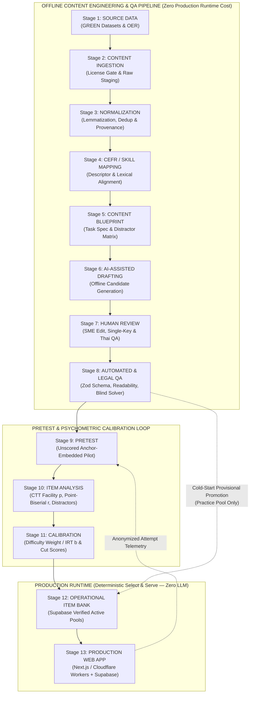
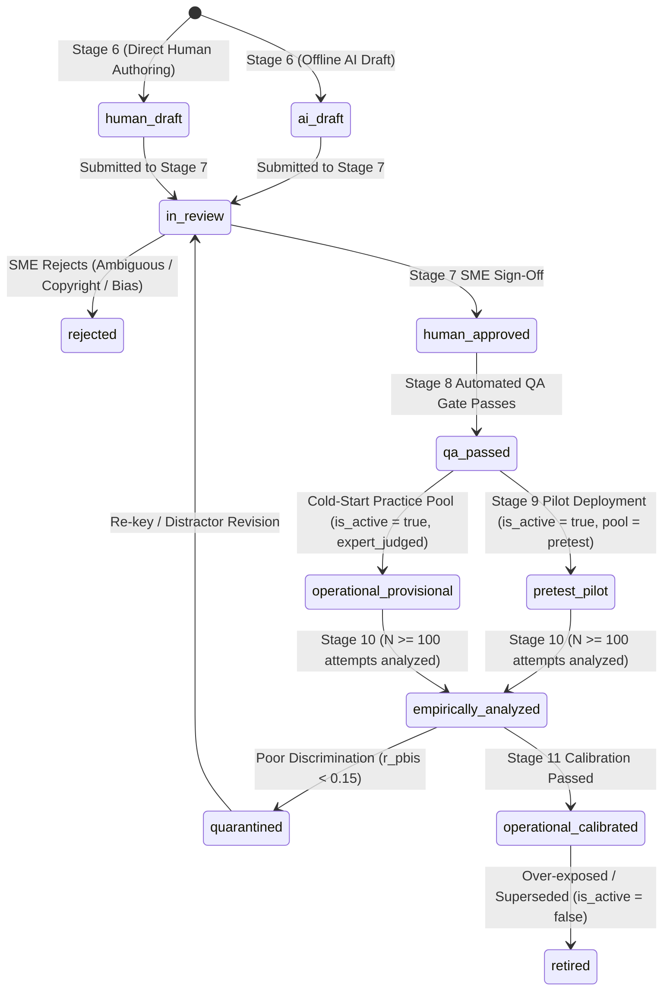

# Glova End-to-End Content & Item Production Pipeline (Phase 6.2.6.1)

**Document Status**: Operational Pipeline Specification (Research + Architecture Only)  
**Companion Document**: [`docs/assessment/content-sourcing-strategy.md`](file:///c:/CEFR_platform/docs/assessment/content-sourcing-strategy.md)  
**Core Production Model**: Offline Content Factory → Validated Operational Item Bank → Deterministic Runtime Select & Serve (Zero Runtime LLM)

---

## 1. Pipeline Architecture Overview

Glova separates **Offline Content Production** from **Online Production Serving** across a strict air-gap boundary. LLMs, corpus parsers, readability analyzers, and psychometric calibration scripts run **exclusively offline** during content engineering. The production Cloudflare Worker + Supabase backend only executes fast, indexed SQL queries and server-side grading RPCs against pre-approved records.

---

## 2. Stage-by-Stage Operational Specification (Stages 1–13)

### Stage 1: SOURCE DATA
- **Purpose**: Select raw lexical entries, frequency lists, and open educational texts/audio strictly from `GREEN`-classified sources defined in [`content-sourcing-strategy.md`](file:///c:/CEFR_platform/docs/assessment/content-sourcing-strategy.md).
- **Approved Inputs**:
  - **Lexical Spine**: `CEFR-J Vocabulary Profile v1.5` (`A1–B2`) + `Octanove Vocabulary Profile v1.0` (`C1–C2`).
  - **Frequency & Domain Lists**: `NGSL v1.2`, `NAWL`, `TSL`, `BSL` (`CC BY-SA 4.0`).
  - **Sense Inventory**: `Open English WordNet (OEWN)` (`CC BY 4.0`).
  - **Passages & Audio**: `VOA Learning English` (original staff text/audio, US Public Domain), `ESL LibreTexts` (`CC BY 4.0` volumes), `Mozilla Common Voice` (`CC0`), `Tatoeba` (`CC0` / `CC BY 2.0 FR`).
- **Hard Gate**: Any source classified as `RED` (e.g., `RACE`, `CLOTH`, `DREAM`, scraped exam papers) or `REFERENCE ONLY` (e.g., `Cambridge EVP`, `Oxford 3000/5000`, `OneStopEnglish`) is blocked at the source boundary.

---

### Stage 2: CONTENT INGESTION
- **Purpose**: Load raw source files (`CSV`, `TSV`, `XML`, `JSON`, `MP3`) into an offline local staging directory (never directly into Production Supabase) and verify license headers and checksums.
- **Operations**:
  1. Parse raw dataset files and assign an immutable `import_batch` identifier (e.g., `batch-2026-10-cefrj-v1.5`).
  2. Filter out multi-rights contaminations (e.g., automatically drop any VOA article containing `AP`, `Reuters`, or `AFP` wire credits; drop any LibreTexts page carrying an `NC` or `ND` license tag).
  3. Record raw source identifiers (`original_id`, `source_url`, `license`, `license_url`).
- **Output**: Raw staging JSONL artifacts with verified `GREEN` license manifests.

---

### Stage 3: NORMALIZATION
- **Purpose**: Standardize text encoding, orthography, part-of-speech tags, and deduplicate entries against Glova's existing content bank.
- **Operations**:
  1. **Unicode & Whitespace Normalization**: Enforce UTF-8 NFC normalization, strip HTML entities, and standardize smart quotes/punctuation (zero em-dashes in UI labels).
  2. **POS Tag Canonicalization**: Map heterogeneous source POS tags (`n.`, `NN`, `noun`, `v.`, `VB`) to Glova's canonical set (`noun`, `verb`, `adjective`, `adverb`, `preposition`, `conjunction`, `determiner`, `pronoun`, `phrasal_verb`, `idiom`).
  3. **Cross-Source Lexical Join**: Join `CEFR-J / Octanove` (`word`, `pos`, `cefr_level`) with `NGSL / NAWL` (`frequency_rank`) and `OEWN` (`synset_id`, base English gloss).
  4. **Deduplication Check**: Compare normalized `(word, part_of_speech, cefr_level, sense_key)` and passage/question hashes against existing `supabase/migrations/20260925000006_seed_content_bank.sql` rows so existing production UUIDs and slugs are never overwritten or duplicated.
- **Output**: Normalized staging records with complete `provenance` headers.

---

### Stage 4: CEFR / SKILL MAPPING
- **Purpose**: Align every normalized lexical item, grammar topic, passage, or audio stimulus with a specific Council of Europe CEFR descriptor and Glova skill (`vocabulary`, `grammar`, `reading`, `listening`, `writing`, `speaking`).
- **Operations**:
  1. **Vocabulary**: Assign `target_cefr` (`A1–C2`) from `CEFR-J / Octanove`, cross-checked offline against `EFLLex` level-frequency distributions (`A1–C1`) and `NGSL/NAWL` rank bands.
  2. **Reading & Listening Stimuli**: Measure passage word count, sentence length, and lexical coverage (`% of words within A1–B2 CEFR-J profile`) to confirm the stimulus matches its target CEFR level:
     - `A1`: 40–100 words (`≥ 95%` `A1–A2` vocabulary)
     - `A2`: 120–180 words (`≥ 92%` `A1–A2` vocabulary)
     - `B1`: 200–280 words (`≥ 90%` `A1–B1` vocabulary)
     - `B2`: 300–450 words (`≥ 88%` `A1–B2` vocabulary)
     - `C1`: 450–650 words (complex argumentation, implicit attitude)
     - `C2`: 600–800 words (abstract, specialized, or idiomatic register)
  3. **Communicative Activity Tagging**: Map each item to a CEFR Companion Volume (2020) communicative activity (e.g., *Reading for orientation*, *Reading for information and argument*, *Overall listening comprehension*, *Formal correspondence*).

---

### Stage 5: CONTENT BLUEPRINT
- **Purpose**: Define the exact structural specification for an item **before** any text is drafted (following ALTE 2011 item-specification standards).
- **Blueprint Fields (`metadata.blueprint`)**:
  - `target_cefr`: `A1` | `A2` | `B1` | `B2` | `C1` | `C2`
  - `skill`: `vocabulary` | `grammar` | `reading` | `listening` | `writing` | `speaking`
  - `exposure_pool`: `operational_practice` | `operational_diagnostic` | `operational_exam` | `anchor`
  - `question_type`: `multiple_choice` | `fill_blank` | `true_false` | `matching` | `ordering` | `open_response`
  - `task_type`: e.g., `lexical_collocation_mcq`, `key_word_transformation`, `reading_global_gist`, `reading_detail_inference`, `listening_specific_info`
  - `cognitive_operation`: `recall` | `comprehension` | `application` | `inference` | `evaluation`
  - `target_construct`: Specific `vocabulary_id` or `grammar_topic_id` or reading sub-skill being measured
  - `distractor_specification`: Explicit rule for how each distractor (`B`, `C`, `D`) should fail (e.g., *Option B = wrong preposition collocation; Option C = morphologically similar adjective; Option D = opposite polarity*).

---

### Stage 6: AI-ASSISTED DRAFTING (OFFLINE ONLY)
- **Purpose**: Accelerate candidate drafting offline using local/CLI prompts constrained by the Stage 5 Blueprint.
- **Strict Boundary**:
  - Runs **100% offline** on a developer/content-author workstation or CI batch job.
  - Every output record is automatically stamped with `ai_assisted = true`, `review_status = 'ai_draft'`, and `is_active = false`.
- **Offline AI Drafting Tasks**:
  1. **Vocabulary Enrichment**: Given a verified `(word, pos, cefr_level, oewn_synset_gloss)`, draft:
     - Learner-appropriate `meaning_en` (restricted to defining vocabulary at or below the target level)
     - Natural Thai translation `meaning_th`
     - `phonetic_ipa` (verified against CMU Pronouncing Dictionary / open IPA lookup)
     - `example_sentence` demonstrating natural collocation at the target CEFR level
     - 2–4 `vocabulary_collocations` with example sentences
  2. **Question & Distractor Drafting**: Given a Stage 5 Blueprint and stimulus text, draft the question stem, 1 correct key, 3 targeted distractors, and a bilingual (`EN`/`TH`) explanation explaining both why the key is right and why each distractor is wrong.
  3. **Passage Adaptation**: Where a `GREEN` source (e.g., VOA Public Domain article) exceeds target word count or contains a few out-of-level words, adapt the text offline and log `transformation_method = 'lexical_simplification_offline'`.

---

### Stage 7: HUMAN REVIEW
- **Purpose**: Mandatory human Subject-Matter Expert (SME) inspection, editing, and sign-off. **No item can bypass Stage 7.**
- **Human Reviewer Checklist**:
  1. **Single Defensible Key**: Is the keyed answer unquestionably correct, and are all 3 distractors unquestionably incorrect in both British and American English?
  2. **Stem Clarity & Level Control**: Is the question stem clear, free of double negatives (unless testing `C1/C2` inversion/litotes), and written using vocabulary at or below `target_cefr`?
  3. **Distractor Plausibility**: Are distractors homogeneous in length, grammatical category, and register (no absurd "throwaway" options)?
  4. **Thai Pedagogical Quality**: Are `meaning_th` and Thai explanations accurate, natural, and free of machine-translation artifacts?
  5. **Pool Isolation**: Does the item avoid duplicating any existing diagnostic or mock exam question?
- **State Transition**:
  - Approved items: `review_status` transitions from `'ai_draft'` / `'human_draft'` → `'human_approved'`, recording `reviewed_by` and `reviewed_at`.
  - Defective items: Either edited in-place by the reviewer or marked `'rejected'`.

---

### Stage 8: QA (Automated Technical, Linguistic & Legal Gate)
- **Purpose**: Programmatic pre-commit verification script (`scripts/content-pipeline/verify-batch.mjs`) that blocks defective or unreviewed records from entering SQL seed migrations.
- **Automated Checks**:
  1. **Provenance & License Gate**: Reject any item where `provenance.license` is missing, `RED`, or `REFERENCE ONLY`, or where `provenance.review_status !== 'human_approved'`.
  2. **Answer-Key Integrity Gate**:
     - For `multiple_choice`: Verify exactly 4 options exist (`sort_order 1..4`) and **exactly 1 option** has `is_correct = true`.
     - Verify option texts are distinct (no duplicate options) and roughly balanced in character length (no correct option > 2× longer than all distractors).
  3. **Blind Solver Verification (Optional Offline Multi-Check)**: Pass the stem and options (without the answer key) to an independent offline check; if the solver disagrees with the human key or flags two valid answers, halt and return to Stage 7.
  4. **Lexical Profile & Readability Gate**: Verify that `A1/A2` stems and passages do not accidentally contain unglossed `C1/C2` vocabulary.
  5. **Slug & UUID Determinism**: Ensure all UUIDs and slugs follow Glova's deterministic format and do not collide with existing rows.

---

### Stage 9: PRETEST (Pilot Delivery)
- **Purpose**: Gather real learner response data before an item's difficulty weight or CEFR cut contribution is treated as empirically calibrated.
- **Two Pretest Modes**:
  1. **Embedded Unscored Pilot Items (Recommended at Scale)**: Insert 1–2 `pretest_pilot` items into regular practice or diagnostic sessions. These items are indistinguishable to the learner and are graded for immediate feedback, but carry `0` weight toward official placement/mock exam cut scores until `N ≥ 100` responses are collected.
  2. **Cold-Start Provisional Operational Mode (Initial Launch `Horizon 1–2`)**: While learner traffic is growing, items that pass **Stage 7 (`human_approved`) + Stage 8 (`qa_passed`)** may be promoted directly to the **`operational_practice`** pool with default `difficulty_weight = 1.00` and `calibration_status = 'expert_judged_uncalibrated'`, while recording live attempt telemetry in `public.attempt_answers`.

---

### Stage 10: ITEM ANALYSIS (Empirical Psychometrics)
- **Purpose**: Analyze real learner responses from `public.attempt_answers` once an item reaches `N ≥ 100` attempts (preliminary check at `N ≥ 30`).
- **Metrics Computed Offline**:
  1. **Facility Value ($p$-value)**: Proportion of learners answering correctly ($0.00 \le p \le 1.00$).
     - Target range for operational items: **$0.30 \le p \le 0.85$** (items with $p > 0.92$ are too easy; $p < 0.20$ on 4-option MCQ approaches random guessing $0.25$).
  2. **Item Discrimination ($r_{\text{pbis}}$)**: Point-biserial correlation between item score ($0/1$) and total test score.
     - **Pass**: $r_{\text{pbis}} \ge 0.25$
     - **Marginal (Review)**: $0.15 \le r_{\text{pbis}} < 0.25$
     - **Fail (Quarantine / Key Check)**: $r_{\text{pbis}} < 0.15$ or negative ($r_{\text{pbis}} < 0$ indicates a mis-keyed answer or ambiguous distractor that high-ability learners choose).
  3. **Distractor Efficiency**: Proportion of learners selecting each incorrect option (`A`, `B`, `C`, `D`). Any distractor selected by $< 3\%$ of examinees is flagged as non-functioning for revision.

---

### Stage 11: CALIBRATION
- **Purpose**: Map empirical item performance onto a common difficulty scale and establish defensible form cut scores (aligning with [`docs/phase-6.2.6-assessment-standards-evidence.md`](file:///c:/CEFR_platform/docs/phase-6.2.6-assessment-standards-evidence.md)).
- **Operations**:
  1. **CTT / Rasch (1PL IRT) Difficulty Estimation**:
     - Estimate item difficulty parameter $b$ (logit scale, typically $-3.0$ to $+3.0$) anchored across levels `A1–C2` via shared anchor items.
     - Update `public.questions.difficulty_weight` and `metadata.calibration` (`irt_b`, `calibrated_cefr`, `calibration_status = 'empirically_calibrated'`).
  2. **Form-Level Standard Setting (Mock Exams)**:
     - Combine human Modified Angoff / Bookmark standard-setting panels with empirical item difficulty parameters to set the exact form-level `passing_score` (`0–100%`) and `cambridge_style_reference_score` mapping for each Mock Exam form.

---

### Stage 12: OPERATIONAL ITEM BANK
- **Purpose**: Store verified, active content in Supabase PostgreSQL partitioned into strict **Exposure Pools** (`metadata.lifecycle.pool` + `source_type`) to prevent test compromise:
  1. **`operational_practice`**: Open practice items for Vocabulary, Grammar, Reading, and Listening modules. May be repeated across spaced-repetition sessions.
  2. **`operational_diagnostic`**: Dedicated placement/diagnostic items (`source_type = 'diagnostic'`). Never exposed in daily practice drills.
  3. **`operational_exam`**: Dedicated Mock Exam forms (`source_type = 'mock_exam'`). Strictly isolated from practice and diagnostic pools so learners cannot pre-memorize mock exam questions.
  4. **`anchor`**: Secure cross-form linking items used to equate new pretest batches against existing forms.
  5. **`retired`**: Items with `is_active = false` (retired due to over-exposure, poor discrimination, or curriculum updates; retained in DB so historical `attempt_answers` foreign keys remain intact).

---

### Stage 13: PRODUCTION WEB APP (Select & Serve Only)
- **Purpose**: Deliver low-latency, zero-LLM-cost learning and assessment experiences via Next.js + Cloudflare Workers + Supabase.
- **Runtime Behavior**:
  1. **Deterministic Fetching**: Client/Server routes query active items by `skill`, `cefr_level`, and `source_type` (`is_active = true`).
  2. **Answer-Key Protection**: Client-facing queries select from `public.questions` and `public.question_options` **excluding `is_correct`** (enforced by RLS and server API projection).
  3. **Server-Side Objective Grading**: Submissions invoke `/api/attempts/grade-objective` (or the `grade_objective_attempt` PostgreSQL RPC), which grades answers atomically on the server and records `public.attempt_answers`.
  4. **Zero Runtime LLM Dependency**: No external AI API is called during item selection, rendering, or objective grading.

---

## 3. Item Lifecycle State Machine

Every question and content record progresses through deterministic lifecycle states tracked in `metadata.lifecycle.status` and gated by `is_active`:

| Lifecycle Status | `is_active` in Supabase | Allowed in Practice? | Allowed in Diagnostic / Mock Exam? |
| :--- | :---: | :---: | :---: |
| `ai_draft` / `human_draft` / `in_review` | `false` (Offline only) | No | No |
| `rejected` / `quarantined` | `false` | No | No |
| `qa_passed` (`operational_provisional`) | `true` | **Yes** | **Yes** (with explicit *provisional/uncalibrated* metadata flag during cold-start) |
| `pretest_pilot` | `true` | Yes (embedded pilot) | Embedded unscored pilot only |
| `operational_calibrated` | `true` | **Yes** | **Yes (Full Calibrated Status)** |
| `retired` | `false` | No | No (historical foreign keys preserved) |

---

## 4. Phase 6.2.7 Implemented Vocabulary Ingestion Pipeline (`Stages 1–4`)

Phase 6.2.7 implemented the reproducible offline ingestion pipeline for `public.vocabularies` in [`scripts/content-pipeline/vocab/`](file:///c:/CEFR_platform/scripts/content-pipeline/vocab/pipeline.mjs) (see [`docs/assessment/vocabulary-ingestion.md`](file:///c:/CEFR_platform/docs/assessment/vocabulary-ingestion.md)):

1. **Stage 1–2 (Cryptographic Source Gate — `npm run content:vocab:validate`)**:
   - Verifies SHA-256 hashes, byte sizes, row counts, and `GREEN` licenses (`CC BY-SA 4.0` / `CC BY 4.0`) for `CEFR-J v1.5` (`7,799` rows), `Octanove C1/C2 v1.0` (`2,136` rows), `NGSL v1.2` (`2,809` rows), `NAWL v1.2` (`957` rows), `TSL v1.2` (`1,250` rows), `BSL v1.20` (`1,744` rows), and `Open English WordNet 2024` (`35,605` filtered CEFR sense rows / `212,478` archive rows).
2. **Stage 3–4 (Deterministic Normalization, Dedup, Frequency & WordNet Join — `npm run content:vocab:normalize`)**:
   - Normalizes `9,935` raw rows (`1` malformed row rejected $\to$ `9,934` valid rows $\to$ `28` exact duplicates merged $\to$ `99` CEFR conflict groups / `100` rows collapsed $\to$ **`9,806` normalized candidates**).
   - Joins frequency bands/SFI (`5,375 / 9,806 = 54.81%` matched) and OEWN 2024 sense keys (`2,712` unambiguous `matched`, `6,529` `ambiguous`, `264` `not_found`, `301` closed-class `not_attempted`).
3. **Vocabulary Lifecycle & Safe Staging (`public.vocabulary_lifecycle_status`)**:
   - Implemented in [`supabase/migrations/20260926000007_add_vocabulary_provenance_and_lifecycle.sql`](file:///c:/CEFR_platform/supabase/migrations/20260926000007_add_vocabulary_provenance_and_lifecycle.sql) with enum states `RAW_IMPORTED`, `NORMALIZED`, `REVIEW_REQUIRED`, `REVIEWED`, `APPROVED`, `ACTIVE`, `ARCHIVED`.
   - Controlled 180-record pilot batch (`30/level A1–C2`) prepared in [`supabase/migrations/20260926000008_seed_vocabulary_pilot_batch.sql`](file:///c:/CEFR_platform/supabase/migrations/20260926000008_seed_vocabulary_pilot_batch.sql) with `lifecycle_status = 'REVIEW_REQUIRED'`, `is_active = false`, and zero fabricated learner fields.

