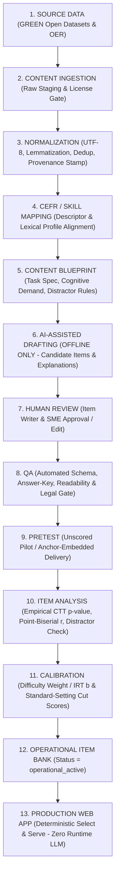

# Glova Content & Item Bank Sourcing Strategy (Phase 6.2.6.1)

**Document Status**: Architecture & Legal Provenance Specification (Research + Design Only)  
**Platform**: Glova CEFR / Cambridge-Style English Preparation Platform  
**Core Production Invariant**: **Select & Serve Prepared Content Only — Zero Runtime LLM Generation**  
**Scope**: CEFR Levels `A1` through `C2` across `Vocabulary`, `Grammar`, `Reading`, `Listening`, `Writing`, and `Speaking`

---

## 1. Executive Summary

Glova is a **free English learning and assessment platform** spanning `A1` to `C2`. To guarantee zero per-request inference cost, deterministic response latency, strict answer-key security, and defensible psychometric validity, **Glova's production runtime does not call an LLM when a student requests a question or vocabulary item**. Instead, the production web application operates strictly as a **Select-and-Serve engine** backed by a pre-validated, versioned Supabase PostgreSQL Content & Operational Item Bank:

```text
External / Licensed / Open Datasets
        ↓
Glova Content Bank (Normalized & Provenance-Tracked)
        ↓
Content & Item Development Pipeline (Blueprint + Offline AI Drafting)
        ↓
Human Expert Review & Automated Linguistic/Legal QA
        ↓
Pretest & Empirical Psychometric Analysis (CTT / IRT)
        ↓
Operational Item Bank (Calibrated & Approved)
        ↓
Production Web App (Deterministic Select & Serve — Zero Runtime LLM)
```

### Key Strategic Decisions
1. **CEFR Is a Reference Framework, Not a Content Database**: The Council of Europe CEFR (2001) and Companion Volume (2020) provide communicative *Can-Do* descriptors and qualitative scales, not downloadable wordlists or test items.
2. **Vocabulary Bank Strategy (`GREEN` Open-Licensed Lexical Spine)**:
   - **Headword, POS & CEFR `A1–C2` Mapping**: Combine **CEFR-J Vocabulary Profile v1.5** (`A1–B2`, ~7,801 entries, Tono Lab TUFS permissive license with attribution) + **Octanove Vocabulary Profile v1.0** (`C1–C2`, ~2,165 entries, `CC BY-SA 4.0`) via the unified `openlanguageprofiles/olp-en-cefrj` release (~9,966 entries).
   - **Frequency & Domain Prioritization**: Layer **NGSL v1.2** (~2,801 core words), **NAWL** (~963 academic words), **TSL** (~1,200 TOEIC words), and **BSL** (~1,700 business words), all licensed under `CC BY-SA 4.0`.
   - **English Sense Definitions & Lexical Relations**: Layer **Open English WordNet (OEWN)** (`CC BY 4.0`, ~120,000 synsets / ~160,000 lemmas).
   - **Offline Enrichment**: Author Thai translations (`meaning_th`), learner-friendly examples, and collocations offline (assisted by offline LLM drafting + mandatory human review).
3. **Proprietary Wordlists Are Strictly `REFERENCE ONLY`**: **Cambridge English Vocabulary Profile (EVP)** and **Oxford 3000/5000** are copyrighted, prohibit bulk scraping/redistribution, and provide no public open-licensed dataset or API. They must never be scraped or imported into Glova's database.
4. **Question Bank Strategy (Original Blueprint-Driven Authoring + Permissive OER Passages)**:
   - Academic NLP benchmarks (**RACE**, **CLOTH**, **DREAM**) are restricted to **non-commercial research only** and frequently contain copyrighted third-party exam items; they are classified as **`REFERENCE ONLY` / `RED` for production import**.
   - **MCTest** (`MSR-LA` non-commercial) and **OneStopEnglish Corpus** (`CC BY-NC-SA 4.0` over copyrighted Guardian articles) are classified as **`YELLOW` / `REFERENCE ONLY`**.
   - Glova's operational questions (`multiple_choice`, `fill_blank`, `true_false`, `matching`, `ordering`, `sentence_transformation`) and productive tasks (`Writing`, `Speaking`) will be **100% original Glova content** authored against explicit CEFR/task blueprints using **offline AI-assisted drafting + mandatory human review**, optionally adapting public-domain (**VOA Learning English**) or `CC BY` (**ESL LibreTexts**) source passages and `CC0` (**Mozilla Common Voice**) audio.

---

## 2. Current Glova Content Inventory & Schema Audit

An inspection of `src/data/*.ts`, `supabase/migrations/20260925000001_create_cefr_platform_schema.sql`, and `supabase/migrations/20260925000006_seed_content_bank.sql` establishes the exact baseline currently in the repository and seeded into Production Supabase.

### 2.1 Existing Content Counts (Repository vs. Production Database)

| Table / Content Store | Source File (`src/data/*.ts`) | Repo Rows | Seeded in Prod (`20260925000006`) | Level Distribution (`A1–C2`) | Current Question / Task Types |
| :--- | :--- | :---: | :---: | :--- | :--- |
| `cefr_levels` | `20260925000001` migration | 6 | **6** | `A1`, `A2`, `B1`, `B2`, `C1`, `C2` (1 each) | Reference lookup table |
| `skills` | `20260925000001` migration | 6 | **6** | All 6 skills across `A1–C2` | `reading`, `listening`, `writing`, `speaking`, `vocabulary`, `grammar` |
| `vocabularies` | `src/data/vocabularyBank.ts` | 21 | **21** | `A1`: 4, `A2`: 3, `B1`: 4, `B2`: 4, `C1`: 3, `C2`: 3 | Headword, POS, IPA, EN/TH meanings, examples |
| `vocabulary_collocations` | `src/data/vocabularyBank.ts` | 58 | **58** | Linked across the 21 vocabulary items | Collocation text + example sentence |
| `grammar_topics` | `src/data/grammarBank.ts` | 5 | **5** | `A1`: 1, `A2`: 1, `B1`: 1, `B2`: 1, `C1`: 1 (`C2`: 0) | Rules, structure formula, positive/negative/question forms, common mistakes |
| `reading_passages` | `src/data/readingBank.ts` | 3 | **3** | `A2`: 1 (165w), `B1`: 1 (240w), `B2`: 1 (`A1,C1,C2`: 0) | `article`, `report`, `academic` (`KET`, `PET`, `FCE` tags) |
| `listening_exercises` | `src/data/listeningBank.ts` | 3 | **3** | `A2`: 1, `B1`: 1, `B2`: 1 (`A1,C1,C2`: 0) | Transcript-backed (`audio_storage_path = NULL` in Prod) |
| `writing_prompts` | `src/data/writingBank.ts` | 3 | **3** | `A2`: 1, `B1`: 1, `B2`: 1 (`A1,C1,C2`: 0) | `email` (KET), `article` (PET), `essay` (FCE) |
| `speaking_prompts` | `src/data/speakingBank.ts` | 3 | **3** | `A2`: 1, `B1`: 1, `B2`: 1 (`A1,C1,C2`: 0) | `interview` (Part 1), `long_turn` (Part 2), `collaborative` (Part 3) |
| `questions` (Content Bank) | `diagnosticAssessment.ts`, `grammarBank.ts`, `readingBank.ts`, `listeningBank.ts` | 33 | **33** | Diagnostic: 18 (`3/level A1–C2`), Grammar: 6 (`A1–C1`), Reading: 5 (`A2–B2`), Listening: 4 (`A2–B2`) | 100% `multiple_choice` (4 options each) |
| `question_options` (Content Bank) | Same as above | 132 | **132** | 4 options (`A, B, C, D`) per question | `is_correct` protected via server-side grading RPC |
| `mock_exams` + `sections` + `questions` | `src/data/mockExams.ts` | 3 exams / 6 sections / 15 questions / 60 options | **0 (Blocked)** | `A2` (KET: 6q), `B1` (PET: 5q), `B2` (FCE: 4q) | Unseeded pending Phase 6.2.6 passing-score semantics migration |

**Total Seeded Production Rows**: **261 rows** across 9 content tables (`6 + 6 + 21 + 58 + 5 + 3 + 3 + 3 + 3 + 33 + 132` = 273 including `cefr_levels` and `skills`, or 261 content rows).

### 2.2 Current Metadata & Provenance Audit
- **Current Provenance Tracking**: Neither `src/data/*.ts` nor `20260925000006_seed_content_bank.sql` records dataset provenance (`source`, `license`, `original_id`, `ai_assisted`, `review_status`). All 261 existing rows are hand-crafted prototype items authored inside the repository.
- **Current CEFR Metadata**: Every content table has a foreign key `cefr_level public.cefr_level_code NOT NULL REFERENCES public.cefr_levels(code)`. However, this single column currently conflates **authored target CEFR level** with **empirically calibrated CEFR level**.
- **Current Question Metadata**: `public.questions` includes:
  - `source_type` (`diagnostic`, `grammar_topic`, `reading_passage`, `listening_exercise`, `vocabulary`, `mock_exam`, `standalone`)
  - `question_type` (`multiple_choice`, `fill_blank`, `true_false`, `matching`, `ordering`, `open_response`)
  - `difficulty_weight NUMERIC(4,2) DEFAULT 1.00`
  - `metadata JSONB NOT NULL DEFAULT '{}'::jsonb` (currently seeded as `'{}'::jsonb` on all 33 rows)
- **Current Structural Limitations**:
  1. **Severe Volume Deficit**: 21 words and 33 active questions cannot sustain repeated learner practice or prevent item memorization.
  2. **Missing Level Coverage in 4 Skills**: `reading_passages`, `listening_exercises`, `writing_prompts`, and `speaking_prompts` have **zero items** at `A1`, `C1`, and `C2`. `grammar_topics` has **zero items** at `C2`.
  3. **Task Type Monoculture**: All 48 repository questions use `multiple_choice`, even though the PostgreSQL enum `public.question_type_code` already supports `fill_blank`, `true_false`, `matching`, `ordering`, and `open_response`.
  4. **Missing Audio Assets**: The 3 seeded `listening_exercises` have `audio_storage_path = NULL` in Production.
  5. **No Provenance or Lifecycle Columns**: `vocabularies` lacks a `metadata JSONB` or provenance column; `questions` has `metadata JSONB` (`'{}'`), which is not yet populated with provenance, review state, or pretest statistics.

---

## 3. Crucial Conceptual Distinction: 5 Categories of Language Data

Before evaluating external sources, Glova's architecture enforces a strict separation between five distinct categories of language resources. **These five categories are not interchangeable:**

| Category | Definition | Examples | Role in Glova |
| :--- | :--- | :--- | :--- |
| **A. CEFR Reference Material** | International policy frameworks, communicative *Can-Do* descriptors, qualitative assessment grids, and alignment manuals. **Contains zero wordlists and zero test questions.** | Council of Europe *CEFR* (2001), *CEFR Companion Volume* (2020), *Manual for Language Test Development and Examining* (ALTE, 2011). | Used to define **Content Blueprints**, task specifications, communicative activities, and analytic rubric criteria (`Writing`/`Speaking`). |
| **B. Vocabulary Dataset** | Structured lexical inventories mapping lemmas/headwords and Parts of Speech (POS) to graded proficiency levels or semantic synsets. | **CEFR-J Vocabulary Profile v1.5** (`A1–B2`), **Octanove Vocabulary Profile v1.0** (`C1–C2`), **Open English WordNet (OEWN)**, **EFLLex**. | Used as the **Lexical Spine** (`word`, `pos`, `target_cefr`, English synset definitions, synonyms/antonyms) in Glova's Vocabulary Bank. |
| **C. Frequency / Corpus Dataset** | Empirical word-frequency lists derived from general, academic, or business corpora (e.g., Cambridge National Corpus, BNC, COCA, ELT textbook corpora). | **NGSL v1.2** (General), **NAWL** (Academic), **TSL** (TOEIC), **BSL** (Business), **SUBTLEX-US**. | Used to rank **learning priority (`frequency_rank`)**, control reading passage lexical density, and prevent obscure distractors in lower-level (`A1–B1`) items. |
| **D. Licensed Educational Content (OER)** | Openly licensed reading passages, audio recordings, sentence pairs, or instructional grammar texts whose explicit license permits adaptation and redistribution. | **VOA Learning English** (US Public Domain), **ESL LibreTexts** (`CC BY 4.0` / `CC BY-NC-SA`), **Mozilla Common Voice** (`CC0`), **Tatoeba** (`CC BY 2.0 FR`). | Used as **raw stimulus material** (reading texts, audio clips, sentence contexts) that enters the ingestion and offline transformation pipeline. |
| **E. Original Glova Content** | Purpose-built assessment items, distractors, bilingual explanations (`EN`/`TH`), collocation examples, and writing/speaking prompts created specifically for Glova. | Existing 261 seeded rows + future items created via **Blueprint → Offline AI Draft → Human Review → QA → Pretest**. | Forms **100% of Glova's operational test questions, distractors, and explanations**, ensuring zero copyright encumbrance and strict item security. |

---

## 4. Vocabulary Source Candidates

Every candidate vocabulary resource was audited against official documentation and license terms across all 14 required dimensions.

### 4.1 Candidate A: Cambridge English Vocabulary Profile (EVP / English Profile)
- **Source**: Cambridge University Press & Assessment / English Profile Programme
- **URL**: `https://www.englishprofile.org/wordlists/evp`
- **Dataset size**: ~6,700+ headwords and ~15,000+ word senses, idioms, and phrasal verbs
- **CEFR coverage**: `A1` through `C2` (British & American English, grounded in the Cambridge Learner Corpus)
- **Data format**: Web-only interactive search application (HTML UI); no official raw CSV/JSON bulk export
- **API/download**: **No public API, no API key program, and no official bulk download** (unofficial third-party scraped copies on GitHub violate Cambridge copyright)
- **License**: Proprietary Copyright © Cambridge University Press & Assessment (`Terms of Use` explicitly restrict use to personal, non-commercial educational reference)
- **Commercial use**: **No** (prohibited without a commercial licensing agreement from Cambridge)
- **Modification**: **No**
- **Redistribution**: **No** (scraping, mirroring, or redistributing EVP entries in a public web app is prohibited)
- **Storage in Glova**: **Not permitted**
- **Attribution requirements**: N/A — Cambridge explicitly forbids claiming a product is *"English Profile informed"* or *"Cambridge EVP aligned"* without formal written permission
- **Limitations**: Closed proprietary license; zero legal path to bulk import into Glova's Supabase database
- **Recommended usage**: **`REFERENCE ONLY`** — Human reviewers may consult the public EVP web interface manually to spot-check ambiguous word senses during human QA, but zero data may be scraped or imported.

### 4.2 Candidate B: CEFR-J Vocabulary Profile v1.5 + Octanove Vocabulary Profile C1/C2 v1.0 (`openlanguageprofiles/olp-en-cefrj`)
- **Source**: Tono Laboratory, Tokyo University of Foreign Studies (CEFR-J `A1–B2`) & Octanove Labs (`C1–C2`)
- **URL**: `https://github.com/openlanguageprofiles/olp-en-cefrj` and `http://www.cefr-j.org/`
- **Dataset size**: **~9,966 entries total**:
  - `cefrj-vocabulary-profile-1.5.csv`: **7,801 entries** (`A1`: ~1,164, `A2`: ~1,410, `B1`: ~2,449, `B2`: ~2,778)
  - `octanove-vocabulary-profile-c1c2-1.0.csv`: **2,165 entries** (`C1`: ~1,126, `C2`: ~1,039)
- **CEFR coverage**: Complete **`A1` through `C2`** (synthesized from English textbooks and aligned with CEFR descriptors)
- **Data format**: Clean UTF-8 CSV (`headword`, `pos`, `CEFR`, `CoreInventory 1`, `CoreInventory 2`, `Threshold`)
- **API/download**: Direct open GitHub release download (`CSV` files)
- **License**:
  - **CEFR-J v1.5 (`A1–B2`)**: Tono Laboratory Open License — explicitly permits free use for both **research and commercial purposes** with attribution to Yukio Tono (TUFS).
  - **Octanove C1/C2 v1.0**: **Creative Commons Attribution-ShareAlike 4.0 (`CC BY-SA 4.0`)**.
- **Commercial use**: **Yes** (explicitly permitted under both licenses)
- **Modification**: **Yes** (under `CC BY-SA 4.0`, adapted lexical tables derived from Octanove must carry `CC BY-SA 4.0` share-alike attribution)
- **Redistribution**: **Yes** (with required attribution notice in Glova's credits/documentation)
- **Storage in Glova**: **Yes — Permitted** in `public.vocabularies`
- **Attribution requirements**: Must credit *"CEFR-J Vocabulary Profile v1.5 by Yukio Tono (Tokyo University of Foreign Studies)"* and *"Octanove Vocabulary Profile C1/C2 v1.0 by Octanove Labs (CC BY-SA 4.0)"*
- **Limitations**: Contains headword, POS, and CEFR level only — **does not include definitions, phonetic IPA, Thai translations, or example sentences**
- **Recommended usage**: **`GREEN` (Primary Lexical Spine for `A1–C2` Headwords + POS + CEFR Level)** — Combine with Open English WordNet (`CC BY 4.0`) for English definitions and offline authoring for Thai meanings and examples.

### 4.3 Candidate C: EFLLex / CEFRLex (UCLouvain CENTAL)
- **Source**: Centre for Natural Language Processing (CENTAL), Université catholique de Louvain (Dürlich & François, LREC 2018)
- **URL**: `https://cental.uclouvain.be/cefrlex/efllex/` and `https://github.com/odaiban/efllex`
- **Dataset size**: **15,280 entries** (13,871 unique lemmas across 25 POS tags)
- **CEFR coverage**: **`A1` through `C1`** (does not include `C2`; provides continuous frequency distributions `level_freq@a1` through `level_freq@c1` plus `total_freq`)
- **Data format**: Tab-separated / CSV download (`EFLLex_NLP4J.tsv`)
- **API/download**: Direct file download from UCLouvain CENTAL / GitHub release
- **License**: **Creative Commons Attribution-NonCommercial-ShareAlike 4.0 (`CC BY-NC-SA 4.0`)**
- **Commercial use**: **No** (`NC` clause strictly prohibits commercial use without separate licensing from UCLouvain)
- **Modification**: **Yes** (for non-commercial use only, under ShareAlike)
- **Redistribution**: **Yes, for non-commercial use only**
- **Storage in Glova**: **Conditional (`YELLOW`)** — While Glova is a 100% free educational platform, `CC BY-NC-SA 4.0` legally restricts any future monetization, sponsorship, or institutional licensing if EFLLex data is stored directly in production tables.
- **Attribution requirements**: Credit Dürlich & François (2018), CENTAL, UCLouvain (`CC BY-NC-SA 4.0`)
- **Limitations**: `CC BY-NC-SA 4.0` non-commercial restriction; lacks `C2` level; contains corpus frequency distributions rather than single canonical definitions
- **Recommended usage**: **`YELLOW` (Offline Cross-Validation & Level-Frequency Verification)** — Use offline in the content pipeline to cross-check `A1–C1` frequency distributions against CEFR-J, rather than storing raw EFLLex columns in the production database. *License requires human/legal review before any direct production redistribution.*

### 4.4 Candidate D: New General Service List (NGSL v1.2) + NAWL + TSL + BSL
- **Source**: Dr. Charles Browne, Dr. Brent Culligan, & Joseph Phillips (`newgeneralservicelist.com`)
- **URL**: `https://www.newgeneralservicelist.com/`
- **Dataset size**:
  - **NGSL v1.2**: **~2,801 core high-frequency headwords** (covering ~92% of general English texts)
  - **NAWL (New Academic Word List)**: **~963 academic headwords**
  - **TSL (TOEIC Service List)**: **~1,200 general business/workplace words**
  - **BSL (Business Service List)**: **~1,700 business headwords**
- **CEFR coverage**: Not natively labeled `A1–C2`, but empirically maps to frequency bands (`NGSL Rank 1–1000 ≈ A1/A2`, `1001–2801 ≈ B1/B2`, `NAWL/BSL ≈ B2/C1`)
- **Data format**: CSV / XLSX (headword, lemmatized family members, SFI frequency, rank)
- **API/download**: Direct CSV/XLSX download from official website
- **License**: **Creative Commons Attribution-ShareAlike 4.0 (`CC BY-SA 4.0`)**
- **Commercial use**: **Yes**
- **Modification**: **Yes** (with `CC BY-SA 4.0` attribution)
- **Redistribution**: **Yes**
- **Storage in Glova**: **Yes — Permitted**
- **Attribution requirements**: Credit Browne, Culligan, & Phillips (`CC BY-SA 4.0`)
- **Limitations**: Does not carry native CEFR labels or Thai translations (separate glossy English definitions are available under `CC BY-SA 4.0`)
- **Recommended usage**: **`GREEN` (Primary Frequency Ranking & Academic/Business Domain Tagging)** — Join with `CEFR-J + Octanove` so every vocabulary item in Glova has an empirical `frequency_rank` and domain tag (`general`, `academic`, `business`).

### 4.5 Candidate E: Open English WordNet (OEWN 2023/2024)
- **Source**: Global WordNet Association (maintained fork of Princeton WordNet)
- **URL**: `https://en-word.net/` and `https://github.com/globalwordnet/english-wordnet`
- **Dataset size**: **~120,000 synsets**, **~160,000 lemmas** across nouns, verbs, adjectives, and adverbs
- **CEFR coverage**: None natively (must be joined against CEFR-J / Octanove headword + POS)
- **Data format**: XML (WN-LMF), YAML, and SQLite/JSON (via Python `wn` library)
- **API/download**: Direct GitHub release download (`CC BY 4.0`)
- **License**: **Creative Commons Attribution 4.0 International (`CC BY 4.0`)**
- **Commercial use**: **Yes**
- **Modification**: **Yes** (no ShareAlike restriction)
- **Redistribution**: **Yes**
- **Storage in Glova**: **Yes — Permitted**
- **Attribution requirements**: Credit Open English WordNet / Global WordNet Association (`CC BY 4.0`)
- **Limitations**: Definitions are lexicographical (sometimes too technical for `A1/A2` learners without simplification); no CEFR tags or Thai meanings
- **Recommended usage**: **`GREEN` (Primary Source for Sense Disambiguation, Base English Definitions, Synonyms, Antonyms, and Collocation Candidates)**.

### 4.6 Candidate F: Oxford 3000 / Oxford 5000 (`oup.com`)
- **Source**: Oxford University Press (Oxford Learner's Dictionaries)
- **URL**: `https://www.oxfordlearnersdictionaries.com/wordlist/english/oxford3000/`
- **Dataset size**: 3,000 core words (`A1–B2`) + 2,000 additional words (`B2–C1`) = 5,000 words
- **CEFR coverage**: `A1` through `C1`
- **Data format**: PDF / Web HTML lookup
- **API/download**: Oxford Dictionaries API exists as a **paid commercial API** with strict rate/caching limits; PDF wordlists are for personal/classroom use only
- **License**: Proprietary Copyright © Oxford University Press
- **Commercial use / Modification / Redistribution / Storage in Glova**: **No** (without paid enterprise licensing)
- **Recommended usage**: **`REFERENCE ONLY`** — Never scrape or import into Glova.

---

## 5. Question & Passage Source Candidates

Unlike vocabulary lists, **high-quality CEFR-graded assessment items with clean open licenses are scarce globally**. Most well-known NLP reading/cloze benchmarks were scraped from commercial exams and released for non-commercial research only. Below is the rigorous legal and technical audit of 9 candidate sources.

### 5.1 Candidate 1: RACE Dataset (Large-Scale ReAding Comprehension Dataset From Examinations)
- **Source**: Carnegie Mellon University (Lai et al., EMNLP 2017)
- **URL**: `https://www.cs.cmu.edu/~glai1/data/race/` / HuggingFace `ehovy/race`
- **Dataset size**: ~27,933 passages and ~97,867 multiple-choice questions (4 options)
- **CEFR/level info**: Chinese Middle School (`RACE-M` ≈ `A2/B1`) and High School (`RACE-H` ≈ `B1/B2`) English exams
- **Question types**: 4-option multiple-choice reading comprehension (main idea, detail, inference, vocabulary in context)
- **Data format**: JSON / Parquet
- **API/download**: Public download via CMU / HuggingFace
- **License**: **Custom Academic Non-Commercial Research License only** (underlying questions originate from third-party Chinese public/mock English examinations whose copyright was never cleared for public web redistribution)
- **Commercial use**: **No**
- **Modification / Redistribution / Storage in Glova**: **No** (storing or serving RACE questions to end users in a public web application violates the research-only terms and underlying exam copyrights)
- **Limitations**: Non-commercial academic restriction; underlying exam copyright risk; zero explanations; no CEFR `C1/C2` coverage
- **Recommended usage**: **`REFERENCE ONLY` / `RED` for Production Import** — Useful only for offline statistical benchmarking of passage length and distractor structure. **Do not import into Glova.**

### 5.2 Candidate 2: CLOTH Dataset (Large-scale Cloze Test Dataset Created by Teachers)
- **Source**: CMU / Peking University (Xie et al., EMNLP 2018)
- **URL**: `https://www.cs.cmu.edu/~glai1/data/cloth/`
- **Dataset size**: ~7,131 passages and ~99,433 4-option cloze (`fill_blank` / multiple-choice gap-fill) questions
- **CEFR/level info**: Middle School and High School ESL levels (`A2–B2`)
- **Question types**: Multiple-choice cloze (grammar + lexical collocation in context)
- **Data format**: JSON
- **License**: **Academic Non-Commercial Research Only** (sourced from Chinese school examinations)
- **Commercial use / Redistribution / Storage in Glova**: **No**
- **Recommended usage**: **`REFERENCE ONLY` / `RED` for Production Import** — Do not import into Glova's database.

### 5.3 Candidate 3: DREAM Dataset (Dialogue-based Reading Comprehension Examination Dataset)
- **Source**: Sun et al. (TACL 2019)
- **URL**: `https://dataset.org/dream/`
- **Dataset size**: ~6,444 dialogues and ~10,197 multiple-choice questions
- **CEFR/level info**: Intermediate to Upper-Intermediate ESL listening/dialogue comprehension (`A2–B2`)
- **Question types**: 3-option multiple-choice dialogue comprehension
- **License**: **Research-only license** (sourced from English listening comprehension exams)
- **Commercial use / Redistribution / Storage in Glova**: **No**
- **Recommended usage**: **`REFERENCE ONLY` / `RED` for Production Import** — Do not import into Glova's database.

### 5.4 Candidate 4: SQuAD 2.0 (Stanford Question Answering Dataset)
- **Source**: Stanford NLP Group (Rajpurkar et al., 2018)
- **URL**: `https://rajpurkar.github.io/SQuAD-explorer/`
- **Dataset size**: ~100,000+ answerable questions + ~50,000 unanswerable questions over Wikipedia articles
- **CEFR/level info**: None (native encyclopedic English, typically `B2–C2`)
- **Question types**: Extractive span selection (no multiple-choice distractors)
- **Data format**: JSON
- **License**: **Creative Commons Attribution-ShareAlike 4.0 (`CC BY-SA 4.0`)** (aligned with Wikipedia `CC BY-SA`)
- **Commercial use / Modification / Redistribution / Storage in Glova**: **Yes** (with `CC BY-SA 4.0` attribution)
- **Limitations**: Designed for extractive machine QA, not language proficiency testing; lacks distractors, CEFR grading, and ESL scaffolding
- **Recommended usage**: **`YELLOW` / Auxiliary Passage Source (`B2–C2`)** — Wikipedia/SQuAD passages (`CC BY-SA 4.0`) can be used as raw informational texts for `B2–C2` reading items, but the extractive SQuAD questions themselves are unsuitable as CEFR proficiency items without full blueprint redesign.

### 5.5 Candidate 5: MCTest (Microsoft Research Machine Comprehension Test)
- **Source**: Microsoft Research (Richardson et al., EMNLP 2013)
- **URL**: `https://mattr1.github.io/mctest/`
- **Dataset size**: 660 crowd-authored fictional stories (grade-school level) + 2,640 4-option multiple-choice questions
- **CEFR/level info**: Elementary narrative English (roughly `A1–B1`)
- **Question types**: 4-option multiple-choice reading comprehension
- **License**: **Microsoft Research License Agreement (`MSR-LA`) — Non-Commercial Academic Use Only**
- **Commercial use**: **No**
- **Storage in Glova**: **Not permitted for commercial/production redistribution**
- **Recommended usage**: **`REFERENCE ONLY` (`YELLOW` requires legal clearance)** — Do not import into production.

### 5.6 Candidate 6: OneStopEnglish Corpus
- **Source**: Vajjala & Lučić (BEA Workshop / ACL 2018), sourced from `onestopenglish.com` (Macmillan Education) and *The Guardian*
- **URL**: `https://github.com/nishkalavallabhi/OneStopEnglishCorpus`
- **Dataset size**: 189 news articles rewritten at 3 reading levels (Elementary ≈ `A2`, Intermediate ≈ `B1`, Advanced ≈ `B2/C1` = 567 texts)
- **CEFR/level info**: 3 graded proficiency tiers
- **License**: Released under **`CC BY-NC-SA 4.0`** for research, with underlying article rights retained by Macmillan Education / *The Guardian*
- **Commercial use**: **No**
- **Storage in Glova**: **Not recommended for production storage** due to dual `NC` + publisher copyright constraints
- **Recommended usage**: **`REFERENCE ONLY`** — Use offline to calibrate readability metrics (Flesch-Kincaid, lexical profile targets across `A2/B1/B2`) in Glova's automated QA scripts.

### 5.7 Candidate 7: VOA (Voice of America) Learning English
- **Source**: Voice of America (U.S. Agency for Global Media — U.S. Federal Government work)
- **URL**: `https://learningenglish.voanews.com/`
- **Dataset size**: Thousands of graded news, science, health, culture, and everyday grammar articles + MP3 audio broadcasts
- **CEFR/level info**: Graded into **Level 1** (`A1/A2`, 500–1,000 word vocabulary, slow speech), **Level 2** (`B1`), and **Level 3** (`B2/C1`)
- **Question types**: Graded reading passages, audio transcripts, slow/normal speech MP3s, and short comprehension quizzes
- **License**: **U.S. Public Domain (`17 U.S.C. § 105`)** for all staff-produced VOA text and audio (*Critical caveat*: third-party wire agency photos or AP/Reuters/AFP syndicated text excerpts are excluded and must be filtered out)
- **Commercial use / Modification / Redistribution / Storage in Glova**: **Yes** (for original VOA staff text and audio)
- **Attribution requirements**: Credit *"Source: VOA Learning English (Public Domain)"*
- **Limitations**: Must verify each imported article/audio is original VOA staff content (not third-party wire copy); still requires Glova blueprint-aligned questions and distractors
- **Recommended usage**: **`GREEN` (Primary Open Source for Graded Reading Passages & Listening Audio/Transcripts at `A2–C1`)**.

### 5.8 Candidate 8: ESL Open Educational Resources (ESL LibreTexts / Open Textbooks)
- **Source**: LibreTexts Humanities (`human.libretexts.org` — English as a Second Language OER collection) & Open Textbook Library (University of Minnesota)
- **URL**: `https://human.libretexts.org/Bookshelves/Languages/English_as_a_Second_Language`
- **Dataset size**: 40+ full open ESL textbooks covering grammar (`A1–C1`), academic reading (`B1–C2`), academic writing prompts, and speaking tasks
- **CEFR/level info**: Mapped by US college ESL levels (Beginning ≈ `A1/A2`, Intermediate ≈ `B1`, High-Intermediate ≈ `B2`, Advanced Academic ≈ `C1/C2`)
- **License**: Per-book Creative Commons licenses — predominantly **`CC BY 4.0`** and **`CC BY-NC-SA 4.0`** (each book page explicitly states its exact CC license)
- **Commercial use / Modification / Redistribution / Storage in Glova**: **Yes for `CC BY 4.0` and `CC BY-SA 4.0` volumes** (filter out `NC` or `ND` volumes during ingestion)
- **Attribution requirements**: Standard Creative Commons author/title/license URL attribution per textbook
- **Recommended usage**: **`GREEN` (for `CC BY 4.0` / `CC BY-SA 4.0` volumes only)** — Primary open source for grammar explanations, academic reading passages (`B2–C2`), and writing/speaking prompt blueprints.

### 5.9 Candidate 9: Tatoeba Corpus + Mozilla Common Voice
- **Source**: Tatoeba (`tatoeba.org`) & Mozilla Common Voice (`commonvoice.mozilla.org`)
- **URL**: `https://tatoeba.org/en/downloads` and `https://commonvoice.mozilla.org/`
- **Dataset size**:
  - **Tatoeba**: Millions of community-contributed example sentences (including English-Thai aligned pairs)
  - **Mozilla Common Voice**: Thousands of hours of multi-speaker recorded English speech clips
- **License**:
  - **Tatoeba**: **`CC BY 2.0 FR`** (some contributors also dual-license as **`CC0`**)
  - **Mozilla Common Voice**: **`CC0 1.0 Universal` (Public Domain Dedication)**
- **Commercial use / Modification / Redistribution / Storage in Glova**: **Yes** (`CC0` requires zero attribution; Tatoeba requires `CC BY 2.0 FR` attribution)
- **Limitations**: Community-contributed; sentence quality varies and requires automated + human QA filtering
- **Recommended usage**: **`GREEN`** — Use Tatoeba (`CC0` / `CC BY 2.0 FR`) for supplementary example sentence mining and Mozilla Common Voice (`CC0`) / offline neural TTS for listening audio clips.

---

## 6. Legal & Licensing Boundary Classification (`GREEN` / `YELLOW` / `REFERENCE ONLY` / `RED`)

Glova enforces a four-tier legal gate. **No dataset may enter the ingestion pipeline unless it is classified as `GREEN` (or `YELLOW` with explicit written legal sign-off).**

| Tier | Legal Definition | Sources Classified in This Tier | Allowed Action in Glova |
| :--- | :--- | :--- | :--- |
| **`GREEN`** | Explicitly open license (`CC0`, `Public Domain`, `CC BY 4.0`, `CC BY-SA 4.0`, or explicit permissive academic/commercial grant) permitting storage, modification, and public web redistribution. | • **Original Glova Authoring** (100% Glova-owned)<br>• **CEFR-J Vocabulary Profile v1.5** (`A1–B2`, TUFS permissive)<br>• **Octanove Vocabulary Profile v1.0** (`C1–C2`, `CC BY-SA 4.0`)<br>• **NGSL v1.2 / NAWL / TSL / BSL** (`CC BY-SA 4.0`)<br>• **Open English WordNet (OEWN)** (`CC BY 4.0`)<br>• **VOA Learning English** (original VOA staff text/audio, US Public Domain)<br>• **ESL LibreTexts** (books explicitly marked `CC BY 4.0` or `CC BY-SA 4.0`)<br>• **Mozilla Common Voice** (`CC0`) & **Tatoeba** (`CC0` / `CC BY 2.0 FR`) | **Direct ingestion, database storage, offline transformation, and production serving permitted** (must preserve attribution metadata in `provenance`). |
| **`YELLOW`** | Openly downloadable, but carries **Non-Commercial (`NC`)** restrictions (`CC BY-NC-SA 4.0`), ShareAlike viral implications on derivative schemas, or mixed-rights sub-items. *License requires human/legal review.* | • **EFLLex / CEFRLex** (`CC BY-NC-SA 4.0`)<br>• **ESL LibreTexts (`CC BY-NC-SA` volumes)**<br>• **SQuAD 2.0 / Wikipedia passages** (`CC BY-SA 4.0`) | **Do not bulk-import raw records into production tables without human/legal review.** May be used offline for frequency cross-validation or non-commercial research. |
| **`REFERENCE ONLY`** | Publicly viewable or downloadable for academic research, but copyright or terms of service prohibit database redistribution in a public learning app. | • **Council of Europe CEFR (2001 / 2020)** (framework reference)<br>• **Cambridge English Vocabulary Profile (EVP)**<br>• **Oxford 3000 / 5000**<br>• **OneStopEnglish Corpus** (`CC BY-NC-SA` + Guardian copyright)<br>• **MCTest** (`MSR-LA` non-commercial) | **Human/pipeline reference and statistical benchmarking only.** Never copy wordlists, passages, or questions into Glova's database. |
| **`RED`** | Scraped third-party commercial exams, copyrighted Cambridge/IELTS/TOEFL past papers, or datasets containing un-cleared exam items. | • **RACE Dataset** (un-cleared exam copyright + research-only)<br>• **CLOTH Dataset** (un-cleared exam copyright + research-only)<br>• **DREAM Dataset** (un-cleared exam copyright + research-only)<br>• Any scraped Cambridge/Oxford/British Council web pages | **Strictly forbidden.** Never ingest, store, or paraphrase copyrighted test items. |

---

## 7. Recommended Primary Sources & Reference-Only Sources

### 7.1 Recommended Primary Production Sources (`GREEN`)
1. **Vocabulary Spine (`A1–C2`)**:
   - **CEFR-J v1.5 (`A1–B2`) + Octanove v1.0 (`C1–C2`)** (`openlanguageprofiles/olp-en-cefrj`) for `headword`, `part_of_speech`, and baseline `cefr_level`.
   - **NGSL v1.2 + NAWL + TSL + BSL** (`CC BY-SA 4.0`) for `frequency_rank` and domain tags (`general`, `academic`, `business`).
   - **Open English WordNet (OEWN)** (`CC BY 4.0`) for sense disambiguation, base English definitions, synonyms, and antonyms.
   - **Offline Glova Enrichment** (offline AI draft + human editor sign-off) for learner-simplified English definitions (`meaning_en`), Thai meanings (`meaning_th`), phonetic IPA, natural example sentences, and collocations.
2. **Reading Passages (`A1–C2`)**:
   - **VOA Learning English** (original VOA staff articles, Public Domain) for `A2–C1` informational/news texts, adapted offline to target word counts and lexical profiles.
   - **ESL LibreTexts (`CC BY 4.0` volumes)** for `B2–C2` academic passages.
   - **Original Glova Authoring** for `A1–A2` short functional texts (signs, notices, emails, schedules, messages) and tailored `C1–C2` argumentative essays.
3. **Listening Exercises (`A1–C2`)**:
   - **VOA Learning English** (original VOA staff broadcasts, Public Domain) + **Original Glova Dialogues/Monologues** synthesized via offline high-quality multi-speaker TTS or recorded under `CC0` / buyout license, stored in Supabase Storage (`listening-audio` bucket).
4. **Questions, Distractors, Explanations & Productive Prompts (`All 6 Skills`)**:
   - **100% Original Glova Content** authored offline from CEFR Task Blueprints (`Stage 5 → Stage 6 → Stage 7 → Stage 8`), guaranteeing zero third-party exam copyright contamination and full answer-key secrecy.

### 7.2 Reference-Only Sources (`REFERENCE ONLY`)
- **Council of Europe CEFR Companion Volume (2020)** & **ALTE Manual (2011)**: Used to design task blueprints, communicative activities, text types, and analytic scoring rubrics.
- **Cambridge EVP & Oxford 3000/5000**: Used manually by human reviewers during linguistic QA when resolving borderline level disputes (`B1` vs `B2`).
- **OneStopEnglish / RACE / CLOTH / DREAM**: Used strictly offline as read-only statistical baselines (e.g., calibrating average sentence length and lexical density per level).

---

## 8. Content Production Pipeline Overview

Glova's content factory is an **offline, 13-stage gated pipeline** (detailed operationally in [`docs/assessment/content-production-pipeline.md`](file:///c:/CEFR_platform/docs/assessment/content-production-pipeline.md)):



---

## 9. AI / LLM Role (Strictly Offline Content Preparation Only)

### 9.1 Architectural Invariant: Zero Runtime LLM in Production
- The production Next.js / Cloudflare Worker application **must never import or call** `openai`, `@anthropic-ai/sdk`, `@google/generative-ai`, or any external LLM endpoint during user requests.
- If all external AI providers are unreachable or discontinued tomorrow, **100% of Glova's production features (Diagnostic, Vocabulary, Grammar, Reading, Listening, Writing prompts, Speaking prompts, Mock Exams, and Objective Grading) continue functioning with zero degradation**.

### 9.2 What Offline AI Is Allowed vs. Forbidden to Do

| Permitted Offline AI Tasks (Stage 6 & Stage 8) | Strictly Forbidden AI Tasks (Must Be Human / Empirical) |
| :--- | :--- |
| • **Draft question candidates** from a structured Stage 5 Blueprint (`target_cefr`, `skill`, `question_type`, grammar/lexical focus). | • **Decide official CEFR level**: AI CEFR tags are noisy (`±1 level`); target levels come from open lexical profiles (`CEFR-J`/`Octanove`) + human SME review, and empirical levels come from pretest calibration. |
| • **Generate plausible distractor candidates** targeting specific learner misconceptions (e.g., tense confusion, false friends, wrong preposition). | • **Determine final item difficulty (`difficulty_weight` / IRT `b`)**: Difficulty must be derived from real learner response data (`Stage 10–11`), never LLM guesses. |
| • **Draft bilingual explanations** (`explanation` in English + Thai rationale for why the key is correct and why each distractor is wrong). | • **Perform psychometric calibration or set cut scores**: Cut scores (`passing_score`) require formal human standard-setting (Angoff/Bookmark) and empirical validation. |
| • **Draft learner-friendly example sentences, collocations, and Thai glosses (`meaning_th`)** for vocabulary headwords. | • **Claim official Cambridge / Oxford / IELTS score equivalence**: Forbidden by Phase 6.2.6 standards specification. |
| • **Perform automated linguistic QA**: flag ambiguous keys (multiple defensible answers), out-of-level vocabulary in `A1/A2` stems, or near-duplicate items via embedding similarity. | • **Approve items for Production**: No item with `review_status = 'ai_draft'` may ever be served to learners or promoted to `operational_active` without human sign-off. |
| • **Adapt `GREEN` licensed passages** (e.g., VOA Public Domain articles) to match target word counts and lexical profiles where the license permits modification. | • **Ingest or paraphrase `RED` / `REFERENCE ONLY` copyrighted exams** (e.g., rewriting Cambridge past papers or RACE/CLOTH items). |

---

## 10. Human Review Role

Every item and vocabulary entry must pass **Human Subject-Matter Expert (SME) Review (Stage 7)** before entering QA (`Stage 8`) or Pretest (`Stage 9`). Human reviewers are responsible for:
1. **Single-Key Defensibility**: Confirming that for every objective item (`multiple_choice`, `fill_blank`, `true_false`, `matching`, `ordering`), **one and only one** correct answer exists among the options, and no distractor is accidentally defensible in standard British or American English.
2. **CEFR Construct & Cognitive Alignment**: Verifying that the item tests the intended communicative descriptor (e.g., a `B2` reading inference question actually requires inference rather than `A2` lexical word-matching).
3. **Lexical & Grammatical Appropriateness of Stems**: Ensuring that an `A1` or `A2` question does not fail a learner because the question stem uses `C1` vocabulary.
4. **Thai Localization Accuracy**: Reviewing `meaning_th` and bilingual explanations for natural, accurate Thai pedagogical phrasing (with zero robotic parenthetical slop).
5. **Fairness, Bias & Safety Gate**: Rejecting items with cultural bias, sensitive topics, regional trivia, or health-restricted content.
6. **Explicit Audit Sign-Off**: Recording `reviewed_by`, `reviewed_at`, and transitioning `review_status` from `ai_draft` / `human_draft` to `human_approved`.

---

## 11. Target Content Inventory (Product Targets Across 4 Growth Horizons)

> **Important Distinction**: The quantities below are **Glova Product & Engineering Targets** designed to support spaced practice, diagnostic coverage, and mock test assembly without item over-exposure. **They are NOT official CEFR standards** (the Council of Europe defines no mandatory question counts).

### 11.1 Four Inventory Horizons Across All Content Types

| Content Category | Current Prod (`Phase 6.2.5.5`) | Horizon 1: Minimum Viable (`MVP Complete`) | Horizon 2: Initial Production (`v1 Launch`) | Horizon 3: Medium-Term (`Calibrated Bank`) | Horizon 4: Large-Scale (`Adaptive / Multi-Form`) |
| :--- | :---: | :---: | :---: | :---: | :---: |
| **Vocabulary (`vocabularies`)** | 21 | **600** (`100/level`) | **1,800** (`300/level`) | **5,000** (`A1–C2` core) | **10,000** (Full `CEFR-J` + `Octanove`) |
| **Collocations (`vocabulary_collocations`)** | 58 | **1,200** (`~2/word`) | **3,600** (`~2/word`) | **10,000** | **25,000** |
| **Grammar Topics (`grammar_topics`)** | 5 (`C2`=0) | **36** (`6/level A1–C2`) | **72** (`12/level`) | **120** (`20/level`) | **180** (`30/level`) |
| **Reading Passages (`reading_passages`)** | 3 (`A1,C1,C2`=0) | **24** (`4/level A1–C2`) | **60** (`10/level`) | **180** (`30/level`) | **600** (`100/level`) |
| **Listening Exercises (`listening_exercises`)** | 3 (no audio) | **18** (`3/level` + audio) | **48** (`8/level` + audio) | **150** (`25/level`) | **480** (`80/level`) |
| **Writing Prompts (`writing_prompts`)** | 3 (`A1,C1,C2`=0) | **18** (`3/level A1–C2`) | **36** (`6/level`) | **90** (`15/level`) | **240** (`40/level`) |
| **Speaking Prompts (`speaking_prompts`)** | 3 (`A1,C1,C2`=0) | **18** (`3/level A1–C2`) | **36** (`6/level`) | **90** (`15/level`) | **240** (`40/level`) |
| **Questions (`questions` total across skills)** | 33 (+15 unseeded) | **360** (`60/level`) | **1,200** (`200/level`) | **3,600** (`600/level`) | **12,000** (`2,000/level`) |
| **Mock Exam Forms (`mock_exams`)** | 0 (3 unseeded) | **6** (`1/level A1–C2`) | **12** (`2/level A1–C2`) | **24** (`4/level`) | **60** (`10/level`) |

### 11.2 Horizon 2 (`Initial Production = 1,200 Questions`) Breakdown by CEFR Level, Skill & Question Type

| Skill Domain | Per Level (`A1`, `A2`, `B1`, `B2`, `C1`, `C2`) | Total Across `A1–C2` | Target Question Types (`public.question_type_code`) |
| :--- | :---: | :---: | :--- |
| **Diagnostic & Anchor Pool** | 25 / level | **150** | `multiple_choice` (60%), `fill_blank` (40%) |
| **Vocabulary Practice Items** | 45 / level | **270** | `multiple_choice` (collocation/sense in context, 60%), `fill_blank` (25%), `matching` (15%) |
| **Grammar Practice Items** | 45 / level | **270** | `multiple_choice` (50%), `fill_blank` (open cloze / error / transformation, 35%), `ordering` (15%) |
| **Reading Comprehension Items** | 40 / level (10 passages × 4q) | **240** | `multiple_choice` (detail/inference/main idea, 65%), `true_false` (20%), `matching` (headings/sentences, 15%) |
| **Listening Comprehension Items** | 25 / level (~8 exercises × 3–4q) | **150** | `multiple_choice` (70%), `fill_blank` (note completion, 15%), `true_false` (15%) |
| **Mock Exam Dedicated Items** | 20 / level (isolated from practice!) | **120** | Mixed exam blueprint (`multiple_choice`, `fill_blank`, `matching`) |
| **Total Operational Questions** | **200 / level** | **1,200** | Multi-format distribution (breaks current 100% `multiple_choice` monoculture) |

### 11.3 Content Bottleneck Analysis (Where Production Will Slow Down)
1. **Bottleneck #1 — `C1` and `C2` Reading & Listening Stimuli (Highest Cognitive & Legal Bottleneck)**:
   - Openly licensed texts at `A2–B1` (e.g., VOA Learning English) are abundant, whereas authentic `C1/C2` texts requiring dense academic argumentation, subtle pragmatic register, irony, and implicit attitude are harder to source under clean `CC BY` licenses and require expert human item writers to craft non-obvious distractors.
2. **Bottleneck #2 — Listening Audio Production & Verification**:
   - Every listening exercise requires not just a transcript and questions, but natural-sounding multi-speaker audio with realistic pacing, accent variety, and Supabase Storage (`listening-audio`) upload + timing verification.
3. **Bottleneck #3 — `A1` Comprehension Without Visual Dependency**:
   - Real `A1` reading/listening items often rely on illustrations or visual signs. Designing text-and-audio-only `A1` items where the stem itself does not exceed `A1` grammar requires strict lexical filtering against the `A1` CEFR-J core inventory.
4. **Bottleneck #4 — Empirical Pretest Sample Size (`N ≥ 100–200` per item)**:
   - Authoring 1,200 items can be completed offline in weeks, but transitioning those items from `human_approved` to `empirically_calibrated` (`Stage 10–11`) requires real learner traffic on Glova.

---

## 12. Future Item Bank Architecture (`CURRENT SCHEMA` vs. `REQUIRED FUTURE METADATA`)

### 12.1 Inspection of Current `public.questions` Schema
In `supabase/migrations/20260925000001_create_cefr_platform_schema.sql`, `public.questions` currently has:
- `id UUID PRIMARY KEY`
- `slug TEXT NOT NULL UNIQUE`
- `source_type public.question_source_type NOT NULL` (`diagnostic`, `grammar_topic`, `reading_passage`, `listening_exercise`, `vocabulary`, `mock_exam`, `standalone`)
- `source_id UUID`
- `skill public.skill_code NOT NULL`
- `cefr_level public.cefr_level_code NOT NULL`
- `question_type public.question_type_code NOT NULL`
- `question_text TEXT NOT NULL`
- `explanation TEXT`
- `difficulty_weight NUMERIC(4,2) NOT NULL DEFAULT 1.00`
- `sort_order INTEGER NOT NULL DEFAULT 0`
- `is_active BOOLEAN NOT NULL DEFAULT true`
- **`metadata JSONB NOT NULL DEFAULT '{}'::jsonb`**
- `created_at TIMESTAMPTZ`, `updated_at TIMESTAMPTZ`

> **Key Architectural Insight**: Because `public.questions` **already contains `metadata JSONB NOT NULL DEFAULT '{}'::jsonb`**, Glova can store rich provenance, blueprint, review, and pretest metadata immediately inside `metadata` (validated by a strict Zod schema in the offline pipeline) **without breaking any existing production API, RLS policy, or query**, before later promoting high-query lifecycle fields to dedicated indexed columns in Phase 6.2.7+.

### 12.2 `CURRENT SCHEMA` vs. `REQUIRED FUTURE METADATA` Across 5 Lifecycle Phases

| Lifecycle Stage | Field / Attribute | Current Schema Support (`20260925000001`) | Recommended Storage Strategy (Immediate vs. Phase 6.2.7+ Migration) |
| :--- | :--- | :--- | :--- |
| **1. Needed Now (Authoring & Provenance)** | `target_cefr` | Stored in `cefr_level` column | Keep `cefr_level` as operational level; record `metadata.target_cefr` explicitly at authoring time. |
| | `skill` & `question_type` | `skill`, `question_type` columns | Already supported natively (`public.skill_code`, `public.question_type_code`). |
| | `task_type` / `communicative_activity` | Missing column | Store in `metadata.blueprint.task_type` (e.g., `multiple_choice_cloze`, `key_word_transformation`, `reading_inference`) and `metadata.blueprint.communicative_activity`. |
| | `content_domain` / `topic` | Missing column | Store in `metadata.blueprint.domain` (`personal`, `public`, `occupational`, `educational`) & `metadata.blueprint.topic`. |
| | `provenance` (`source`, `license`, `ai_assisted`, `created_by`, `import_batch`) | Missing column | Store in `metadata.provenance` JSONB object immediately; optionally link to `content_import_batches` in Phase 6.2.7. |
| | `version` | Missing column | Store `metadata.version` (`integer`, default `1`) + `metadata.parent_question_id` for revised items. |
| **2. Needed During Review (Stage 7 & 8)** | `review_status` | Missing (only `is_active BOOLEAN` exists) | Store `metadata.lifecycle.review_status` (`ai_draft`, `human_draft`, `in_review`, `human_approved`, `rejected`); promote to indexed column in Phase 6.2.7. |
| | `reviewed_by`, `reviewed_at`, `review_notes` | Missing | Store in `metadata.lifecycle.reviewed_by`, `reviewed_at`, `review_notes`. |
| | `qa_checks` (readability, lexical profile, single-key check) | Missing | Store automated QA report in `metadata.qa` (`passed`, `flesch_kincaid`, `out_of_level_words`, `checked_at`). |
| **3. Needed During Pretest (Stage 9)** | `pretest_status` / `exposure_pool` | Missing | Store `metadata.lifecycle.pool` (`staging`, `pretest_pilot`, `operational_practice`, `operational_exam`, `anchor`, `retired`). |
| | `pretest_cohort_id`, `pretest_target_n` | Missing | Store in `metadata.pretest` (`target_n: 100`, `current_n`, `anchor_form_id`). |
| **4. Needed After Empirical Analysis (Stage 10)** | `empirical_n` (sample size) | Missing | Store in `metadata.psychometrics.n_responses`. |
| | `facility_p` (CTT proportion correct, `0.00–1.00`) | Missing | Store in `metadata.psychometrics.facility_p`. |
| | `discrimination_r_pbis` (point-biserial correlation) | Missing | Store in `metadata.psychometrics.r_pbis` (flag items if `r_pbis < 0.20`). |
| | `distractor_Selection_rates` (`A/B/C/D` frequencies) | Missing | Store in `metadata.psychometrics.option_rates` (detect non-functioning distractors `< 5%`). |
| **5. Needed for Calibration & Retirement (Stage 11–12)** | `calibrated_cefr` & `irt_b` (difficulty) / `irt_a` (discrimination) | Only `difficulty_weight NUMERIC(4,2)` exists | Keep `difficulty_weight` for current runtime scoring; store `metadata.calibration.irt_b`, `irt_a`, `calibrated_cefr`, `calibration_method`, `calibrated_at`. |
| | `validation_status` & `retirement_status` | Only `is_active BOOLEAN` exists | Set `is_active = false` when retired; record `metadata.lifecycle.retired_at` and `retirement_reason` (`overexposed`, `poor_discrimination`, `key_flaw`). |

---

## 13. Future Vocabulary Bank Architecture & Content Provenance Model

### 13.1 Inspection of Current `public.vocabularies` Schema
Currently, `public.vocabularies` (`20260925000001_create_cefr_platform_schema.sql`) contains:
- `id UUID PRIMARY KEY`
- `word TEXT NOT NULL`
- `part_of_speech TEXT NOT NULL`
- `cefr_level public.cefr_level_code NOT NULL`
- `phonetic_ipa TEXT`
- `meaning_en TEXT NOT NULL`
- `meaning_th TEXT NOT NULL`
- `example_sentence TEXT`
- `audio_storage_path TEXT`
- `topic_tag TEXT`
- `frequency_rank INTEGER`
- `is_active BOOLEAN NOT NULL DEFAULT true`
- `created_at TIMESTAMPTZ`, `updated_at TIMESTAMPTZ`
- `UNIQUE (word, part_of_speech, cefr_level)`

### 13.2 Vocabulary Schema Gap Analysis (`Current` vs. `Recommended Future Model`)
1. **What `public.vocabularies` Already Supports Natively**:
   - Headword (`word`), POS (`part_of_speech`), CEFR level (`cefr_level`), IPA (`phonetic_ipa`), bilingual meanings (`meaning_en`, `meaning_th`), example sentence (`example_sentence`), collocations (`public.vocabulary_collocations`), topic (`topic_tag`), frequency (`frequency_rank`), and active status (`is_active`).
2. **What `public.vocabularies` Currently Lacks (Recommended Additive Migration in Next Phase)**:
   - **`sense_key TEXT NOT NULL DEFAULT '1'`**: Polysemous words (e.g., *bank*, *run*, *set*, *fair*) can have multiple senses even within the same POS and level, or across levels (`run` verb at `A1` = physical running vs. `B1` = manage a business).
   - **`lemma TEXT` & `word_forms JSONB`**: To link inflected forms (`ran`, `running`) and derivative family members (`NGSL` word families) back to the base lemma.
   - **`usage_notes TEXT`**: Register (`formal`, `informal`, `academic`), British vs. American spelling, or learner grammar notes (e.g., `[U]` uncountable noun).
   - **`metadata JSONB NOT NULL DEFAULT '{}'::jsonb`**: Unlike `public.questions`, `public.vocabularies` does not yet have a `metadata JSONB` column for provenance (`CEFR-J` / `Octanove` / `NGSL` / `OEWN` IDs, license, review status). Adding `metadata JSONB NOT NULL DEFAULT '{}'::jsonb` to `vocabularies` (and `grammar_topics`, `reading_passages`, `listening_exercises`, `writing_prompts`, `speaking_prompts`) is completely non-breaking.

### 13.3 Mandatory Content Provenance Model
To ensure Glova can always answer **"Where did this content come from, under what license, and who reviewed it?"**, every imported or authored record must carry a standardized `provenance` object inside its `metadata JSONB` (and/or reference an `import_batch_id` in a future `public.content_import_batches` table):

```json
{
  "provenance": {
    "source": "olp-en-cefrj + oewn-2024 + glova-offline-authoring",
    "source_type": "open_lexical_composite",
    "source_url": "https://github.com/openlanguageprofiles/olp-en-cefrj",
    "license": "TUFS-Permissive + CC-BY-SA-4.0 + CC-BY-4.0",
    "license_url": "https://creativecommons.org/licenses/by-sa/4.0/",
    "attribution_text": "Headword/CEFR: CEFR-J v1.5 (Tono Lab, TUFS) / Octanove v1.0 (CC BY-SA 4.0); Base sense: Open English WordNet (CC BY 4.0); Thai meaning & examples: Glova Editorial.",
    "original_id": "cefrj:abandon:v:B1 | oewn:02232523-v",
    "import_batch": "batch-2026-10-vocab-b1-001",
    "transformation_method": "headword_pos_imported_definitions_rewritten_th_authored",
    "created_by": "pipeline:vocab-enricher-v1",
    "ai_assisted": true,
    "ai_assistance_scope": ["meaning_th_draft", "example_sentence_draft", "collocation_candidates"],
    "review_status": "human_approved",
    "reviewed_by": "editor:sme-th-en-01",
    "reviewed_at": "2026-09-26T00:00:00Z"
  }
}
```

#### Why This Normalized JSONB + Batch Provenance Design Fits Glova Best
1. **Zero Immediate Schema Breakage**: Works immediately inside `public.questions.metadata` and requires only a single additive `ADD COLUMN IF NOT EXISTS metadata JSONB NOT NULL DEFAULT '{}'::jsonb` on the remaining content tables when Phase 6.2.7 begins.
2. **Supports Multi-Source Composite Records**: A single vocabulary row often combines a headword/CEFR level from `CEFR-J`, a frequency rank from `NGSL`, a synset ID from `OEWN`, and an original Thai definition from Glova. A flat `source TEXT` column loses component-level attribution, whereas structured `provenance` preserves every upstream source ID and license requirement.
3. **Hard Gate Against Unreviewed AI Content**: The seed/import script and database check can enforce `metadata->'provenance'->>'review_status' = 'human_approved'` before setting `is_active = true`.

---

## 14. Risks and Limitations

1. **ShareAlike (`CC BY-SA 4.0`) Propagation on Vocabulary Exports**:
   - Because `Octanove C1/C2` and `NGSL/NAWL` use `CC BY-SA 4.0`, if Glova distributes its adapted vocabulary list publicly, the adapted lexical compilation must carry `CC BY-SA 4.0` attribution and ShareAlike terms. (Under Creative Commons 4.0 database guidelines, keeping `public.questions` in a separate table ensures `CC BY-SA` on the vocabulary table does not force Glova's proprietary test question bank to become `CC BY-SA`.)
2. **AI Hallucination of Ambiguous Distractors (Offline Risk)**:
   - Offline LLMs frequently generate distractors that are grammatically or contextually acceptable in secondary dialects. **Mitigation**: Automated Stage 8 multi-pass solver verification (if an independent verifier model or human reviewer cannot uniquely identify the key with 100% agreement, the item is quarantined).
3. **Cold-Start Uncalibrated Items**:
   - Newly authored items (`Horizon 1–2`) will initially only have *expert-judged target CEFR levels*, not empirical IRT parameters (`b`, `a`). **Mitigation**: Label early assessments transparently as *"CEFR-aligned practice/placement estimates"* (per Phase 6.2.6 specification) until empirical pretest sample sizes (`N ≥ 100`) are reached.
4. **VOA Public Domain Wire-Copy Filtering**:
   - While VOA staff articles are US Public Domain, occasional pages on `voanews.com` syndicate AP/Reuters/AFP text. **Mitigation**: The ingestion script must strictly restrict imports to `learningenglish.voanews.com` staff-authored educational transcripts and reject any page containing AP/Reuters/AFP bylines.

---

## 15. Recommended Next Phase (Phase 6.2.7)

Do **not** jump straight to generating 10,000 items. Execute **Phase 6.2.7 — Offline Content Pipeline & Provenance Schema Foundation** in a controlled, incremental sequence:

1. **Phase 6.2.7A — Non-Breaking Provenance & Mock Exam Schema Migration**:
   - Add `metadata JSONB NOT NULL DEFAULT '{}'::jsonb` (and `sense_key` / `lemma` on `vocabularies`) so all content tables support the mandatory `provenance`, `blueprint`, and `lifecycle` metadata contract.
   - Resolve the Phase 6.2.6 `mock_exams` passing-score schema representation (`passing_percentage` vs `cambridge_style_reference_score`) so the 3 existing Mock Exams (`15` questions) can be safely seeded with full provenance.
2. **Phase 6.2.7B — Offline Ingestion & QA CLI Tooling (`scripts/content-pipeline/`)**:
   - Build deterministic local scripts (zero production runtime dependency) to ingest `CEFR-J v1.5 + Octanove C1/C2`, `NGSL/NAWL`, and `OEWN`, validate JSONB provenance schemas via Zod, run automated readability/single-key QA gates, and output idempotent SQL seed batches.
3. **Phase 6.2.7C — Horizon 1 (`MVP Complete`) Content Expansion**:
   - Populate the missing `A1`, `C1`, and `C2` gaps in `reading_passages`, `listening_exercises` (with real `CC0`/synthesized audio in Supabase Storage), `writing_prompts`, `speaking_prompts`, and `grammar_topics` (`C2`), plus the first provenance-stamped batch of `CEFR-J + NGSL + OEWN` vocabulary items.

---

## 16. Phase 6.2.7 Empirical Implementation Record (Vocabulary Provenance & Ingestion Foundation)

Phase 6.2.7 implemented the deterministic offline vocabulary ingestion pipeline ([`scripts/content-pipeline/vocab/`](file:///c:/CEFR_platform/scripts/content-pipeline/vocab/pipeline.mjs)) and documented the full pipeline in [`docs/assessment/vocabulary-ingestion.md`](file:///c:/CEFR_platform/docs/assessment/vocabulary-ingestion.md).

### 16.1 Verified Source Versions, Checksums & Row Counts (`source-manifest.json`)
- **`cefr_j` (`CEFR-J Vocabulary Profile v1.5`, `CC BY-SA 4.0`)**: `7,799` rows, `233,214` bytes, SHA-256 `b0dd3c635f1c9a4fdf1490c7e5b7c48e8bbe55b652ad0c9860a95f98e10ae498`.
- **`octanove` (`Octanove Vocabulary Profile C1/C2 v1.0`, `CC BY-SA 4.0`)**: `2,136` rows, `46,462` bytes, SHA-256 `18c33a407f2f89f7b8de9671c6d45fe3ea0bce45e7d2d7dcaab48d73e0f7b380`.
- **`ngsl` (`NGSL v1.2`, `CC BY-SA 4.0`)**: `2,809` rows, `62,566` bytes, SHA-256 `2098bab8955a120a9766c6282a51d7d578c6cb0a7d946600d2ffb73ba25a0b44`.
- **`nawl` (`NAWL v1.2`, `CC BY-SA 4.0`)**: `957` rows, `25,103` bytes, SHA-256 `4c99a9512730496fb19b7fbdd69831a1333ac3dd5f10cafb71487dd03c8f41f0`.
- **`tsl` (`TSL v1.2`, `CC BY-SA 4.0`)**: `1,250` rows, `32,010` bytes, SHA-256 `2259df25a1077b04067ef0c0e9e4c98b46c91e4d539741dfaceba88651ff486d`.
- **`bsl` (`BSL v1.20`, `CC BY-SA 4.0`)**: `1,744` rows, `59,643` bytes, SHA-256 `45055265eb4e74c65f5d26edabbc1a0da38c45bbb924cd9bd01fd391b74ff157`.
- **`oewn` (`Open English WordNet 2024`, `CC BY 4.0`)**:
  - Filtered CEFR sense index (`oewn-2024-cefr-senses.txt`): `35,605` rows, `1,127,110` bytes, SHA-256 `a95fd823705565b6f2dc4429239d34714ea736f4dc2998ac57f1e8fcf11a6efd`.
  - Upstream archive (`english-wordnet-2024.zip`): `212,478` `index.sense` rows, `11,457,906` bytes, SHA-256 `12ce54dd051b9420353f6c4ea74b34c736e23c8233d6d0bbd75407526f1fc732`.

### 16.2 Empirical Normalization, Coverage & Pilot Batch Summary
- **Normalized Candidate Set (`9,806` candidates, SHA-256 `ef119da594cc6f5c58c315f083bf77487fcbf15bafc9ec937e8d340a16ad69a9`)**:
  - From `9,935` raw primary rows (`7,799` CEFR-J + `2,136` Octanove) $\to$ `1` rejected malformed row (`octanove:v1.0:line:606`) $\to$ `9,934` valid rows $\to$ `28` exact duplicates merged $\to$ `99` CEFR conflict groups (`100` competing rows collapsed into `conflicting_entries`) $\to$ **`9,806` candidates** (`A1: 1,164`, `A2: 1,411`, `B1: 2,446`, `B2: 2,778`, `C1: 1,064`, `C2: 943`).
- **Frequency Match Rate**: **`5,375 / 9,806` (`54.81%`)** across `NGSL v1.2` (`3,602`), `TSL v1.2` (`737`), `NAWL v1.2` (`601`), and `BSL v1.20` (`435`).
- **Open English WordNet 2024 Match Rate**: **`2,712` (`27.66%`)** unambiguous 1-sense matches + **`6,529` (`66.58%`)** multi-sense `ambiguous` matches (`9,241 / 9,505 = 97.22%` of open-class items found in OEWN 2024), `264` `not_found`, and `301` closed-class `not_attempted`.
- **Database Schema & Pilot Seed Migrations**:
  - [`supabase/migrations/20260926000007_add_vocabulary_provenance_and_lifecycle.sql`](file:///c:/CEFR_platform/supabase/migrations/20260926000007_add_vocabulary_provenance_and_lifecycle.sql) adds provenance, frequency, WordNet sense-key, and `vocabulary_lifecycle_status` columns while preserving `is_active = true` enforcement on `meaning_th`.
  - [`supabase/migrations/20260926000008_seed_vocabulary_pilot_batch.sql`](file:///c:/CEFR_platform/supabase/migrations/20260926000008_seed_vocabulary_pilot_batch.sql) prepares a controlled **180-record pilot batch** (`30/level A1–C2`, `lifecycle_status = 'REVIEW_REQUIRED'`, `is_active = false`, `0` fabricated learner fields).

