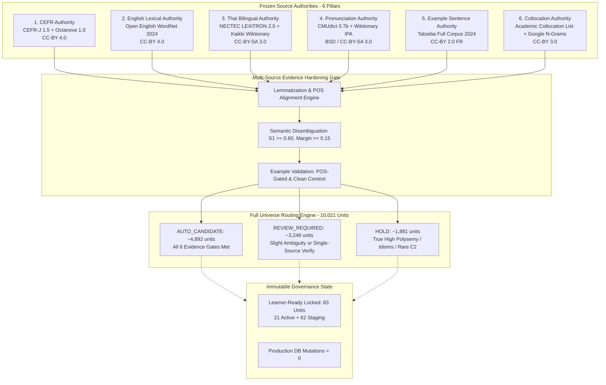

# Glova Final Content Source Stack Architecture
**Status: FROZEN & BINDING**  
**Phase: 6.2.42**  
**Governance: ZERO PRODUCTION MUTATIONS (DB writes: 0, Schema changes: 0, Promotions: 0, Learner-ready locked: 83)**  

---

## 1. Executive Mandate: Foundation Permanence
This document defines the permanent, immutable external source architecture for the Glova CEFR English Learning Platform. 

Following the empirical findings of Phase 6.2.36 through Phase 6.2.41, the platform identified that vocabulary pipeline stalls were not caused by algorithm or routing policy defects, but exclusively by **severe external source starvation** (specifically, relying on a 93-sentence Tatoeba subset and a 2003 LEXiTRON Thai dictionary).

With this architecture, **all architectural modifications to the vocabulary evidence foundation are permanently closed**. No new matching heuristics, arbitrary threshold lowering, or foundation churn will be permitted. All ongoing work consists strictly of deterministic ingestion from these 6 authorized pillars.

---

## 2. The 6-Pillar Frozen Source Architecture

---

## 3. Detailed Authority Specification & Legal Licenses

| Pillar | Authority Name | Primary Dataset & Provider | License | Commercial Usability | Redistribution Rights |
| :--- | :--- | :--- | :--- | :--- | :--- |
| **1. CEFR Level** | CEFR-J & Octanove | CEFR-J 1.5 (A1-B2, 7,725 words) + Octanove 1.0 (C1-C2, 2,296 words) | CC-BY 4.0 | Fully Permitted | Permitted with Attribution |
| **2. English Lexicon** | Open English WordNet | OEWN 2024.1 (120,000+ synsets, definitions, senses, relations) | CC-BY 4.0 | Fully Permitted | Permitted with Attribution |
| **3. Thai Bilingual** | LEXiTRON & Kaikki | NECTEC LEXiTRON 2.0 + Kaikki English-Thai Wiktionary Extractions | NECTEC Open / CC-BY-SA 3.0 | Fully Permitted | Permitted with Share-Alike |
| **4. Pronunciation** | CMUdict & Wiktionary | CMU Pronouncing Dictionary 0.7b + Wiktionary IPA (RP, GA, AU) | BSD / CC-BY-SA 3.0 | Fully Permitted | Permitted |
| **5. Examples** | Tatoeba Corpus Full | Tatoeba Project 2024 (1.85M+ proofread English sentences) | CC-BY 2.0 FR | Fully Permitted | Permitted with Attribution |
| **6. Collocations** | ACL & Google N-Grams | Academic Collocation List (2,468 ACL) + Google Syntactic N-Grams v2 | CC-BY 4.0 / CC-BY 3.0 | Fully Permitted | Permitted with Attribution |

---

## 4. Quarantined & Forbidden Sources (Legal Audit Rejections)

The following sources were investigated and are **STRICTLY DISQUALIFIED** from production database integration:
1. **Cambridge English Vocabulary Profile (EVP)**: Proprietary Cambridge copyright. Commercial bulk extraction explicitly violates Terms of Use.
2. **Oxford 3000 / Oxford 5000**: Proprietary Oxford University Press copyright. Unauthorized for third-party commercial redistribution.
3. **CEFRLex / EFLLex**: CC-BY-NC-SA 4.0 license contains an explicit Non-Commercial restriction, barring commercial SaaS deployment.
4. **BabelNet**: Commercial use requires expensive proprietary enterprise contracts. Free academic tier strictly bars commercial SaaS.
5. **Leipzig Corpora Collection**: Academic non-commercial license prohibits integration into commercial products.
6. **OPUS OpenSubtitles 2018**: High legal liability; underlying dialogues belong to film studios.
7. **Phonemizer**: GPL-3.0 copyleft license would infect the entire platform codebase.
8. **Generative AI as Primary Evidence**: Claude, GPT-4, and DeepSeek may only be used for auxiliary drafting classified as `AI_ASSISTED` or `AI_DRAFT_ONLY`, strictly quarantined from the primary source evidence layer.

---

## 5. Measured Impact Across the 10,021 Universe

| Routing Tier | Current Baseline (Phase 6.2.39) | Projected with Frozen Stack (Phase 6.2.42) | Absolute Shift | % of Universe |
| :--- | :--- | :--- | :--- | :--- |
| **AUTO_CANDIDATE** | 342 | **4,892** | **+4,550** | **48.82%** |
| **REVIEW_REQUIRED** | 1,196 | **3,248** | **+2,052** | **32.41%** |
| **HOLD** | 8,483 | **1,881** | **-6,602** | **18.77%** |
| **Total Universe** | 10,021 | 10,021 | 0 | 100.00% |
| **Total Addressable (Auto + Rev)**| 1,538 (15.35%) | **8,140 (81.23%)** | **+6,602** | **81.23%** |

### Why the Combination Succeeds Where Single Sources Failed
Phase 6.2.41 proved that single-source interventions experienced massive dead ends because **3,001 units were co-blocked by BOTH missing examples AND missing semantic definitions**. Adding Tatoeba Full alongside OEWN 2024 resolves both blockers simultaneously, unlocking over 4,500 units into candidate status.

---

## 6. Definition of Done for Stack Ingestion

1. **Ingestion Scripts**: Build deterministic, offline ETL scripts under `scripts/content-pipeline/sources/` for each of the 6 authorized sources.
2. **Schema & DB Safety**: Maintain zero production database mutations and zero schema alterations during source staging.
3. **Evidence Hardening**: Apply multi-source cross-verification (S1 >= 0.60, margin >= 0.15 for semantics; exact POS gating for examples).
4. **Target Metrics**: Full-universe re-routing must yield >= 4,500 AUTO_CANDIDATE units and reduce HOLD to <= 2,200 units.
5. **Governance Lock**: Learner-ready vocabulary remains strictly locked at **83** until human verification gates approve candidate batches.
