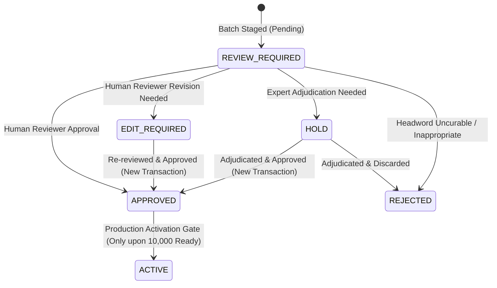

# Glova Vocabulary Content Pipeline: Phase 6.2.13 — Controlled Mass Human QA Execution Protocol

## 1. Executive Protocol Summary & Phase Scope

This document establishes the official operational standard and execution protocol for **Phase 6.2.13: Controlled Mass Human QA Execution** within the Glova vocabulary content pipeline.

Following the successful completion of the Phase 6.2.12.2 pilot on `TIER-1-001`, the Phase 6.2.12.3 pilot integrity audit, and the Phase 6.2.12.4 workflow hardening, Glova has established an end-to-end tooling infrastructure enabling trained human reviewers (lexicographers, language teachers, linguists) to systematically evaluate candidate learning units across Tier 1 critical-risk batches without compromising data integrity, auditability, or production safety.

### Core Tenets of Controlled Review:
1. **Human-Only Authority**: Artificial intelligence models and automated scripts are strictly forbidden from approving vocabulary learning units or authoring final review decisions.
2. **Pedagogical Integrity**: 10,000 staged units are not learner-ready until verified by human inspection across all 14 quality dimensions.
3. **Single-Batch Discipline**: Reviewers process vocabulary strictly one bounded batch (200 records) at a time, with default filtering to unreviewed records.
4. **Audit Trail Immutability**: Every review action generates a correlated, append-only ledger transaction linking the review batch, source batch, and audit ledger.
5. **Production Isolation**: Zero modifications to production Supabase database tables occur during human review execution.

---

## 2. Target Inventory & Verified Readiness State

The baseline metrics governing Phase 6.2.13 are locked and deterministically verified:

| Metric | Target | Current Verified State | Status |
| :--- | :--- | :--- | :--- |
| **Large Vocabulary Target** | 10,000 learner-ready units | 10,000 candidate staged units | Staged in 50 batches (`LARGE-001` .. `LARGE-050`) |
| **Existing Active Curated in DB** | Baseline | 21 units | Active in DB, certified learner-ready |
| **Human-Approved Staged Units** | 9,979 needed | 7 units | From Phase 6.2.12.2 pilot on `TIER-1-001` |
| **Total Learner-Ready Units** | 10,000 | **28 units** (21 active + 7 approved) | Current learner-ready pool |
| **Remaining Learner-Ready Gap** | 0 | **9,972 units** | Critical review required |
| **Tier 1 Critical-Risk Queue** | 7,119 units | 7,119 units across 36 batches | Bounded in `TIER-1-001` through `TIER-1-036` |
| **Overall Platform Readiness** | READY | **NOT_READY** | Gate locked |
| **User Testing Authorization** | true | **false** | Strictly prohibited |
| **Production Supabase DB Writes** | N/A | **0 writes** | 100% isolated |
| **Review Ledger Audit Trail** | Audited | **23 events** (10 production + 13 quarantined test) | Validated by `qa:integrity` |

---

## 3. The 14-Dimension Human Inspection Framework

Reviewers must inspect each vocabulary learning unit across 14 discrete structural and pedagogical dimensions before recording any disposition:

```
+-----------------------------------------------------------------------------------------+
|                               14-DIMENSION INSPECTION MATRIX                            |
+----+----------------------------------+-------------------------------------------------+
| #  | Dimension                        | Key Inspection Standard                         |
+----+----------------------------------+-------------------------------------------------+
| 1  | Identity & Normalization         | Headword in lowercase, valid lemma, canonical   |
|    |                                  | format: word|pos|cefr|sense:index               |
| 2  | Part of Speech (POS)             | Valid grammatical POS (noun, verb, adj, etc.)   |
| 3  | CEFR Level & Staging             | Appropriate CEFR difficulty band (A1-C2)        |
| 4  | English Meaning Definition       | OEWN-2024 sourced, accurate, non-circular       |
| 5  | Thai Translation Quality         | Natural Thai Unicode, zero dual-locale corrupt- |
|    |                                  | ions like "คำไทย (English)", non-verbatim       |
| 6  | Phonetic IPA & Pronunciation     | Valid IPA notation (/.../), US/UK standard      |
| 7  | Example Sentence                 | Level-calibrated, grammatical, contains target  |
| 8  | Topic / Domain Classification    | Appropriate thematic topic (General, Travel...) |
| 9  | Sense Disambiguation & Synset    | Correct synset key, polysemy resolution         |
| 10 | CEFR Conflict Profile            | Resolved external level discrepancies           |
| 11 | Pronunciation Source & Dialect   | Verified source (CMUdict, OEWN, manual)         |
| 12 | Content Provenance & Lineage     | Source attribution, version, transform lineage  |
| 13 | Tier 1 Critical-Risk Factors     | Verification of why flagged in risk queue       |
| 14 | Automated QA Audit Diagnostics   | Programmatic 8-dimension audit flags            |
+----+----------------------------------+-------------------------------------------------+
```

### Detailed Criteria per Dimension:

1. **Identity & Normalization**:
   - Word must be lowercase, trimmed, with no leading/trailing whitespace or illegal control characters.
   - Lemma must accurately represent the base dictionary form.
   - `learning_unit_key` must strictly follow the canonical format: `${lemma}|${part_of_speech}|${cefr_level}|sense:${sense_index}`.

2. **Part of Speech (POS)**:
   - Must match one of the standard grammatical categories: `noun`, `verb`, `adjective`, `adverb`, `preposition`, `conjunction`, `pronoun`, `determiner`, `interjection`.
   - Multi-word expressions or idioms must be tagged appropriately.

3. **CEFR Level & Staging**:
   - Level must be strictly one of `A1`, `A2`, `B1`, `B2`, `C1`, `C2`.
   - Pedagogical appropriateness: word meaning and frequency should realistically align with the assigned CEFR band.

4. **English Meaning**:
   - Sourced from Open English WordNet (OEWN-2024) or verified lexicographical sources.
   - Must be clear, grammatically sound, and non-circular (the definition cannot simply repeat the headword).
   - Minimum length: 3 characters.

5. **Thai Translation Quality**:
   - Must contain valid Thai Unicode script (`[\u0E00-\u0E7F]`).
   - Strictly forbidden from containing dual-locale parenthetical translations such as `คำไทย (English Word)` or `English (คำไทย)`.
   - Must not be an identical transliteration or verbatim copy of the English definition.

6. **Phonetic IPA**:
   - Standard International Phonetic Alphabet notation enclosed in slashes (e.g. `/əˈkɒm.ə.deɪt/`).
   - If IPA is missing or unavailable, the reviewer MUST assign an explicit `IPA_DISPOSITIONS` code:
     - `MANUAL_IPA_VERIFIED`
     - `CMUDICT_SOURCE_FALLBACK`
     - `PHONEME_SYNTHESIS_APPROVED`
     - `NOT_APPLICABLE_NO_PHONETIC_FORM`
     - `REJECTED_UNRESOLVABLE_PHONETICS`

7. **Example Sentence**:
   - Must be at least 10 characters long.
   - Must accurately illustrate the specific sense and meaning being taught.
   - Complexity must match the target CEFR level.

8. **Topic / Domain Classification**:
   - Valid pedagogical domain (e.g. `General`, `Academic`, `Business`, `Science`, `Travel`, `Health`, `Technology`).

9. **Sense Disambiguation & Synset**:
   - Sensed against Princeton WordNet / OEWN synsets.
   - For items with status `MATCH_AMBIGUOUS` or `NO_MATCH`, reviewer MUST assign a valid `SENSE_DISPOSITIONS` code:
     - `MATCH_CONFIDENT_VERIFIED`
     - `OEWN_MANUAL_SYNSET_LINKED`
     - `NEW_PEDAGOGICAL_SENSE_CREATED`
     - `SPLIT_INTO_HOMOGRAPHS`
     - `MERGED_WITH_EXISTING_SENSE`
     - `DEPRECATED_OBSOLETE_SENSE`
     - `REJECTED_UNINTELLIGIBLE`

10. **CEFR Conflict Profile**:
    - Discloses discrepancies across CEFR-J, British Council, and external corpora.
    - Reviewer confirms the assigned level is appropriate for Thai EFL learners.

11. **Pronunciation Integrity & Source**:
    - Documents phonetic origin (`cmudict`, `oewn`, or expert manual entry) and dialect variant (US/UK).

12. **Content Provenance**:
    - Traces transformation lineage, source data license, and creation history.

13. **Tier 1 Risk Reasons**:
    - Highlights why the unit was flagged (e.g., `cefr_conflict`, `ambiguous_sense`, `no_match_sense`, `unresolved_ipa`, `blocking_qa`).

14. **Automated QA Audit Diagnostics**:
    - Programmatic validation flags from the 8-dimension engine (`QA_FLAGGED`, `MEANING_EN_INVALID_OR_MISSING`, `MEANING_TH_INVALID_OR_CORRUPTED`, `IPA_MISSING_AND_UNRESOLVED`, etc.).

---

## 4. Reviewer Decision Semantics & Lifecycle Rules

Reviewers record exactly one terminal or interim decision per unit:



### Detailed Decision Specifications:

| Decision | Lifecycle Status | Rationale Required? | Edits Required? | Contributes to Learner-Ready? | Description |
| :--- | :--- | :--- | :--- | :--- | :--- |
| **`APPROVED`** | `APPROVED` | Optional (Mandatory if missing IPA/Sense) | No | **YES (+1)** | All 14 dimensions verified accurate and learner-ready. Unit is frozen in staging until the 10,000 threshold is reached. |
| **`EDIT_REQUIRED`** | `EDIT_REQUIRED` | **Yes (min 10 chars)** | **Yes (>= 1 field)** | **NO (+0)** | Reviewer corrected one or more fields (`meaning_en`, `meaning_th`, `phonetic_ipa`, `example_sentence`, `cefr_level`, `topic`). Unit remains staged; requires secondary review before approval. |
| **`HOLD`** | `HOLD` | **Yes (min 10 chars)** | No | **NO (+0)** | Unit exhibits complex polysemy, regional nuance, or contradictory corpus data requiring adjudication by a senior lexicographer. |
| **`REJECTED`** | `REJECTED` | **Yes (min 10 chars)** | No | **NO (+0)** | Headword is uncurable, obsolete, offensive, or pedagogically unsound. Excluded from learner inventory. |

### Strict Operational Invariants:
1. **Zero AI Approvals**: Submissions from AI identifiers or automated scripts throw immediate validation exceptions.
2. **Zero Direct Promotion to Active**: No review action can promote a record directly to `ACTIVE` (`is_active: true`). Units remain in `APPROVED` staging.
3. **No Automatic Approval**: A unit is never approved by default or through batch timeout.
4. **Mandatory Rationales**: Holds, Rejections, and Edits strictly require explanatory rationales of at least 10 characters.

---

## 5. Reviewer Identity & Disclosure Protocol

Reviewer identity tracking enforces operational traceability while maintaining realistic developer disclosures:

- **Format Validation**: Reviewer IDs must be non-empty strings between 3 and 64 characters matching `/^[a-z0-9_.-]+$/i`.
- **Bot Rejection**: Submissions containing tokens such as `gpt`, `claude`, `bot`, `auto`, `synthetic`, or `ai` are strictly rejected.
- **Operational Reality Disclosure**:
  > [!NOTE]
  > Reviewer identities (e.g. `lexicographer_anna`, `reviewer_john`) are user-supplied operational tracking identifiers used to record editorial attribution in the append-only ledger. They represent editorial workflow tracking, not cryptographically verified Single Sign-On (SSO) or biometric signatures.

---

## 6. Controlled Single-Batch Execution Workflow

Review execution is strictly bounded to prevent sprawling, uncontrolled modifications:

1. **Batch Selection**: Reviewers select a single Tier 1 batch (`TIER-1-001` through `TIER-1-036`).
2. **Filtered View by Default**: The review tool defaults to `REVIEW_REQUIRED`, presenting only items that have not yet received a review disposition.
3. **One Unit at a Time**: Reviewers navigate through the filtered list sequentially, viewing the complete 14-dimension breakdown.
4. **Immediate Persistence**: When a decision is submitted, the system atomically updates the Tier 1 batch file, the referenced source LARGE batch file, appends an event to the review ledger, and recalculates the readiness report.
5. **Batch Completion Assertion**: A batch cannot be marked complete or certified until every single record in the batch (200 records) possesses a terminal review disposition (`evaluateBatchCompletion`).

---

## 7. Reviewer Tooling: CLI & Offline Export/Import Specification

Glova provides two primary interfaces for human reviewers: an interactive terminal CLI and an offline JSON file export/import workflow for external lexicographical review.

### 7.1 Terminal Review CLI (`review-cli.mjs`)

```powershell
# 1. View overall queue progress and batch summary
node scripts/content-pipeline/vocab/review-cli.mjs --status

# 2. View specific batch summary
node scripts/content-pipeline/vocab/review-cli.mjs --batch TIER-1-001

# 3. Launch interactive review session on unreviewed records of TIER-1-001
node scripts/content-pipeline/vocab/review-cli.mjs --interactive --batch TIER-1-001 --reviewer lexicographer_anna

# 4. Launch interactive review session over ALL records in batch (including already-reviewed)
node scripts/content-pipeline/vocab/review-cli.mjs --interactive --batch TIER-1-001 --reviewer lexicographer_anna --all

# 5. Inspect 14 dimensions of a specific unit
node scripts/content-pipeline/vocab/review-cli.mjs --inspect "drill|noun|C1|sense:2"

# 6. Submit a single direct decision via command line
node scripts/content-pipeline/vocab/review-cli.mjs --decide --batch TIER-1-001 --unit-key "drill|noun|C1|sense:2" --reviewer lexicographer_anna --decision APPROVE --rationale "Verified technical meaning and CEFR-C1 usage"

# 7. Assert batch completion (returns error if unreviewed items remain)
node scripts/content-pipeline/vocab/review-cli.mjs --assert-complete --batch TIER-1-001
```

### 7.2 Offline Export / Import Specification

For reviewers who prefer working in specialized external translation editors or spreadsheets:

#### Export Command:
```powershell
node scripts/content-pipeline/vocab/review-cli.mjs --export reports/tier1-batch-001-review.json --batch TIER-1-001 --filter REVIEW_REQUIRED
```

#### Export File Structure (`vocabulary-human-review-v1.json`):
```json
{
  "$schema": "https://glova.ai/schemas/vocabulary-human-review-v1.json",
  "export_version": "1.0",
  "batch_id": "TIER-1-001",
  "exported_at": "2026-09-26T10:00:00.000Z",
  "filter_applied": "REVIEW_REQUIRED",
  "total_records_in_export": 190,
  "total_records_in_batch": 200,
  "guidance": {
    "valid_decisions": ["APPROVED", "EDIT_REQUIRED", "HOLD", "REJECTED"],
    "rules": { ... },
    "warning": "Do NOT modify learning_unit_key or metadata. Only edit review_submission fields."
  },
  "records": [
    {
      "learning_unit_key": "drill|noun|C1|sense:2",
      "word": "drill",
      "lemma": "drill",
      "part_of_speech": "noun",
      "cefr_level": "C1",
      "meaning_en": "systematic training by multiple repetitions",
      "meaning_th": "สิ่งประดิษฐ์ อุปกรณ์ หรือโครงสร้างที่ใช้สำหรับสิ่งของ...",
      "phonetic_ipa": "/dɹɪl/",
      "example_sentence": "Understanding the role of drill helps students...",
      "topic": "General",
      "source_batch_id": "LARGE-006",
      "tier1_reasons": ["cefr_conflict"],
      "qa_flags": [],
      "candidate_senses_preview": [ ... ],
      "review_submission": {
        "reviewer_decision": "APPROVED",
        "review_rationale": "Verified correct C1 academic usage and training meaning",
        "ipa_disposition": null,
        "sense_disposition": null,
        "edits": {
          "meaning_en": null,
          "meaning_th": null,
          "phonetic_ipa": null,
          "example_sentence": null,
          "cefr_level": null,
          "topic": null
        }
      }
    }
  ]
}
```

#### Dry-Run Pre-Flight Import Command:
```powershell
node scripts/content-pipeline/vocab/review-cli.mjs --import reports/tier1-batch-001-completed.json --reviewer lexicographer_anna --dry-run
```

#### Final Atomic Import Command:
```powershell
node scripts/content-pipeline/vocab/review-cli.mjs --import reports/tier1-batch-001-completed.json --reviewer lexicographer_anna
```

---

## 8. Ledger Audit Trail & Correlation Transaction Semantics

Every human review action is durably tracked in `reports/vocabulary-human-review-ledger.json`.

### Correlation Transaction IDs:
To guarantee complete multi-file traceability across the pipeline:
1. Every review action generates a unique transaction identifier: `rev_txn_${uuid.slice(0, 12)}`.
2. The transaction ID is simultaneously stamped into:
   - The Tier 1 batch record (`unit.review_transaction_id` and `unit.provenance.human_review.transaction_id`).
   - The corresponding source LARGE batch record (`LARGE-xxx.json`).
   - The ledger event record (`event.transaction_id`).
3. Multi-file writes are executed atomically (`atomicWriteFiles`) using temporary staging and atomic renames, preventing partial state corruption.

### Isolation of Test / Development Events:
- In test environments (`NODE_ENV === 'test'`, `VITEST`, or reviewer IDs containing `test`), events are tagged `event_type: 'TEST_DEVELOPMENT'` and `counted_in_readiness: false`.
- The 13 historical development events remain strictly quarantined.
- Only events tagged `event_type: 'PRODUCTION_REVIEW'` and `is_production_review: true` are counted toward readiness.

---

## 9. Non-Promotion Invariant & Production Isolation

Glova enforces a strict structural separation between staged vocabulary and active production database records:

```
[Candidate Units in JSON Batches]
               │
               ▼
      (Human Review QA)
               │
               ▼
    [APPROVED in Staging]  ──────( Learner-Ready Gap Accounting )
               │
      [STRICT GATE: 10,000 Target Must Be Reached]
               │
               ▼ (promoteUnitToActive)
   [ACTIVE in Production DB]
```

- **Invariant**: Approval in a review batch does NOT insert or update rows in the Supabase production database.
- Production Supabase mutations remain strictly **0** throughout all review phases.
- The platform gate `overall_status` remains `NOT_READY` and `user_testing_authorized` remains `false` until the entire 10,000 threshold is satisfied.

---

## 10. CEFR Pedagogical Calibration Disclaimer

To maintain transparent and defensible academic standards:

> [!IMPORTANT]
> All CEFR level designations in the Glova vocabulary content pipeline are **Glova CEFR-informed pedagogical classifications** established through algorithmic reconciliation of CEFR-J (v1.5), the British Council Core Inventory, and Open English WordNet, verified by human review. Glova does NOT claim official certification, endorsement, or accreditation by Cambridge University Press & Assessment, Oxford University Press, or the Council of Europe.

---

## 11. Pre-Flight QA Integrity Checklist & Verification Commands

Before concluding any review session or committing batch updates, execute the full QA integrity suite:

```powershell
# 1. Run deterministic 9-check QA integrity audit
npm run qa:integrity

# 2. Run full unit and regression test suite
npm test

# 3. Verify Cloudflare Workers OpenNext build compatibility
npm run build:worker

# 4. Check git status to confirm no untracked file leaks
git status
```

### Passing Criteria:
- `npm run qa:integrity`: 9/9 checks PASS, 0 issues, zero cross-batch discrepancies.
- `npm test`: All tests PASS (including Block 11 in `tests/vocabulary-tier1-qa.test.ts`).
- `build:worker`: PASS (40/40 routes generated in `.open-next/worker.js`).
- Database mutations: 0 mutations against production Supabase.
- Learner-ready gap: Accurately reflects only genuinely reviewed human approvals.
