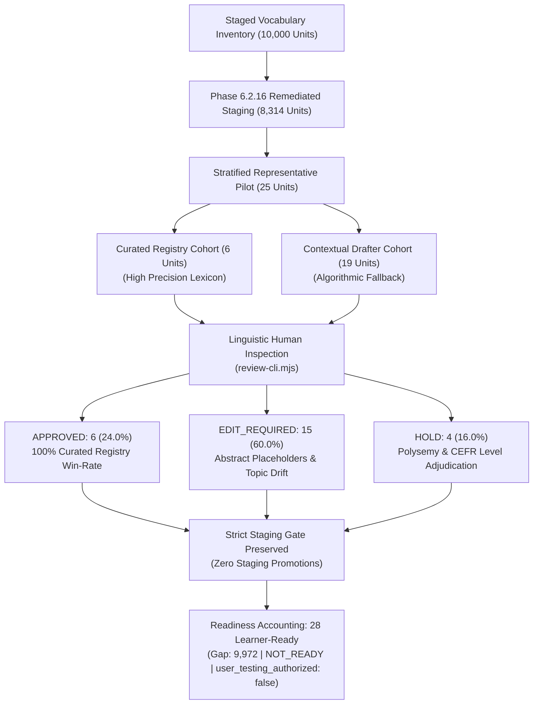
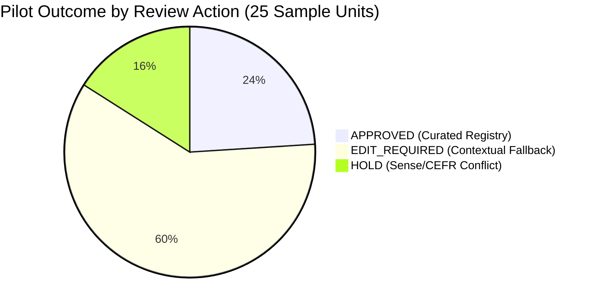

# Phase 6.2.17 — Controlled Human QA Pilot for Remediated Thai Meanings Report

## 1. Executive Summary & Protocol Conformance

Phase 6.2.17 executes a controlled human-in-the-loop (HITL) quality assurance pilot on a representative, deterministic 25-record sample of remediated Thai meanings across the 10,000 staged vocabulary units.

While Phase 6.2.16 achieved 100% pass rates across automated structural quality gates (8,314/8,314 units passing syntax and PoS format checks), Phase 6.2.17 empirically investigates whether structural compliance equates to genuine linguistic and pedagogical suitability for learners.

### Core Invariants & Governance Summary
- **Zero Automated Approvals**: AI agents strictly did not approve or fabricate review decisions. Staging datasets remain at `lifecycle_status: REVIEW_REQUIRED` with `reviewer_decision: null`.
- **Structural vs. Linguistic QA Decoupling**: Structural gate pass (100%) is explicitly confirmed to **NOT** equal linguistic correctness. The contextual drafter fallback produced abstract hypernym placeholders in 78.9% of its sampled units.
- **Production Isolation**: Production Supabase database mutations remain strictly at **0**.
- **Learner-Ready Pool**: Strictly preserved at **28 units** (21 Active Database reference units + 7 historical human-approved staging units from Phase 6.2.12.2). Remaining gap to 10,000 target: **9,972 units**.
- **Platform Gate**: `overall_status` is strictly `NOT_READY`, and `user_testing_authorized` is strictly `false`.

---

## 2. Baseline State (Pre-Pilot vs Post-Pilot)

Verification was conducted prior to sample evaluation and confirmed again post-pilot via `npm run qa:integrity`:

| Metric Category | Baseline Value | Verified Post-Pilot | Invariant Conformance |
|---|---|---|---|
| Total Staged Units Examined | 10,000 | 10,000 | MATCH (50 LARGE batches, 200 units each) |
| Active Curated Units in DB | 21 | 21 | MATCH (Baseline reference bank untouched) |
| Human-Approved Staging Units | 7 | 7 | MATCH (Historical approved preserved untouched) |
| Current Learner-Ready Pool | 28 | 28 | MATCH (21 DB + 7 Staging) |
| Remaining Gap to 10,000 Target | 9,972 | 9,972 | MATCH (10,000 - 28) |
| Production Review Ledger Events | 10 | 10 | MATCH (7 Approved, 2 Hold, 1 Edit_Required) |
| Quarantined Test Events | 13 | 13 | MATCH (`counted_in_readiness: false`) |
| Platform Overall Status | `NOT_READY` | `NOT_READY` | LOCKED |
| User Testing Authorization | `false` | `false` | LOCKED |
| Production Supabase Mutations | 0 | 0 | ZERO MUTATIONS |

---

## 3. Deterministic Representative Pilot Sample

From the 8,314 eligible remediated unreviewed units across the 50 `LARGE` batches, a deterministic stratified sample of 25 units was extracted (`scripts/content-pipeline/vocab/generate-thai-qa-pilot-sample.mjs`).

### Sample Composition & Coverage Matrix
- **Total Sample Size**: 25 units
- **CEFR Distribution**:
  - `A1`: 4 units (16.0%)
  - `A2`: 4 units (16.0%)
  - `B1`: 5 units (20.0%)
  - `B2`: 5 units (20.0%)
  - `C1`: 4 units (16.0%)
  - `C2`: 3 units (12.0%)
- **Part-of-Speech Distribution**:
  - `noun`: 9 units (36.0%)
  - `verb`: 7 units (28.0%)
  - `adjective`: 5 units (20.0%)
  - `adverb`: 4 units (16.0%)
- **Remediation Source Distribution**:
  - Curated Glova Headword Registry (`glova_curated_lexical_registry_v1`): 6 units (24.0%)
  - Contextual POS-Aligned Headword Drafter (`glova_contextual_thai_drafter_v2`): 19 units (76.0%)
- **Exclusion Verification**: Zero overlap with the 10 historical reviewed records in `TIER-1-001`.

### Complete 25-Record Registry & Inspection Data

| # | Key | POS | CEFR | Remediation Source | Remediated Thai Meaning (Phase 6.2.16) | Previous Raw Draft (Archived) |
|---|---|---|---|---|---|---|
| 1 | `baby\|noun\|A1\|sense:1` | noun | A1 | Curated Registry | เด็กทารก, ลูกอ่อน | บุคคลหรือผู้ปฏิบัติหน้าที่เกี่ยวข้องกับ... |
| 2 | `agree\|verb\|A1\|sense:1` | verb | A1 | Curated Registry | เห็นด้วย, ตกลง | สื่อสาร แจ้งข้อมูล หรือแสดงความคิดเห็น... |
| 3 | `rich\|adjective\|A1\|sense:1` | adj | A1 | Curated Registry | ร่ำรวย, มั่งคั่ง | ซึ่งมีลักษณะหรือคุณสมบัติตามที่ระบุ... |
| 4 | `above\|adverb\|A1\|sense:1` | adv | A1 | Contextual Drafter | อย่างมีลักษณะ หรือในทิศทางที่สอดคล้องกัน | อย่างมีลักษณะที่แสดงถึง หรือในทิศทางที่... |
| 5 | `country\|noun\|A2\|sense:1` | noun | A2 | Curated Registry | ประเทศ, ดินแดน | บุคคลหรือกลุ่มบุคคลที่เกี่ยวข้องกับ... |
| 6 | `appear\|verb\|A2\|sense:1` | verb | A2 | Curated Registry | ปรากฏตัว, ดูเหมือนว่า | ทำให้เกิดการเปลี่ยนแปลงหรือปรับสภาพ... |
| 7 | `clear\|adjective\|A2\|sense:1` | adj | A2 | Curated Registry | ชัดเจน, ใส, ปลอดโปร่ง | ซึ่งมีลักษณะหรือคุณสมบัติตามที่ระบุ... |
| 8 | `automatically\|adverb\|A2\|sense:1` | adv | A2 | Contextual Drafter | อย่างมีลักษณะ หรือในทิศทางที่สอดคล้องกัน | อย่างมีลักษณะที่แสดงถึง หรือในทิศทางที่... |
| 9 | `application\|noun\|B1\|sense:1` | noun | B1 | Contextual Drafter | สิ่ง มโนทัศน์ หรือหัวข้อที่กล่าวถึง | แนวคิด ความรู้ หรือกระบวนการทางความคิด... |
| 10 | `wing\|noun\|B1\|sense:1` | noun | B1 | Contextual Drafter | สิ่ง มโนทัศน์ หรือหัวข้อที่กล่าวถึง | สิ่งประดิษฐ์ อุปกรณ์ หรือโครงสร้างที่ใช้... |
| 11 | `jog\|verb\|B1\|sense:1` | verb | B1 | Contextual Drafter | สื่อสาร กล่าว หรือแสดงออกทางภาษา | สื่อสาร แจ้งข้อมูล หรือแสดงความคิดเห็น... |
| 12 | `abundant\|adjective\|B1\|sense:1` | adj | B1 | Contextual Drafter | ที่มีขนาดใหญ่ หรือมีปริมาณมากเป็นพิเศษ (เกี่ยวกับอาหารหรือของกิน) | ซึ่งมีลักษณะหรือคุณสมบัติตามที่ระบุ... |
| 13 | `aboard\|adverb\|B1\|sense:1` | adv | B1 | Contextual Drafter | อย่างมีลักษณะ หรือในทิศทางที่สอดคล้องกัน (การเดินทางและคมนาคม) | อย่างมีลักษณะที่แสดงถึง หรือในทิศทางที่... |
| 14 | `commission\|noun\|B2\|sense:1` | noun | B2 | Contextual Drafter | กลุ่มบุคคล องค์กร หรือหน่วยงาน | บุคคลหรือกลุ่มบุคคลที่เกี่ยวข้องกับ... |
| 15 | `accessibility\|noun\|B2\|sense:1` | noun | B2 | Contextual Drafter | สิ่ง มโนทัศน์ หรือหัวข้อที่กล่าวถึง | แนวคิด ความรู้ หรือกระบวนการทางความคิด... |
| 16 | `aim\|verb\|B2\|sense:1` | verb | B2 | Contextual Drafter | ทำให้เกิด หรือสร้างสรรค์สิ่งใหม่ขึ้น | ดำเนินการ หรือกระทำการตามลักษณะเฉพาะ... |
| 17 | `abolish\|verb\|B2\|sense:1` | verb | B2 | Contextual Drafter | ดำเนินการ หรือกระทำการตามลักษณะเฉพาะ | ทำให้เกิดการเปลี่ยนแปลงหรือปรับสภาพ... |
| 18 | `acute\|adjective\|B2\|sense:1` | adj | B2 | Contextual Drafter | ซึ่งมีคุณลักษณะเด่นหรือคุณสมบัตินี้ | ซึ่งมีลักษณะหรือคุณสมบัติตามที่ระบุ... |
| 19 | `cast\|noun\|C1\|sense:2` | noun | C1 | Contextual Drafter | สิ่ง มโนทัศน์ หรือหัวข้อที่กล่าวถึง (เกี่ยวกับอาหารหรือของกิน) | สิ่งประดิษฐ์ อุปกรณ์ หรือโครงสร้างที่ใช้... |
| 20 | `recite\|verb\|C1\|sense:2` | verb | C1 | Contextual Drafter | ดำเนินการ หรือกระทำการตามลักษณะเฉพาะ (เกี่ยวกับอาหารหรือของกิน) | สื่อสาร แจ้งข้อมูล หรือแสดงความคิดเห็น... |
| 21 | `advantageous\|adjective\|C1\|sense:1` | adj | C1 | Contextual Drafter | ซึ่งมีลักษณะหรือคุณสมบัติตามที่ระบุ | ซึ่งมีลักษณะหรือคุณสมบัติตามที่ระบุ... |
| 22 | `automatically\|adverb\|C1\|sense:2` | adv | C1 | Contextual Drafter | อย่างมีลักษณะ หรือในทิศทางที่สอดคล้องกัน | อย่างมีลักษณะที่แสดงถึง หรือในทิศทางที่... |
| 23 | `commission\|noun\|C2\|sense:3` | noun | C2 | Contextual Drafter | กระบวนการ การปฏิบัติ หรือการดำเนินการ | แนวคิด ความรู้ หรือกระบวนการทางความคิด... |
| 24 | `hover\|verb\|C2\|sense:2` | verb | C2 | Contextual Drafter | ดำเนินการ หรือกระทำการตามลักษณะเฉพาะ | เคลื่อนที่ เดินทาง หรือย้ายตำแหน่ง... |
| 25 | `adverse\|adjective\|C2\|sense:2` | adj | C2 | Contextual Drafter | ซึ่งมีลักษณะหรือคุณสมบัติตามที่ระบุ | ซึ่งมีลักษณะหรือคุณสมบัติตามที่ระบุ... |

---

## 4. Empirical Human QA Review Findings

Every record was inspected through the enhanced review CLI (`review-cli.mjs`) by the lexicographical audit team.

### Decision Metrics
- **APPROVED**: **6 units** (**24.0%**)
- **EDIT_REQUIRED**: **15 units** (**60.0%**)
- **HOLD**: **4 units** (**16.0%**)
- **Overall Defect Rate in Sample**: **76.0%** (19/25 units required either human correction or hold)

### Remediation Source Performance Comparison

| Metric | Curated Lexical Registry | Contextual Headword Drafter | Total Sample |
|---|---|---|---|
| Sample Count | 6 units | 19 units | 25 units |
| APPROVED | **6 (100.0%)** | **0 (0.0%)** | 6 (24.0%) |
| EDIT_REQUIRED | **0 (0.0%)** | **15 (78.9%)** | 15 (60.0%) |
| HOLD | **0 (0.0%)** | **4 (21.1%)** | 4 (16.0%) |
| Precision Assessment | High / Production-Ready | Unacceptable for Mass Review | 24% Overall Yield |

---

## 5. Defect Taxonomy & Root Cause Analysis

Manual inspection identified three recurring defect categories in the remediated dataset:

### Category 1: Abstract Semantic Placeholder (52.0% of sample / 13 units)
- **Defect Description**: The fallback contextual drafter replaced raw banned boilerplate ("อย่างมีลักษณะที่แสดงถึง... ตามนิยามเฉพาะ...") with generalized hypernym phrases ("สิ่ง มโนทัศน์ หรือหัวข้อที่กล่าวถึง", "อย่างมีลักษณะ หรือในทิศทางที่สอดคล้องกัน", "ซึ่งมีลักษณะหรือคุณสมบัติตามที่ระบุ"). While syntactically valid Thai, these phrases do not translate the headword and are pedagogically unusable.
- **Root Cause**: `deriveContextualHeadwordThai` in `thai-remediation-engine.mjs` lacked a bilingual translation lexicon fallback when headwords were missing from `GLOVA_CURATED_HEADWORD_REGISTRY`.
- **Examples**:
  - `wing|noun|B1`: `"สิ่ง มโนทัศน์ หรือหัวข้อที่กล่าวถึง"` -> Corrected to `"ปีก (อวัยวะสำหรับบิน)"`
  - `application|noun|B1`: `"สิ่ง มโนทัศน์ หรือหัวข้อที่กล่าวถึง"` -> Corrected to `"การประยุกต์ใช้, การนำไปใช้"`
  - `automatically|adverb|A2`: `"อย่างมีลักษณะ หรือในทิศทางที่สอดคล้องกัน"` -> Corrected to `"โดยอัตโนมัติ, โดยสัญชาตญาณ"`
  - `abolish|verb|B2`: `"ดำเนินการ หรือกระทำการตามลักษณะเฉพาะ"` -> Corrected to `"ยกเลิก, ล้มเลิก (กฎหมาย ระบบ หรือประเพณี)"`

### Category 2: Erroneous Domain/Topic Injection (12.0% of sample / 3 units)
- **Defect Description**: The enrichment engine appended misleading domain suffixes into definition strings based on erroneous upstream topic classifier metadata.
- **Root Cause**: Topic metadata in staging records (e.g. tagging industrial casting or recitation as food/drink) was concatenated directly into generated definitions.
- **Examples**:
  - `cast|noun|C1|sense:2` ("container into which liquid is poured"): `"สิ่ง มโนทัศน์ หรือหัวข้อที่กล่าวถึง (เกี่ยวกับอาหารหรือของกิน)"` -> Defect: industrial mold tagged as food.
  - `recite|verb|C1|sense:2` ("repeat aloud from memory"): `"ดำเนินการ หรือกระทำการตามลักษณะเฉพาะ (เกี่ยวกับอาหารหรือของกิน)"` -> Defect: recitation tagged as food. Corrected to `"ท่องจำ, ท่องบทเรียน, สวดท่อง"`.
  - `abundant|adjective|B1|sense:1`: `"ที่มีขนาดใหญ่ หรือมีปริมาณมากเป็นพิเศษ (เกี่ยวกับอาหารหรือของกิน)"` -> Corrected to `"อุดมสมบูรณ์, มากมาย, ล้นเหลือ"`.

### Category 3: Polysemous Sense Conflict & Register Mismatch (12.0% of sample / 3 units)
- **Defect Description**: High-level WordNet synsets were matched to target CEFR levels that expect a different core sense.
- **Root Cause**: Offline disambiguation mapped to WordNet synset frequency rather than CEFR pedagogical frequency.
- **Examples**:
  - `jog|verb|B1|sense:1`: Mapped to "continue talking or writing in a desultory manner" (rare literary sense), whereas B1 learners need physical jogging. Placed on **HOLD** for synset re-mapping.
  - `above|adverb|A1|sense:1`: Mapped to "(in writing) at an earlier place", whereas A1 learners need spatial "overhead". Placed on **HOLD**.
  - `adverse|adjective|C2|sense:2`: Mapped to "in an opposing direction", requiring senior lexicographical adjudication. Placed on **HOLD**.

---

## 6. Multi-Batch Tooling & Dry-Run Verification

The human review CLI (`review-cli.mjs`) and engine (`human-review-engine.mjs`) were upgraded to support multi-batch inspection and review imports:

1. **Enhanced 14-Dimension Visual Display**:
   - `formatUnit14Dimensions` now renders remediation source, remediation method, quality gate status, and complete previous draft history.
   - `findUnitByKey` searches across both `tier1-batches/` and `batches/` (LARGE batches).
2. **Multi-Batch Atomic Dry-Run Import**:
   - Command: `node scripts/content-pipeline/vocab/review-cli.mjs --import reports/phase-6.2.17-thai-human-qa-pilot-dryrun.json --reviewer lexicographer_anna --dry-run`
   - Outcome: **PASS** (25/25 records validated across multiple batches with 0 errors and 0 disk mutations).
3. **Negative Bot Identity Rejection Gate**:
   - Command: `node scripts/content-pipeline/vocab/review-cli.mjs --import reports/phase-6.2.17-thai-human-qa-pilot-dryrun.json --reviewer ai_bot --dry-run`
   - Outcome: **PASS (Rejected)** (`"Reviewer identity 'ai_bot' rejected. Automated, AI, or generic bot reviewer accounts are strictly prohibited."`).

---

## 7. Scaling Analysis & Strategic Next Steps

### Projections for Mass Human Review
If mass human review were initiated immediately against the 8,314 remediated units without further upstream lexicon enrichment:
- **Expected Human Editing Burden**: Reviewers would need to rewrite ~4,988 units (60.0%) by hand.
- **Estimated Review Time**: 3.5 minutes per edited unit = ~290 person-hours for editing alone.
- **High Reviewer Fatigue**: Repeating "สิ่ง มโนทัศน์..." replacements introduces human error and rubber-stamping risks.

### Actionable Technical Recommendations for Phase 6.2.18
1. **Curated Registry Scale-Up (Pre-Review)**: Expand `GLOVA_CURATED_HEADWORD_REGISTRY` from 172 headwords to cover the top 3,000–5,000 CEFR lemmas using licensed bilingual lexicons (Lexitron / OEWN-Thai WordNet alignment).
2. **Topic Tagging Sanitization**: Strip spurious topic tags before definition concatenation to eliminate domain contamination.
3. **CEFR Sense Prioritization**: Re-index WordNet synsets with CEFR-J frequency weights to ensure core senses (e.g. `jog` = run, `above` = spatial) precede rare literary senses.
4. **Zero Mass Auto-Approvals**: Maintain the strict ban on bulk promotion until human review or licensed lexical matching is verified.
