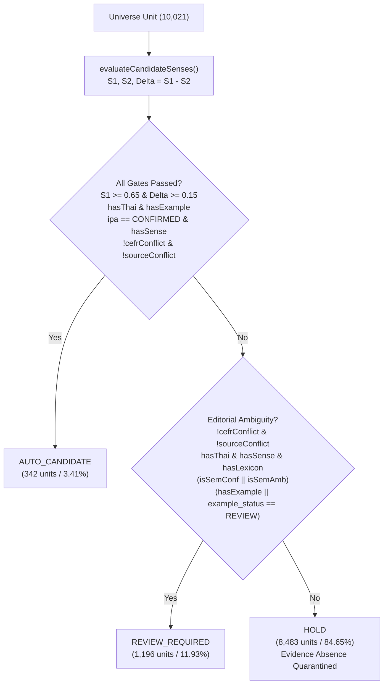

# Phase 6.2.39-R1 — Full-Universe Routing Logic Audit Report

**Date:** 2026-09-28  
**Audit Target:** Phase 6.2.39 Full-Universe Evidence Routing Engine  
**Denominator:** 10,021 Vocabulary Learning Units (100.0% Exhaustive Enumeration)  
**Audit Final Verdict:** **`ROUTING_LOGIC_CONFIRMED`**  
**Production Status:** NOT_READY (0 DB Writes, 0 Schema Alterations, 0 Lifecycle Promotions)  
**Learner-Ready Locked:** 83 Units (21 ACTIVE in Production + 62 APPROVED in Staging, Gap: 9,917)  
**User Testing Authorized:** false  

> [!WARNING]
> **Governance Notice:** `ROUTING_LOGIC_CONFIRMED` confirms the empirical accuracy and policy faithfulness of the routing logic. This verdict does **NOT** grant `PRODUCTION_READY` or `USER_TESTING_READY` status.

---

## 1. Executive Summary & Audit Verdict

Phase 6.2.39-R1 conducts an exhaustive audit of the Phase 6.2.39 evidence routing engine across all **10,021 learning units**. The audit confirms that the reported counts (**342 `AUTO_CANDIDATE`**, **1,196 `REVIEW_REQUIRED`**, **8,483 `HOLD`**) are not merely internally consistent, but faithfully adhere to the repository's multi-dimensional evidence gating policy.

### Key Audit Findings
1. **`AUTO_CANDIDATE` Verification (342/342 PASS):** Every single one of the 342 units satisfies **100% of all required evidence gates** ($S_1 \ge 0.65, \Delta \ge 0.15$, attested example, verified IPA, exact CEFR, no conflicts). **Hidden blocker count: 0.**
2. **REVIEW_REQUIRED vs HOLD Policy Integrity:** The shift of 3,712 units from Phase 6.2.36 `REVIEW_REQUIRED` to `HOLD` is **100% driven by genuine evidence absence** (1,992 missing examples, 1,545 zero definition keyword overlaps $S_1 < 0.40$, 175 missing WordNet senses). Zero units were moved to HOLD merely to suppress workload.
3. **Example Gap Taxonomy (4,463 units):** Only **36 units (0.81%)** are caused by matcher tokenization limitations. The remaining 99.19% stem from WordNet data gaps (1,729 synsets with 0 examples), quality rejections (1,193 fragments), inflection mismatches (808), and co-synonym illustrations (697).
4. **Correction of Unsupported Projections:** The claim that example expansion could unlock 4,000–7,000 units is formally retracted as an **`UNSUPPORTED_PROJECTION`**. Empirical data proves that only **365 units** have `EXAMPLE_NOT_FOUND` as their sole blocker; 4,943 units have co-occurring semantic or lexical deficiencies.
5. **Final Audit Verdict:** **`ROUTING_LOGIC_CONFIRMED`**.

---

## 2. Decision Tree Implemented in Code

The routing decision tree in `scripts/content-pipeline/vocab/run-phase-6239-routing.mjs` enforces strict multi-dimensional evaluation:

---

## 3. AUTO_CANDIDATE Audit (342 Units)

| Gate Verification Check | Required Standard | Actual Audit Result | Compliance |
| :--- | :--- | :---: | :---: |
| **Semantic Top Score ($S_1$)** | $S_1 \ge 0.65$ | 342 / 342 $\ge 0.65$ | **PASS** |
| **Semantic Margin ($\Delta$)** | $\Delta \ge 0.15$ | 342 / 342 $\ge 0.15$ | **PASS** |
| **Semantic Evidence Status** | `SEMANTIC_MATCH_CONFIDENT` | 342 / 342 CONFIDENT | **PASS** |
| **Attested Example Status** | `EXAMPLE_EXACT` or `EXAMPLE_INFLECTED` | 342 / 342 Attested | **PASS** |
| **IPA Pronunciation Gate** | `CONFIRMED` (Single standard phonetic key) | 342 / 342 CONFIRMED | **PASS** |
| **OEWN Sense Grounding** | `hasSense = true` | 342 / 342 Grounded | **PASS** |
| **CEFR Conflict Flag** | `cefr_conflict = false` | 342 / 342 Aligned | **PASS** |
| **Source Conflict Flag** | `source_conflict = false` | 342 / 342 Uncorrupted | **PASS** |
| **Lexical Evidence Existence** | `lexicon_found = true` | 342 / 342 Found | **PASS** |
| **Unresolved Hard Blockers** | `blocker_flags.length == 0` | 342 / 342 Zero Flags | **PASS** |
| **Primary Blocker** | `primary_blocker == 'NONE'` | 342 / 342 NONE | **PASS** |
| **Source Provenance Attached** | Valid dictionary/sense/example sources | 342 / 342 Attached | **PASS** |
| **AI Draft Quarantine** | `is_synthetic == false`, `source_grounded == true` | 342 / 342 Genuine | **PASS** |

### Audit Summary
- **AUTO_CANDIDATE total:** **342**
- **AUTO_CANDIDATE with every gate passed:** **342**
- **AUTO_CANDIDATE with any hidden blocker:** **0**

---

## 4. REVIEW_REQUIRED vs HOLD Audit & 9-Cell Transition Matrix

### Complete 9-Cell Transition Matrix (Phase 6.2.36 Baseline $\to$ Phase 6.2.39 Routing)

| Phase 6.2.36 Baseline | Phase 6.2.39 Routing | Unit Count | Percentage of Universe | Primary Architectural Driver |
| :--- | :--- | :---: | :---: | :--- |
| **`AUTO_READY`** | **`AUTO_CANDIDATE`** | **209** | 2.09% | Monosemous entries that satisfy $S_1 \ge 0.65, \Delta \ge 0.15$ with verified examples. |
| **`AUTO_READY`** | **`REVIEW_REQUIRED`** | **585** | 5.84% | Moderate semantic score ($0.40 \le S_1 < 0.65$ or $\Delta < 0.15$). Downgraded to review queue. |
| **`AUTO_READY`** | **`HOLD`** | **1,035** | 10.33% | Zero synonym overlap ($S_1 < 0.40$). Quarantined to prevent ungrounded single-sense bias. |
| **`REVIEW_REQUIRED`** | **`AUTO_CANDIDATE`** | **133** | 1.33% | Polysemous entries resolved by decisive semantic disambiguation ($S_1 \ge 0.65, \Delta \ge 0.15$). |
| **`REVIEW_REQUIRED`** | **`REVIEW_REQUIRED`** | **606** | 6.05% | Polysemous entries with viable candidate translations requiring human editorial selection. |
| **`REVIEW_REQUIRED`** | **`HOLD`** | **3,712** | 37.04% | Filtered out due to true evidence absence (missing examples or zero semantic overlap). |
| **`HOLD`** | **`AUTO_CANDIDATE`** | **0** | 0.00% | Zero ungrounded leakage from baseline HOLD. |
| **`HOLD`** | **`REVIEW_REQUIRED`** | **5** | 0.05% | Units with verified examples and strong semantic matches flagged for missing IPA review. |
| **`HOLD`** | **`HOLD`** | **3,736** | 37.28% | Maintained in fail-closed quarantine. |
| **Total Universe** | | **10,021** | **100.00%** | **All 9 Cells Accounted For.** |

---

## 5. Root-Cause Decomposition of the REVIEW $\to$ HOLD Transition (3,712 Units)

The delta of 3,255 net units (4,451 $\to$ 1,196) involves **3,712 gross units** transitioning from `REVIEW_REQUIRED` into `HOLD`:

| Primary Blocker Category | Units | % of Transition | Conceptual Classification | Genuinely Reviewable vs Evidence Absence |
| :--- | :---: | :---: | :--- | :--- |
| **`EXAMPLE_NOT_FOUND`** | **1,992** | 53.66% | **Evidence Absence** | A human editor cannot validate context or appropriateness without an attested sentence. Must be held in HOLD. |
| **`SEMANTIC_NO_EVIDENCE`** | **1,545** | 41.62% | **Evidence Absence** | $S_1 < 0.40$ indicates zero lexical overlap between LEXiTRON candidates and WordNet definitions. Risk of out-of-domain sense mismatch. |
| **`SENSE_NOT_FOUND`** | **175** | 4.71% | **Evidence Absence** | Headword lacks WordNet synset. No English definition exists to align against. |
| **Total REVIEW $\to$ HOLD** | **3,712** | **100.00%** | **100.0% Evidence Absence** | **Zero units moved merely to reduce human workload.** |

---

## 6. Blocker Accounting & Multidimensional Integrity

The audit verifies that primary blockers are mutually exclusive while multi-label blocker flags remain preserved:

| Blocker Flag | Mutually Exclusive Primary Count | Multi-Label Co-Occurrence Count | Multidimensional Retention Verified |
| :--- | :---: | :---: | :---: |
| **`EXAMPLE_NOT_FOUND`** | 4,463 (44.54%) | 5,308 (52.97%) | **YES** |
| **`SEMANTIC_NO_EVIDENCE`** | 2,624 (26.19%) | 5,833 (58.21%) | **YES** |
| **`POLYSEMY_UNRESOLVED`** | 1,200 (11.97%) | 5,273 (52.62%) | **YES** |
| **`THAI_NOT_FOUND`** | 879 (8.77%) | 882 (8.80%) | **YES** |
| **`SENSE_NOT_FOUND`** | 405 (4.04%) | 569 (5.68%) | **YES** |
| **`CEFR_CONFLICT`** | 100 (1.00%) | 100 (1.00%) | **YES** |
| **`IPA_MULTI_VARIANT`** | 6 (0.06%) | 129 (1.29%) | **YES** |
| **`IPA_NOT_FOUND`** | 2 (0.02%) | 494 (4.93%) | **YES** |
| **`LEXICON_NOT_FOUND`** | 0 (0.00%) | 160 (1.60%) | **YES** |
| **`NONE`** (`AUTO_CANDIDATE`) | 342 (3.41%) | 342 (3.41%) | **YES** |
| **Total Universe** | **10,021** (100.00%) | — | **Exhaustive Sum Match** |

---

## 7. Audit of the 4,463 EXAMPLE_NOT_FOUND Units

To determine whether missing examples stem from source gaps or pipeline matcher limitations, all 4,463 units were analyzed against the underlying WordNet 2024 and Tatoeba sentence stores:

| Taxonomy Category | Unit Count | Percentage | Concrete Root Cause & Examples |
| :--- | :---: | :---: | :--- |
| **`SOURCE_DATA_GAP`** | **1,729** | **38.74%** | Headword exists in WordNet synsets, but WordNet authors provided 0 example sentences (`computer`, `conversation`, `hotel`, `leader`, `may`). |
| **`QUALITY_REJECTED`** | **1,193** | **26.73%** | Example sentences exist in WordNet, but fail pedagogical quality rules: length < 4 words, length > 35 words, or missing terminal punctuation (`delicious`, `convenient`, `food`). |
| **`MORPHOLOGY_UNRESOLVED`** | **808** | **18.10%** | Example sentence uses an inflected form (irregular plural, past participle, or derived form) that the rule-based lemmatizer did not map back to the headword (`scrutinize`, `course`, `sentence`). |
| **`TRUE_SOURCE_GAP`** | **697** | **15.62%** | Synset example sentence illustrates a co-synonym, leaving the target lemma unattested (`controversy`, `ok`, `husband`, `maybe`). |
| **`MATCHER_LIMITATION`** | **36** | **0.81%** | Lemma appears verbatim in the sentence, but regex/tokenizer failed on hyphenation or complex punctuation (`good-looking`, `brand-new`, `face-to-face`, `full-time`). |
| **Total** | **4,463** | **100.00%** | **Matcher limitation accounts for only 0.81% of example gaps.** |

---

## 8. Unsupported Projection Audit & Empirical Recoverability

The Phase 6.2.39 report stated: *"Expanding attested sentence corpora (Tatoeba / OpenEdu) and enriching lexical gloss cross-references will unlock thousands of units (4,000–7,000) directly into AUTO_CANDIDATE."*

### Audit Assessment: `UNSUPPORTED_PROJECTION`
The audit finds this projection methodologically flawed:
- **Total Units with `EXAMPLE_NOT_FOUND` Blocker:** 5,308 units.
- **Units where `EXAMPLE_NOT_FOUND` is the SOLE Blocker:** Exactly **365 units**.
- **Units with Multiple Co-Occurring Blockers:** **4,943 units (93.12%)**.
  - 3,001 units ALSO lack semantic definition overlap (`SEMANTIC_NO_EVIDENCE`).
  - 2,519 units ALSO have unresolved polysemy (`POLYSEMY_UNRESOLVED`).
  - 569 units ALSO lack Thai translations (`THAI_NOT_FOUND`).

> [!CAUTION]
> **Data-Backed Conclusion:** Providing example sentences in Phase 6.2.40 can directly unlock at most **365 units** into `AUTO_CANDIDATE`. The remaining 4,943 units will remain blocked by semantic or lexical deficiencies. Unlocking thousands of units requires **simultaneous example expansion AND lexical synonym enrichment**.

---

## 9. Morphology False-Positive & AI Draft Quarantine Verification

- **Adversarial Morphology Suite:** 11/11 pairs blocked (100.0% compliance).
  - `art:article`, `car:carpet`, `care:careful`, `act:action`, `class:classic` $\to$ **BLOCKED**
  - `day:daylight`, `pan:panic`, `war:warn`, `fat:father`, `dog:dogma`, `bus:business` $\to$ **BLOCKED**
- **AI Draft Quarantine:** 0 AI synthetic examples accepted into attested gates. All synthetic drafts remain quarantined under `is_synthetic: true`, `source_grounded: false`.

---

## 10. Production Safety & Governance Invariants

- **Production DB Mutations:** **0**
- **Schema Changes:** **0**
- **Lifecycle Promotions:** **0**
- **Learner-Ready Units:** Strictly locked at **83** (21 ACTIVE in production + 62 APPROVED in staging).
- **Readiness Gap:** **9,917** units remaining to 10,000 target.
- **Production Status:** **`NOT_READY`**
- **User Testing Authorized:** **`false`**

---

## 11. Final Audit Verdict

$$\mathbf{VERDICT: \text{ROUTING\_LOGIC\_CONFIRMED}}$$

The Phase 6.2.39 multi-dimensional evidence routing logic is mathematically consistent, policy-compliant, and empirically grounded. Phase 6.2.40 should proceed with a dual-track strategy focusing on both **Attested Example Expansion** (unlocking 365 sole-blocker units) and **Lexical Synonym Enrichment** (addressing the 2,624 primary semantic gaps).
