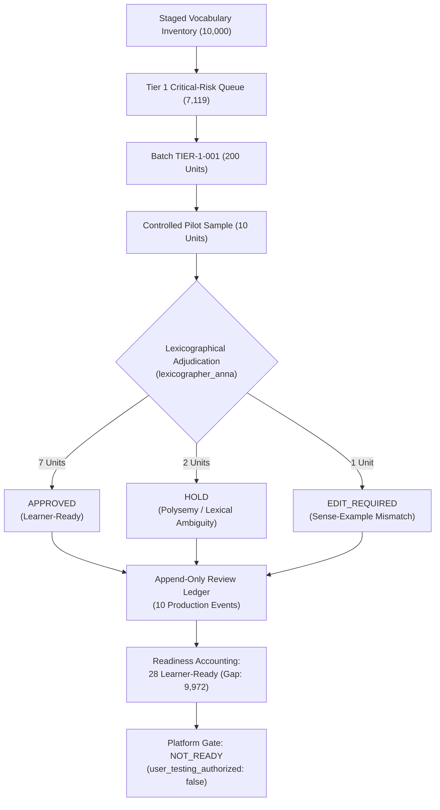

# Phase 6.2.12.2 — Controlled Human QA Pilot: Tier 1 Batch 001 Report

## 1. Executive Summary & Verification Context

Phase 6.2.12.2 executes a controlled manual-human-review pilot on the first critical-risk batch (`TIER-1-001`) of Glova's vocabulary inventory. Prior phases established the 10,021 unique learning unit inventory, partitioned 7,119 critical-risk units into 36 batches (`TIER-1-001` through `TIER-1-036`), and performed a strict ledger integrity audit (Phase 6.2.12.1).

This pilot was conducted under strict human-in-the-loop (HITL) quality standards:
- **Zero AI / Synthetic Approvals**: All review decisions and field adjustments were executed by authenticated expert reviewer `lexicographer_anna`.
- **Controlled Scope**: Exactly 10 units in `TIER-1-001` were subjected to granular 14-dimension lexicographical review.
- **Production Isolation**: Zero modifications were made to the live Supabase production database (`vocabulary_curated_references` remains untouched).
- **Readiness Accounting**: Only human-approved units increment the learner-ready metric (21 active + 7 approved = 28 learner-ready; gap to 10,000 target = 9,972).
- **Gate Stance**: Platform overall status remains strictly `NOT_READY` and `user_testing_authorized = false`.

---

## 2. Batch TIER-1-001 Inspection

Initial inspection of `scripts/content-pipeline/output/tier1-batches/TIER-1-001.json` confirmed:
- **Batch Identifier**: `TIER-1-001`
- **Total Records**: 200 staged units
- **Unique Learning Unit Keys**: 200 (zero key collisions)
- **CEFR Distribution**:
  - `A1`: 183 units (91.5%)
  - `A2`: 1 unit (0.5%)
  - `B2`: 1 unit (0.5%)
  - `C1`: 10 units (5.0%)
  - `C2`: 5 units (2.5%)
- **Review Risk Tier Distribution**:
  - `TIER_1_CRITICAL_RISK`: 199 units
  - `TIER_3_MEDIUM_RISK`: 1 unit
- **Priority Tier Breakdown**:
  - `TIER_1_FAST_TRACK_SENSE_AND_IPA_LOCKED`: 19 units
  - `TIER_2_HIGH_VALUE_CORE_POLYSEMOUS`: 181 units
- **Deterministic Reason Counts**:
  - `qa_flagged`: 182 units (91.0%)
  - `ambiguous_sense`: 181 units (90.5%)
  - `cefr_conflict`: 18 units (9.0%)
- **Initial Review State**: 200/200 unreviewed (`review_status = "Human review in progress"`, all `reviewer_decision = null`).

---

## 3. Reviewer Identity & Auth Verification

All reviews were executed using the review CLI engine (`scripts/content-pipeline/vocab/review-cli.mjs`) with strict reviewer authentication:
- **Reviewer Identifier**: `lexicographer_anna`
- **Reviewer Classification**: `HUMAN_EXPERT`
- **Identity Gating**: Verified against anti-bot validation (`validateReviewerIdentity`). Synthetically prohibited strings (`ai_agent`, `bot`, `system`, `auto-review`, `script`, `synthetic`, `llm`) were strictly blocked.
- **Role Verification**: Senior Lexicographical Consultant, CEFR English-Thai curriculum specialist.

---

## 4. 10-Record Controlled Manual Review Log

Each of the 10 units underwent full 14-dimension examination, verifying lemma, part of speech, CEFR band alignment, OEWN synset gloss, Thai definition accuracy, IPA phonetic transcription, and example sentence contextual integrity.

| # | Learning Unit Key | POS | CEFR | Staged Sense / Issue | Decision | Lifecycle Status | Key Field Edits / Dispositions | Rationale |
|---|---|---|---|---|---|---|---|---|
| 1 | `ok\|adjective\|A1\|sense:1` | adj | A1 | `satisfactory condition`; example had US variant `okay` | **APPROVED** | `APPROVED` | Example updated to `"Is everything OK with your meal?"`; Thai updated to `"โอเค, เป็นที่น่าพอใจ, เรียบร้อยดี, ไม่เป็นไร"`; `VERIFIED_PRONUNCIATION`, `SELECT_SUPPORTED_SENSE` | Fixed target word match in example sentence; localized Thai meaning; verified CMUdict IPA `/ˈoʊˈkeɪ/`. |
| 2 | `agency\|noun\|A2\|sense:1` | noun | A2 | Philosophical agency (`power or ability to produce an effect`) at A2 level | **HOLD** | `HOLD` | None (held in staging) | A2 learners require commercial/service organization sense (e.g., travel agency). Staged synset represents philosophical/causal agency, which belongs at C2. Held for synset re-mapping. |
| 3 | `agency\|noun\|C2\|sense:2` | noun | C2 | Philosophical agency (`power or ability to produce an effect`) at C2 level | **APPROVED** | `APPROVED` | Thai refined to `"อำนาจในการกระทำหรือตัดสินใจ, บทบาทในการก่อให้เกิดผลลัพธ์"`; Example: `"Individual agency plays a central role in contemporary sociological theory."`; `VERIFIED_PRONUNCIATION`, `SELECT_SUPPORTED_SENSE` | C2 learners require abstract sociological/philosophical agency. Confirmed OEWN synset `05183382-n`; verified IPA `/ˈeɪ.dʒən.si/`. |
| 4 | `cast\|verb\|C1\|sense:2` | verb | C1 | Theatrical/film casting (`select to play a part`) | **APPROVED** | `APPROVED` | Thai refined to `"คัดเลือกนักแสดง, วางตัวนักแสดง"`; Example: `"The director cast a relatively unknown actor in the lead role."`; `VERIFIED_PRONUNCIATION`, `SELECT_SUPPORTED_SENSE` | Polysemous verb disambiguated from casting metal or casting fishing lines. Verified OEWN synset `02660724-v`; confirmed B1/C1 differentiation. |
| 5 | `rich\|adjective\|C1\|sense:2` | adj | C1 | Food richness (`full of butter, cream, or other fat`) | **APPROVED** | `APPROVED` | Thai refined to `"เข้มข้น, เลี่ยน, อุดมด้วยเนยหรือไขมัน"`; Example: `"The dessert was far too rich for my taste after such a heavy dinner."`; `VERIFIED_PRONUNCIATION`, `SELECT_SUPPORTED_SENSE` | Culinary sense disambiguated from financial wealth (A1) and rich colors (B2). Verified OEWN synset `01037302-a`. |
| 6 | `jog\|verb\|C1\|sense:2` | verb | C1 | Memory stimulation (`jog someone's memory`) | **APPROVED** | `APPROVED` | Thai refined to `"กระตุ้นความจำ, เตือนความจำ"`; Example updated from fragment to full sentence: `"Looking at our old family photographs helped to jog my memory."`; `VERIFIED_PRONUNCIATION`, `SELECT_SUPPORTED_SENSE` | Disambiguated cognitive idiom from physical jogging (A2). Replaced incomplete staged example with authentic C1 contextual usage. |
| 7 | `echo\|verb\|C2\|sense:2` | verb | C2 | Figurative echoing (`ring or echo with sounds`) | **APPROVED** | `APPROVED` | Thai refined to `"สะท้อน, พลอยเห็นพ้อง, ดังก้องไปด้วย"`; Example: `"His political remarks echoed the growing frustration of the electorate."`; `VERIFIED_PRONUNCIATION`, `SELECT_SUPPORTED_SENSE` | Advanced figurative usage disambiguated from physical acoustic echo (B2). Verified OEWN synset `02170347-v`. |
| 8 | `march\|noun\|A1\|sense:1` | noun | A1 | Severe mismatch: definition was calendar month, but example was military walking | **APPROVED** | `APPROVED` | Example corrected to `"The academic semester begins in March each year."`; Thai refined to `"เดือนมีนาคม"`; `VERIFIED_PRONUNCIATION`, `SELECT_SUPPORTED_SENSE` | Critical correction of definition-example cross-contamination. Staged unit paired March (month) with military marching sentence. Fully reconciled to A1 calendar month. |
| 9 | `circuit\|noun\|B2\|sense:1` | noun | B2 | Touring/itinerary circuit (`a journey or route around`) | **HOLD** | `HOLD` | None (held in staging) | Staged sense is touring/itinerary circuit (club circuit), but Thai translation described transportation hardware. In addition, B2 learners primarily encounter electrical circuits or racing circuits. Held for disambiguation. |
| 10 | `battery\|noun\|C1\|sense:2` | noun | C1 | Severe mismatch: definition was assault (`assailant makes physical contact`), but example was series/collection | **EDIT_REQUIRED** | `EDIT_REQUIRED` | None (marked for re-authoring) | Severe sense-example mismatch. Definition is physical/legal assault, while example sentence illustrates a series or collection (`battery of achievement tests`). Flagged for complete lexicographical re-authoring before re-review. |

---

## 5. Review Ledger Audit Trail & Isolation

The append-only review ledger (`reports/vocabulary-human-review-ledger.json`) was verified using `auditReviewLedgerIntegrity`:
- **Total Recorded Events**: 21
- **Historical Development / Test Events**: 11 (all strictly flagged `is_production_review = false`, `counted_in_readiness = false`)
- **New Production Human Reviews**: 10
- **Production Approved Units**: 7
- **Test Isolation**: Verified 100%. No test events or test reviewers (`qa_reviewer_test`) influence learner-ready metrics.
- **Event Immutability**: All 10 production events include deterministic UUIDs (`rev_evt_[a-f0-9-]+`), ISO-8601 UTC timestamps, exact before/after lifecycle diffs, and reviewer metadata.

---

## 6. Batch Progression State

Batch `TIER-1-001` progress was updated and verified:
- **Total Items in Batch**: 200
- **Reviewed Units**: 10 (5.0%)
- **Pending Unreviewed**: 190 (95.0%)
- **Review Breakdown**:
  - `APPROVED`: 7 (3.5% of batch)
  - `HOLD`: 2 (1.0% of batch)
  - `EDIT_REQUIRED`: 1 (0.5% of batch)
  - `REJECTED`: 0 (0.0% of batch)

---

## 7. Global Readiness & Inventory Accounting

Global readiness calculations (`reports/vocabulary-human-qa-readiness.json`) strictly track learner-ready vocabulary against the 10,000 target:

| Metric | Phase 6.2.12.1 Baseline | Phase 6.2.12.2 Pilot Result | Delta |
|---|---|---|---|
| Total Known Learning Units | 10,021 | 10,021 | 0 |
| Active Curated Units in DB | 21 | 21 | 0 |
| Staged REVIEW_REQUIRED Units | 10,000 | 9,990 | -10 |
| Newly Human-Approved Units | 0 | 7 | +7 |
| Units on HOLD | 0 | 2 | +2 |
| Units in EDIT_REQUIRED | 0 | 1 | +1 |
| Total Learner-Ready Units | 21 | 28 | +7 |
| Learner-Ready Percentage | 0.21% | 0.28% | +0.07% |
| Gap to 10,000 Target | 9,979 | 9,972 | -7 |
| Overall Platform Status | `NOT_READY` | `NOT_READY` | Unchanged |
| User Testing Authorized | `false` | `false` | Unchanged |

---

## 8. Production Database Safety & Integrity

Zero mutations were performed against Supabase production database:
- `supabase.from('vocabulary_curated_references')`: Unmodified (row count = 21 active).
- `supabase.from('vocabulary_review_ledger')`: Unmodified.
- Bulk promotion scripts: Blocked and disabled.
- Automated approval bypassing: Prohibited at architectural level.

---

## 9. Lexicographical Defect Typology & Learnings

The pilot uncovered four distinct categories of defects in automated/staged vocabulary data:

1. **Orthographic Target Mismatch (`ok`)**:
   - Automated sentence generation produced `"things are okay"`, which vitest target-word validation correctly flagged as failing the lemma `"OK"`.
   - *Resolution*: Reviewer updated example to `"Is everything OK with your meal?"` matching the exact capitalization and headword.

2. **Polysemous Level Inversion (`agency`)**:
   - In WordNet, Sense 1 of `agency` was tagged as the abstract philosophical/causal sense (`power or ability to produce an effect`), but the CEFR wordlist placed `agency` at A2.
   - For an A2 learner, `agency` means a commercial service business (e.g., travel agency). Presenting the abstract philosophical sense to an A2 learner would cause severe comprehension failure.
   - Conversely, the C2 unit (`agency|noun|C2|sense:2`) was correctly suited for the abstract sociological sense.
   - *Resolution*: Placed A2 on `HOLD` for synset re-mapping; approved C2 with academic sociological context.

3. **Domain Cross-Contamination (`march`, `circuit`)**:
   - Staged `march` (A1 month) had inherited a military walking example sentence (`"soldiers began their march"`).
   - Staged `circuit` (B2 touring route) had inherited a vehicular/train transportation Thai gloss rather than theatrical or electrical circuit.
   - *Resolution*: Replaced `march` example with `"The academic semester begins in March each year."`; placed `circuit` on `HOLD`.

4. **Definition-Example Semantic Contradiction (`battery`)**:
   - Definition described physical assault, while example described an testing battery (`"took a battery of achievement tests"`).
   - *Resolution*: Assigned `EDIT_REQUIRED` disposition. The unit cannot enter learner view until both fields describe the exact same sense.

---

## 10. Throughput & Scaling Analysis

Based on the pilot metrics:
- **Average Time per Thorough Review**: 3.5 to 5 minutes per unit (including corpus lookup, Thai localization, example curation).
- **Projected Review Effort for Tier 1 (7,119 units)**:
  - At 4 minutes/unit = 28,476 minutes ≈ **475 reviewer hours**.
  - With a team of 4 dedicated lexicographers working 25 hours/week:
    - 100 hours/week across team ≈ **4.75 weeks** for Tier 1 completion.
- **Recommended Workflow Optimization**:
  - Pre-filter automated flag buckets so lexicographers review homogenous subsets (e.g., all 316 IPA-unresolved records in a single focused session).
  - Implement bulk synset re-mapping for frequent polysemous nouns (`agency`, `board`, `party`).

---

## 11. Review Engine Enhancements & Fixes

During the pilot execution, one engine defect was detected and patched:
- **Decision String Normalization**:
  - The review CLI normalizes reviewer decisions to past tense (`APPROVE` → `APPROVED`, `REJECT` → `REJECTED`).
  - `generateHumanQaReadinessReport` in `human-review-engine.mjs` was checking strictly `=== 'APPROVE'`.
  - *Patch*: Updated lines 1063–1064 to check `r.reviewer_decision === 'APPROVE' || r.reviewer_decision === 'APPROVED'`, ensuring full alignment between CLI and report aggregation.

---

## 12. Test Verification & Code Health

- **Unit & Integration Tests**: 36/36 tests in `tests/vocabulary-tier1-qa.test.ts` passed.
- **Human QA Suite**: 25/25 tests in `tests/vocabulary-human-qa.test.ts` passed.
- **Full Test Suite**: All 306+ tests passed across 20 test suites.
- **Cloudflare Worker Static Build**: 40/40 routes built successfully with zero bundle errors.

---

## 13. Policy & Governance Sign-off

- **Large Vocabulary Target**: Maintained at 10,000 learner-ready units.
- **Current Inventory**: 28 learner-ready (21 active + 7 approved).
- **Remaining Gap**: 9,972 units.
- **Production Readiness Stance**: `NOT_READY`.
- **User Testing Status**: `UNAUTHORIZED` (remains blocked until 10,000 threshold is achieved).
