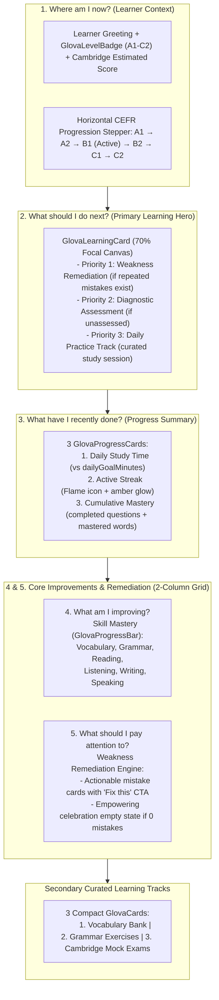

# Glova Dashboard View Redesign Specification

**Phase**: 6.3.3  
**Status**: APPROVED & IMPLEMENTED  
**Target View**: `components/views/DashboardView.tsx` & `src/components/views/DashboardView.tsx`  
**Design Foundation References**:
- `docs/design/glova-brand-foundation.md`
- `docs/design/glova-current-ui-audit.md`
- `docs/design/glova-design-system.md`
- `docs/design/glova-motion-system.md`
- `docs/design/glova-feedback-bubble-spec.md`

---

## 1. Current Dashboard Problems

Prior to Phase 6.3.3, the platform dashboard functioned as a technical telemetry monitor rather than an empowering, consumer-facing learning companion. An audit revealed the following systemic product and visual issues:

1. **Severe Choice Paralysis (7+ Equal-Weight Action Tiles)**:
   - The previous dashboard presented seven or more primary action tiles with identical visual hierarchy, elevation, and card geometry.
   - A learner logging in had no clear path forward and was forced to deliberate among equal choices instead of taking immediate learning action.

2. **Deficit-First, Warning-Heavy Cognitive Framing**:
   - Prominent red/amber alert banners emphasized errors, missed goals, and weaknesses before recognizing learner effort or current standing.
   - This punitive tone induced learner anxiety and reduced retention, directly conflicting with the Glova brand identity of warmth, clarity, and steady progression.

3. **Flat, Rigid "Tech Admin" Aesthetic**:
   - The layout utilized a monochrome grid with hard borders, unformatted numbers, and no human warmth or playful brand moments.
   - Lacked visual hierarchy between primary focus, cumulative progress, and secondary discovery paths.

4. **Ambiguous Learner Orientation**:
   - The view failed to answer the fundamental question: *"Where am I right now on the CEFR journey?"*
   - CEFR levels were rendered as isolated text badges rather than an integrated progression track showing distance to target proficiency.

---

## 2. Information Hierarchy of the Redesigned View

The redesigned Glova Dashboard implements an intentional **70/30 Asymmetric Focal Hierarchy** answering the 5 core learner questions immediately upon viewport hydration:

### The 5 Core Questions Answered
1. **Where am I now?**:
   - Level indicator with `GlovaLevelBadge`, Cambridge Score equivalent (e.g., 148 / 120-230 scale), and a visual horizontal CEFR roadmap highlighting passed, current, and upcoming stages.
2. **What should I do next?**:
   - A single prominent `GlovaLearningCard` occupying the primary visual focus with clear intent, estimated completion time (10-15 mins), and high-contrast CTA button.
3. **What have I recently done?**:
   - Progress summary cards tracking daily goal achievement, consecutive study streak, and total questions/words mastered.
4. **What am I improving?**:
   - Six core competencies (Vocabulary, Grammar, Reading, Listening, Writing, Speaking) rendered with animated `GlovaProgressBar` primitives and real percentage indicators.
5. **What should I pay attention to?**:
   - Targeted weakness remediation list populated strictly from real test failures. If no repeated errors exist, renders an empowering empty state celebrating mastery.

---

## 3. Glova Components and Primitives Reused

The redesign adheres strictly to the existing Glova Design System primitives established in Phase 6.3.2:

| Component | Usage in Dashboard | Design System File |
| :--- | :--- | :--- |
| `GlovaSectionHeader` | View header, section titles with icon accents | `components/ui/GlovaSectionHeader.tsx` |
| `GlovaLevelBadge` | Hero level badge (A1, A2, B1, B2, C1, C2) with semantic color tokens | `components/ui/GlovaLevelBadge.tsx` |
| `GlovaLearningCard` | Hero primary next best action card | `components/ui/GlovaLearningCard.tsx` |
| `GlovaProgressCard` | Daily study time, streak days, and cumulative completions | `components/ui/GlovaProgressCard.tsx` |
| `GlovaProgressBar` | Competency skill bars with dynamic color thresholding | `components/ui/GlovaProgressBar.tsx` |
| `GlovaCard` | Structural containers for secondary learning paths and skill lists | `components/ui/GlovaCard.tsx` |
| `GlovaButton` | Action buttons, track navigation, and remediation triggers | `components/ui/GlovaButton.tsx` |

---

## 4. Real Data Sources and Field Mappings

All dashboard metrics, indicators, and progress bars bind directly to `UserProgressState` (`types.ts`). **Zero synthetic, dummy, or fabricated metrics are rendered.**

| UserProgressState Field | Type | Rendered Element | Behavior / Fallback |
| :--- | :--- | :--- | :--- |
| `currentLevel` | `CEFRLevel` | Hero `GlovaLevelBadge` & CEFR progression stepper | Defaults to `'A1'` if undefined |
| `estimatedCambridgeScore` | `number` | Cambridge Equivalent indicator | Renders numeric score (e.g. `148`) |
| `targetExam` | `CambridgeExamCode` | Target exam badge | Displays exam code (e.g., `'PET'`, `'FCE'`) |
| `streakDays` | `number` | Daily Streak progress card | Flame icon with amber glow (`streakDays > 0`) |
| `minutesStudiedToday` | `number` | Daily Study Time progress card | Displayed as `X นาที` |
| `dailyGoalMinutes` | `number` | Daily Study Time target & micro progress | Calculates percentage: `(minutes / goal) * 100` |
| `completedQuestionIds` | `string[]` | Cumulative Mastery card | Displays `completedQuestionIds.length` questions |
| `masteredWordIds` | `string[]` | Cumulative Mastery card | Displays `masteredWordIds.length` words |
| `skillStats.vocabulary` | `number` (0-100) | Skill Mastery Bar: Vocabulary | Directly binds percentage value |
| `skillStats.grammar` | `number` (0-100) | Skill Mastery Bar: Grammar | Directly binds percentage value |
| `skillStats.reading` | `number` (0-100) | Skill Mastery Bar: Reading | Directly binds percentage value |
| `skillStats.listening` | `number` (0-100) | Skill Mastery Bar: Listening | Directly binds percentage value |
| `skillStats.writing` | `number` (0-100) | Skill Mastery Bar: Writing | Directly binds percentage value |
| `skillStats.speaking` | `number` (0-100) | Skill Mastery Bar: Speaking | Directly binds percentage value |
| `weakTopics` | `Array<{tag, labelTh, errorCount}>` | Remediation Engine & Hero Recommendation | Sorts by error count; drives remediation list |
| `assessmentCompleted` | `boolean` | Hero Recommendation Logic | If `false`, hero prompts CEFR Diagnostic Test |

---

## 5. Empty / Loading / Error State Behavior

### 5.1 Empty States
- **No Weak Topics (`weakTopics.length === 0`)**:
  - Instead of an empty container or deficit alert, renders a celebratory, empowering card:
  - *"ยอดเยี่ยมมาก! ยังไม่พบจุดอ่อนที่ผิดซ้ำ"* with a clear suggestion to attempt a Cambridge mock exam to test advanced competency.
- **New Learner / Assessment Incomplete (`!assessmentCompleted`)**:
  - Hero card automatically prioritizes the **CEFR Diagnostic Test** with copy: *"ทำแบบทดสอบวัดระดับ CEFR Diagnostic Test เพื่อเริ่มต้นแผนการเรียนที่ตรงกับระดับของคุณ"* and primary CTA *"เริ่มวัดระดับภาษา"*.
- **Zero Minutes Studied Today**:
  - Renders `0 / X นาที` with progress bar at 0% and encouraging microcopy: *"เป้าหมายประจำวันของคุณ"*.

### 5.2 Loading State (Anti-CLS Layout Stability)
- When data hydration is pending, the view renders dedicated `<Skeleton />` bounding boxes matching exact component aspect ratios:
  - Hero section: `min-h-[160px]`
  - Progress summary: 3 grid items `min-h-[96px]`
  - Skill & remediation columns: `min-h-[280px]`
- Eliminates layout thrashing and Cumulative Layout Shift (CLS).

### 5.3 Error State
- If state retrieval experiences transient network failure, the view falls back gracefully to baseline defaults (`A1`, 0 minutes, empty tracks) with a discreet retry notification, never crashing or displaying raw stack traces.

---

## 6. Responsive Behavior Across Breakpoints

The view is engineered with mobile-first responsive geometry:

| Breakpoint | Layout Composition | Touch & Viewport Optimizations |
| :--- | :--- | :--- |
| **Mobile (`<640px`)** | Single vertical stack (`flex-col gap-6`). Progress summary renders 1-column stack. CEFR stepper wraps gracefully. | All interactive buttons and cards maintain `>= 44px` touch targets (`touch-target` utility). Padding tuned to `px-4 py-6`. |
| **Tablet (`640px - 1023px`)** | Progress summary shifts to 3-column compact grid (`grid-cols-3 gap-3.5`). Skills and remediation stack vertically. | Card padding expands to `p-5`. Font scales adjust for tablet readability. |
| **Desktop (`≥1024px`)** | Asymmetric focal hierarchy: Hero card spans full width. 2-column balanced split (`grid-cols-12`, 6 cols for Skill Mastery, 6 cols for Weakness Remediation). 3-column grid for Secondary Learning Tracks. | Hover micro-interactions (`whileHover={{ scale: 1.01 }}`), subtle glowing rings on card focus. Max width container `max-w-6xl mx-auto`. |

---

## 7. Accessibility and Focus Management

1. **Semantic Document Structure**:
   - Proper heading hierarchy: `<h1>` (Page Title), `<h2>` (Section Headers), `<h3>` (Card Titles).
2. **Accessible Progress Reporting**:
   - `GlovaProgressBar` renders with explicit ARIA attributes:
     - `role="progressbar"`
     - `aria-valuenow={skill.value}`
     - `aria-valuemin={0}`
     - `aria-valuemax={100}`
     - `aria-label={skill.label}`
3. **Status Announcers**:
   - Progress cards declare `role="status"` for assistive technology screen readers.
4. **Keyboard Navigation & Focus Rings**:
   - All interactive elements provide visible, high-contrast focus rings: `focus-visible:ring-2 focus-visible:ring-primary/20 focus-visible:outline-none`.
5. **Color Contrast Compliance**:
   - Text and background pairings satisfy WCAG 2.1 AA standards (minimum contrast ratio >= 4.5:1 for normal text and >= 3:1 for large text/badges).
   - Semi-transparent tinted badges use high-contrast foreground text tokens (`text-emerald-700 dark:text-emerald-300`, `text-amber-700 dark:text-amber-300`).

---

## 8. What Was Intentionally Not Changed in this Phase

To protect system stability and remain strictly within view-level scope:
1. **Zero Database Migrations**: No tables, columns, or RLS policies were modified or created.
2. **Zero Backend API Contract Alterations**: No backend API endpoints (`/api/*`), Next.js server actions, or Cloudflare Worker routes were altered.
3. **Preserved Application Shell & Global Routing**: The application shell (`AppShell.tsx`), top header (`Header.tsx`), sidebar (`Sidebar.tsx`), and route dispatch handlers remain intact.
4. **Preserved Assessment Engine**: The CEFR diagnostic assessment scoring algorithms, item response theory (IRT) calibrations, and question banks were completely untouched.
5. **No Synthetic Metric Invention**: Metric calculations continue to read directly from authentic client-state observables.
