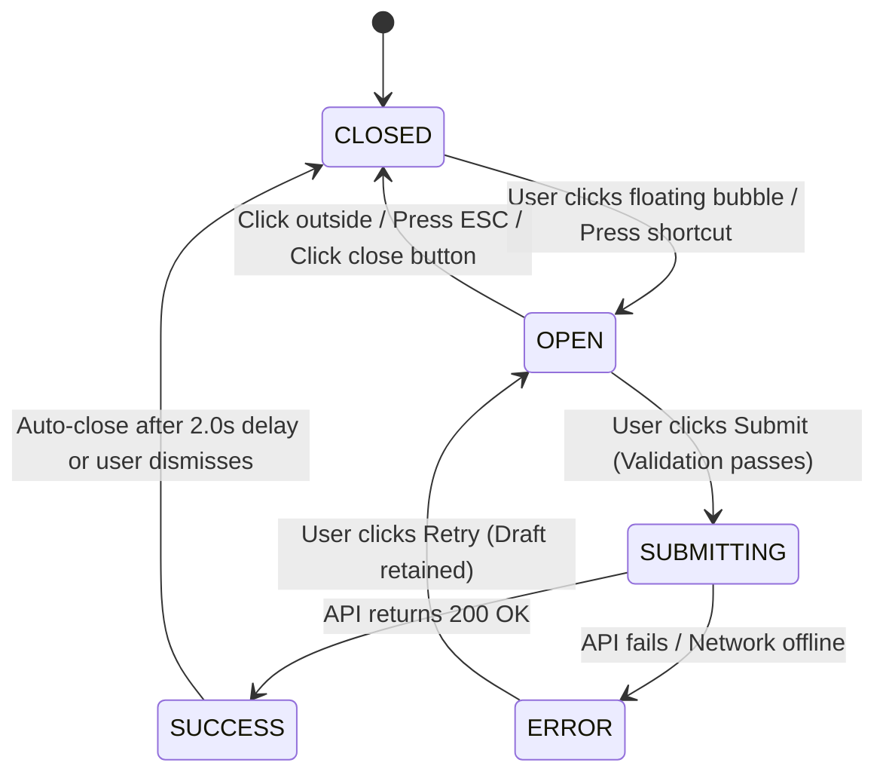

# Glova Feedback Bubble Specification & Client Contract

**Document Version:** 1.0.0  
**Phase:** 6.3.1 — Foundation Only  
**Target:** React 18, Next.js 15, Lucide React, Framer Motion  
**Author:** Principal UX Engineer & Accessibility Architect  

---

## 1. Overview & Purpose

The **Glova Feedback Bubble** is a persistent, non-intrusive, floating interface widget designed to close the feedback loop between learners and the Glova product/pedagogy team.

Learners often encounter vocabulary nuance questions, pronunciation glitches, typos, or UX friction. Rather than forcing them to navigate to a separate contact page (breaking their learning flow), the feedback bubble allows instant in-context reporting with zero friction and automated telemetry capture.

---

## 2. Floating Bubble Anatomy & Placement

```
[ Viewport Ergonomics: Bottom-Right Anchor ]

+-------------------------------------------------------------------+
| Content Area / Learning View                                      |
|                                                                   |
|                                                                   |
|                                               +-----------------+ |
|                                               | Feedback Dialog | |
|                                               | [Category]      | |
|                                               | [Message area]  | |
|                                               | [Submit]        | |
|                                               +-----------------+ |
|                                                        |          |
|                                                     [ ( ? ) ] <-- Floating Bubble
+-------------------------------------------------------------------+
```

### 2.1 Placement Invariants
- **Desktop (>= 768px):** Fixed at `bottom-6 right-6` (`24px` from bottom and right edges), `z-index: 50`.
- **Mobile (< 768px):** Fixed at `bottom-20 right-4` (`80px` from bottom to clear mobile bottom navigation and safe-area insets).
- **Physical Bounds:** `48px x 48px` circular container (`touch-target` compliant), nested `20px x 20px` Lucide `MessageSquareHeart` or `HelpCircle` icon.
- **Visual Styling:**
  - Background: Glassmorphic translucent slate (`bg-slate-900/90 backdrop-blur-md dark:bg-slate-900/95`).
  - Ring & Border: `ring-1 ring-primary/30 border border-white/10 shadow-lg`.
  - Micro-Interaction: `whileHover={{ scale: 1.08 }}`, `whileTap={{ scale: 0.94 }}`.

---

## 3. Compact Feedback Panel Contract

### 3.1 Category Taxonomy
Learners choose one of four distinct, non-overlapping categories:
1. `CONTENT_ERROR` ("เนื้อหา / คำศัพท์ / แปลผิด"): For typos, confusing translations, or audio errors.
2. `BUG` ("พบปัญหาการใช้งาน / Bug"): For layout glitches, button freezes, or loading errors.
3. `SUGGESTION` ("ข้อเสนอแนะ / ฟีเจอร์"): Ideas for new practice modes or UI improvements.
4. `PRAISE` ("ชมเชย / สิ่งที่ชอบ"): Positive affirmation of effective explanations or UI delight.

### 3.2 Automated Context Metadata
When a user submits feedback, the client automatically bundles non-sensitive operational telemetry, relieving the user of tedious manual explanations:
- `view`: Current active view identifier (e.g. `dashboard`, `vocabulary`, `mock-exam`).
- `exerciseId`: Active exercise UUID (if reporting within an exercise session).
- `cefrLevel`: The user's active CEFR tier (e.g. `B1`).
- `targetExam`: Selected target exam (e.g. `IELTS`, `TOEIC`).
- `viewport`: `{ width: number, height: number }` to identify device scale and layout bounds.
- `locale`: Active interface language (`th` or `en`).
- `timestamp`: ISO-8601 string.

---

## 4. State Machine & Lifecycle Transitions



### 4.1 State Descriptions
- `CLOSED`: Bubble rests quietly in bottom-right corner with subtle ambient glow.
- `OPEN`: Compact modal renders with focus trapped on category selector.
- `SUBMITTING`: Submit button transitions to spinner state; inputs are disabled to prevent duplicate posts.
- `SUCCESS`: Displays green confirmation badge (`ขอบคุณสำหรับความคิดเห็น! ทีมงาน Glova ได้รับแล้วครับ`) and smoothly auto-collapses.
- `ERROR`: Displays non-destructive error banner (`ไม่สามารถส่งข้อมูลได้ กรุณาลองใหม่อีกครั้ง`); input text remains intact in the textarea so user never loses their notes.

---

## 5. TypeScript Data Contract

```typescript
export type FeedbackCategory = 'CONTENT_ERROR' | 'BUG' | 'SUGGESTION' | 'PRAISE';

export type FeedbackState = 'CLOSED' | 'OPEN' | 'SUBMITTING' | 'SUCCESS' | 'ERROR';

export interface FeedbackSubmissionPayload {
  category: FeedbackCategory;
  rating?: number; // 1 to 5 scale
  message: string; // Trimmed string, min 3 chars, max 1000 chars
  includeMetadata: boolean;
  metadata: {
    url: string;
    view: string;
    exerciseId?: string;
    cefrLevel?: string;
    targetExam?: string;
    viewport: {
      width: number;
      height: number;
    };
    userAgent: string;
    locale: string;
    timestamp: string;
  };
}
```

---

## 6. Accessibility & WCAG Compliance Checklist

1. **Keyboard Trapping:** When `FeedbackState === 'OPEN'`, focus is strictly confined within the modal. Pressing `Tab` cycles through category chips, textarea, and submit button.
2. **Escape Key Dismissal:** Pressing `Escape` at any time closes the dialog and safely restores keyboard focus back to the floating bubble trigger.
3. **Screen Reader Semantics:**
   - Floating Trigger: `aria-expanded="false"`, `aria-haspopup="dialog"`, `aria-label="เปิดหน้าต่างส่งความคิดเห็น"`.
   - Open Modal: `role="dialog"`, `aria-modal="true"`, `aria-labelledby="feedback-dialog-title"`.
4. **Touch Target Size:** Floating button is `48px x 48px`, satisfying the 44px touch target invariant.
