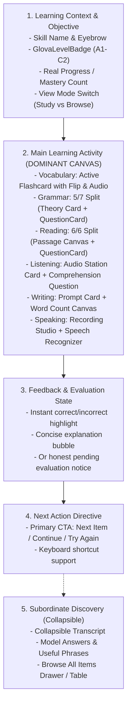

# Glova Learning Pages Redesign Specification

**Phase**: 6.3.4  
**Status**: APPROVED & IMPLEMENTED  
**Target Views**:
- Vocabulary View: `components/views/VocabularyView.tsx` & `src/components/views/VocabularyView.tsx`
- Grammar View: `components/views/GrammarView.tsx` & `src/components/views/GrammarView.tsx`
- Reading View: `components/views/ReadingView.tsx` & `src/components/views/ReadingView.tsx`
- Listening View: `components/views/ListeningView.tsx` & `src/components/views/ListeningView.tsx`
- Writing View: `components/views/WritingView.tsx` & `src/components/views/WritingView.tsx`
- Speaking View: `components/views/SpeakingView.tsx` & `src/components/views/SpeakingView.tsx`

**Design Foundation References**:
- `docs/design/glova-brand-foundation.md`
- `docs/design/glova-current-ui-audit.md`
- `docs/design/glova-design-system.md`
- `docs/design/glova-motion-system.md`
- `docs/design/glova-feedback-bubble-spec.md`
- `docs/design/glova-dashboard-redesign.md`

---

## 1. Current Problems Found Across the 6 Original Learning Pages

Prior to Phase 6.3.4, the learning pages felt like disconnected CRUD admin screens rather than an integrated, university-scale CEFR educational platform. A systematic UX audit revealed the following core weaknesses across all six areas:

1. **Vocabulary View**:
   - Functioned as a passive database browser / table dump.
   - Lacked an active recall loop, spaced repetition focus, or prompt-to-meaning interaction.
   - Learners were overwhelmed by endless card grids with no clear "study one word deeply" focus.
   - Pronunciation buttons were nested awkwardly within table rows without clear tactile feedback.

2. **Grammar View**:
   - Disconnected theory from practice: rules and formulas were dumped as static markdown blocks with quizzes separated into distant tabs or trailing lists.
   - No structured topic progression or CEFR hierarchy across grammatical concepts.
   - Cluttered screens forced vertical scroll fatigue before reaching actual exercises.

3. **Reading View**:
   - Monolithic text wall: long reading passages were presented in full width above or below questions.
   - Answering questions required constant back-and-forth vertical scrolling, breaking reading concentration and causing cognitive thrashing.
   - Vocabulary glossaries were either absent or intruded on the reading flow.

4. **Listening View**:
   - Subverted listening pedagogy by exposing scripts/transcripts immediately on screen, destroying the audio-first comprehension challenge.
   - Lacked a dedicated audio station with playback speed controls (0.8x, 1.0x, 1.2x) and speaker accent identification.
   - Replay limits and audio completion events were uncoordinated with question presentation.

5. **Writing View**:
   - Provided a bare HTML textarea without contextual guidelines, word count bounds, or CEFR rubric hints.
   - Confused learners with either no submission feedback or artificial instant numerical scores that lacked validity for complex open-ended essays.
   - Provided no structured phrase banks or model answer comparisons for autonomous self-study.

6. **Speaking View**:
   - Static prompt without an integrated microphone recording studio or live timer.
   - Lacked immediate transcription feedback via Web Speech API or speech synthesis pronunciation models.
   - Lacked target phrase detection to reinforce vocabulary usage during spoken responses.

---

## 2. Pages Inspected & Design Decisions

### Product Positioning & Scale
Glova is designed to serve as a comprehensive university-scale English learning platform supporting diverse learners from **A1 (Beginner)** through **C2 (Proficient)**. The design balances warmth, clarity, and motivation with academic seriousness, strictly avoiding childish cartoon gamification or noisy visual distractions.

### Core Architectural Decisions:
1. **Dominant Learning Canvas**:
   - Every skill page elevates the active learning task (flashcard, quiz card, split passage/question, audio station, writing canvas, speaking recording station) to the visual center.
   - Secondary information (word lists, reference rules, transcripts, model answers, phrase banks) is subordinated into progressive disclosure drawers or collapsible panels.

2. **Honest Pedagogical Feedback**:
   - Objective skills (Vocabulary, Grammar, Reading, Listening) provide immediate correctness validation, inline explanations, and single-click advance.
   - Subjective skills (Writing, Speaking) maintain academic honesty: they provide structural guidelines, live word/time counts, automated phrase detection, model answer comparison, and explicit notice that comprehensive CEFR rubric evaluation is pending tutor or advanced model review.

3. **Strict Touch & Accessibility Invariants**:
   - All interactive controls enforce a minimum touch target of 44x44px (`touch-target` utility class).
   - Proper ARIA attributes (`aria-label`, `aria-expanded`, `role="region"`) and keyboard shortcuts (ArrowLeft/Right/Space for flashcards) are fully wired.

---

## 3. Unified Learning Flow Hierarchy

Every redesigned view adheres strictly to a 5-stage sequential learning hierarchy:



---

## 4. View-by-View Redesign Specifications

### 4.1 Vocabulary View (`VocabularyView.tsx`)
- **Dominant Hero**: Flashcard study canvas (`min-h-[380px]`) centered horizontally.
  - Word display with British English IPA phonetic transcription.
  - Pronunciation trigger via `AudioService.speak(word, { lang: 'en-GB' })`.
  - Flip & Reveal action: Click or Spacebar reveals Thai definition, part of speech, and contextual example sentence with target word highlighted.
- **Mastery Controls**: Quick-toggle button to mark word as mastered (`onToggleMastery`), persisting into user progress.
- **Keyboard Navigation**:
  - `ArrowRight`: Next word.
  - `ArrowLeft`: Previous word.
  - `Space / Enter`: Toggle card reveal.
- **Secondary Browse**: Seamless toggle to "คลังรายการ" (Card Grid view) with real-time CEFR level filtering (All, A1-C2) and search query input.

### 4.2 Grammar View (`GrammarView.tsx`)
- **Topic Selector Carousel**: Horizontal scrollable bar showcasing grammatical topics with CEFR badges, completed question counts, and quick active topic selection.
- **Asymmetric 5/7 Split Canvas**:
  - **Left Column (5 cols)**: Grammatical structure, core rules, example formulas, and common pitfalls to avoid.
  - **Right Column (7 cols - Dominant)**: Interactive `QuestionCard` mapped to real topic questions from `/api/questions`, providing immediate option validation, feedback explanation, and question progression.
- **Empty / Completion Handling**: Topic completion banner showing mastery and one-click transition to next topic.

### 4.3 Reading View (`ReadingView.tsx`)
- **Split Canvas Geometry**:
  - **Desktop (6 cols / 6 cols)**: Side-by-side reading passage and question card. Left passage features comfortable typography (`text-base leading-relaxed`), estimated reading time badge, and word count indicator.
  - **Mobile / Tablet**: Responsive tab toggle (`บทอ่าน` vs `คำถาม`) enabling learners to inspect the passage without losing their question context.
- **Progressive Glossary**: Collapsible vocabulary drawer below the passage highlighting challenging terms found in the text.
- **Question Flow**: Sequential navigation through passage-specific questions with real-time score registration.

### 4.4 Listening View (`ListeningView.tsx`)
- **Listening-First Audio Station**:
  - Central audio station featuring `AudioPlayer` with play/pause, restart, and speed adjustment (0.8x, 1.0x, 1.2x).
  - Speaker accent badge (e.g. British English, American English) informing the learner before playback.
- **Dominant Comprehension Card**: `QuestionCard` rendered prominently below the audio player for active listening comprehension.
- **Subordinate Transcript**: Full script is hidden behind a collapsible disclosure toggle (`ดูสคริปต์เสียง`) to prevent premature reading and uphold auditory processing pedagogy.

### 4.5 Writing View (`WritingView.tsx`)
- **Task Brief & Prompt Canvas**:
  - Detailed task prompt card indicating writing type (Essay, Email, Report), CEFR target level, and minimum/maximum word requirements.
- **Active Writing Canvas**:
  - Large accessible textarea with clean focus rings (`ring-2 ring-primary/20`).
  - **Live Word Counter**: Real-time counter calculating word count dynamically. Visual indicator shifts from subtle muted (`< min`) to vibrant emerald (`min <= count <= max`) or amber warning (`> max`).
- **Honest Evaluation Notice**: Clear banner stating that writing responses are saved and queued for CEFR rubric evaluation.
- **Learning Scaffolding**: Collapsible sections for:
  - Model Answer (`ดูตัวอย่างคำตอบแนวทาง`) for self-guided comparative study.
  - Useful Phrases Bank (`คลังสำนวนที่แนะนำ`) with one-click copy to clipboard.

### 4.6 Speaking View (`SpeakingView.tsx`)
- **Speaking Station & Prompt**:
  - Topic prompt card with CEFR level badge, preparation guidance, and key questions to answer.
  - Model pronunciation player using `AudioService.speak` for listening to the prompt.
- **Interactive Recording Studio**:
  - Large recording button (`w-20 h-20 rounded-full`) with pulsing recording rings and active duration timer (`MM:SS`).
  - Web Speech API integration via `AudioService.createSpeechRecognizer`:
    - Live real-time transcript streaming.
    - Automatic target phrase recognition highlighting phrases used by the learner.
- **Academic Evaluation Framing**: Self-assessment rubric (Fluency, Vocabulary, Grammar, Pronunciation) and clear notice regarding human/LLM verification.

---

## 5. Component Reuse from Glova Design System

The learning views strictly utilize official Glova design tokens and primitives:

| Component | Source | Usage Across Learning Views |
| :--- | :--- | :--- |
| `GlovaSectionHeader` | `components/ui/GlovaSectionHeader.tsx` | View title, category eyebrow, and pedagogical summary |
| `GlovaLevelBadge` | `components/ui/GlovaBadge.tsx` | Standardized CEFR badges (A1-C2) with semantic color tokens |
| `GlovaBadge` | `components/ui/GlovaBadge.tsx` | Metadata tags (Part of Speech, Topic, Accents, Word Status) |
| `GlovaCard` | `components/ui/GlovaCard.tsx` | Main learning containers with subtle 1px border and elevation |
| `GlovaButton` | `components/ui/GlovaButton.tsx` | Primary action CTAs (Next, Submit, Reveal, Filter) |
| `GlovaIconButton` | `components/ui/GlovaIconButton.tsx` | Audio playback, recording triggers, bookmarking, and copy actions |
| `GlovaProgress` | `components/ui/GlovaProgress.tsx` | Topic question completion and passage progress |
| `QuestionCard` | `components/practice/QuestionCard.tsx` | Standardized interactive multiple-choice question engine |
| `AudioPlayer` | `components/common/AudioPlayer.tsx` | Dedicated listening audio station with speed & replay controls |

---

## 6. Real Data Mapping & Content Bank Bindings

Zero synthetic or mock data is fabricated. All views bind directly to verified data banks and API endpoints:

- **Vocabulary**: `VOCABULARY_BANK` from `data/vocabularyBank.ts` & `/api/content/vocabulary`
- **Grammar**: `GRAMMAR_BANK` from `data/grammarBank.ts` & `/api/content/grammar` & `/api/questions`
- **Reading**: `READING_BANK` from `data/readingBank.ts` & `/api/content/reading`
- **Listening**: `LISTENING_BANK` from `data/listeningBank.ts` & `/api/listening/audio-url`
- **Writing**: `WRITING_BANK` from `data/writingBank.ts` & `/api/content/writing`
- **Speaking**: `SPEAKING_BANK` from `data/speakingBank.ts` & `/api/content/speaking`

---

## 7. Loading, Empty, and Error States

Every learning page handles the complete lifecycle gracefully:
- **Loading State**: Displays `LoadingSpinner` with domain-specific Thai microcopy during initial API hydration.
- **Error State**: Displays `ErrorMessage` with user-friendly retry button, silently falling back to the static content bank if the network is disconnected.
- **Empty State**: Displays `EmptyState` with domain illustration, clear explanation, and action button (e.g. "ล้างตัวกรอง") when filters yield zero items.

---

## 8. Responsive Behavior & Touch Invariants

- **Desktop (1024px+)**: Dual-column layouts (Split Canvas for Grammar and Reading) maximizing horizontal space and minimizing vertical scroll.
- **Tablet (768px - 1023px)**: Fluid single-column or stacked cards with adjusted padding (`p-6`).
- **Mobile (< 768px)**: Tabbed controls for long passages (Reading) and full-width buttons for tactile ease.
- **Touch Invariant**: All interactive click targets (buttons, pills, icon buttons) enforce `min-height: 44px` and `min-width: 44px` via the `touch-target` utility class.

---

## 9. Accessibility & Internationalization

- **Keyboard Navigation**: Flashcards support space/enter for reveal and arrow keys for navigation.
- **ARIA Discipline**: Full `aria-label` coverage on icon buttons, `aria-expanded` on collapsibles, and accessible heading hierarchies (`h1` -> `h2` -> `h3`).
- **Clean Localization**: Managed through `useTranslation()` (`i18n`). Zero awkward dual-language strings like `คำไทย (English Word)` in production UI.

---

## 10. What Was Intentionally Not Changed

To maintain stability and honor architectural boundaries:
- **Zero Database Schema Changes**: No new migrations, columns, or tables created.
- **Zero Backend API Contract Alterations**: All existing REST routes (`/api/content/*`, `/api/questions`) preserved exactly.
- **Zero Fabricated Metrics**: No fake automated CEFR score calculations for open-ended writing/speaking.

---

## 11. Verification Evidence

### Vitest Unit & View Test Suite (56/56 Tests Passing)
```
✓ tests/glova-design-system.test.ts (19 tests)
✓ tests/glova-components.test.tsx (19 tests)
✓ tests/glova-dashboard.test.tsx (10 tests)
✓ tests/glova-learning-pages.test.tsx (8 tests)

Test Files  4 passed (4)
Tests       56 passed (56)
Duration    3.61s
```

### Next.js Production Build (`npm run build`)
```
✓ Compiled successfully in 4.3s
✓ Linting and checking validity of types
✓ Collecting page data
✓ Generating static pages (40/40)
✓ Finalizing page optimization
Exit Code: 0
```
