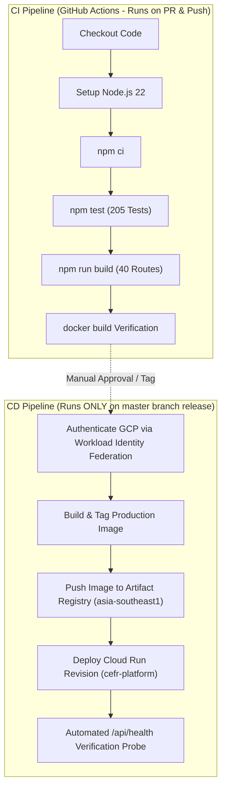

# Phase 6.2 — Google Cloud Run Deployment Configuration Plan

**Document Version**: 1.0.0  
**Status**: DRAFT / CONFIGURATION ONLY (No resources deployed)  
**Target Environment**: Production  
**Target Runtime**: Google Cloud Run (Fully Managed Container Platform)  
**Associated Commit Baseline**: `e6d4a17`  
**Test Suite Status**: 205/205 passing across 15 suites  
**Build Status**: 40/40 routes compiled in Next.js 15 standalone mode  
**Container Status**: `cefr-platform:1.0.0` (352MB, Node 22 Alpine, unprivileged `nextjs` user, healthy IPv4 probe)

---

## 1. GCP Project & Account Identity

- **Project ID**: `<GCP_PROJECT_ID>` (Configured via `gcloud config set project <PROJECT_ID>`)
- **Project Number**: `<GCP_PROJECT_NUMBER>`
- **Deployment Admin Identity**: Principal user or deployment engineer authenticated via `gcloud auth login`
- **Execution Mode**: Strict configuration planning. Zero deployment commands executed in Phase 6.2.

---

## 2. Target Region Selection

- **Primary Deployment Region**: `asia-southeast1` (Singapore)
- **Technical Justification**:
  1. **Supabase Proximity**: The active Supabase project (`atmatooytieelwiarffp.supabase.co`) is hosted in the Southeast Asia (Singapore) cloud region. Placing Cloud Run in `asia-southeast1` minimizes network round-trip time (RTT) for database queries, Auth token checks, and Storage uploads to ~5–15ms.
  2. **End-User Latency**: Optimizes response times for students and language learners in Thailand and Southeast Asia.
  3. **Service Availability**: `asia-southeast1` supports all required Google Cloud features: Cloud Run Gen2, Artifact Registry, Secret Manager, and Cloud Armor.

---

## 3. Required GCP Resources & Inventory

The architecture enforces the principle of minimal resource footprint. Exactly 4 core GCP resources are required:

| Resource Type | Resource Name | Region | Status | Required IAM Roles / Permissions |
| :--- | :--- | :--- | :--- | :--- |
| **Artifact Registry** | `cefr-platform-repo` | `asia-southeast1` | To Create | `roles/artifactregistry.reader` (Cloud Run Agent), `roles/artifactregistry.writer` (Deployer) |
| **Runtime Service Account** | `cefr-platform-runner` | Global | To Create | `roles/secretmanager.secretAccessor` (Scoped to Supabase secret) |
| **Secret Manager Secret** | `cefr-supabase-service-role-key` | Automatic / Global | To Create | Accessible only by `cefr-platform-runner` |
| **Cloud Run Service** | `cefr-platform` | `asia-southeast1` | To Create | `roles/run.invoker` granted to `allUsers` (Public Web App) |

*Optional Future CI/CD Identity*:
- **Workload Identity Pool**: `github-actions-pool`
- **Workload Identity Provider**: `github-actions-provider`
- **Deployer Service Account**: `cefr-platform-deployer@<GCP_PROJECT_ID>.iam.gserviceaccount.com`

---

## 4. Resource Naming Conventions

All resource identifiers follow standard kebab-case naming tied to the project namespace:

- **Artifact Registry Repo**: `cefr-platform-repo`
- **Container Image URI**: `asia-southeast1-docker.pkg.dev/<GCP_PROJECT_ID>/cefr-platform-repo/cefr-platform:<TAG>`
- **Runtime Service Account**: `cefr-platform-runner@<GCP_PROJECT_ID>.iam.gserviceaccount.com`
- **Deployer Service Account**: `cefr-platform-deployer@<GCP_PROJECT_ID>.iam.gserviceaccount.com`
- **Secret Manager Secret ID**: `cefr-supabase-service-role-key`
- **Cloud Run Service Name**: `cefr-platform`

---

## 5. Cloud Run Runtime Configuration

The configuration parameters map directly to the empirical characteristics of the standalone container built in Phase 6.1.1:

```yaml
service: cefr-platform
region: asia-southeast1
template:
  metadata:
    annotations:
      run.googleapis.com/execution-environment: gen2
      autoscaling.knative.dev/minScale: "0"
      autoscaling.knative.dev/maxScale: "5"
  spec:
    serviceAccountName: cefr-platform-runner@<GCP_PROJECT_ID>.iam.gserviceaccount.com
    timeoutSeconds: 300
    containerConcurrency: 80
    containers:
    - image: asia-southeast1-docker.pkg.dev/<GCP_PROJECT_ID>/cefr-platform-repo/cefr-platform:latest
      ports:
      - name: http1
        containerPort: 3000
      resources:
        limits:
          cpu: "1"
          memory: "1Gi"
      startupProbe:
        httpGet:
          path: /api/health
          port: 3000
        initialDelaySeconds: 5
        periodSeconds: 10
        failureThreshold: 3
        timeoutSeconds: 5
      livenessProbe:
        httpGet:
          path: /api/health
          port: 3000
        periodSeconds: 30
        failureThreshold: 3
        timeoutSeconds: 5
```

### Critical Operational Dimensions

1. **Memory Allocation (1 GiB)**:
   - Next.js 15 standalone baseline RSS: ~150–220 MB.
   - Audio buffer processing: Up to 10 MB per audio submission parsed via `FormData` in `/api/speaking/upload`.
   - 1 GiB provides ample headroom for concurrent audio uploads without triggering container OOM restarts.
2. **CPU Allocation (1 vCPU)**:
   - Request-driven CPU virtualization (`--cpu-throttling` enabled) ensures zero CPU billing during idle intervals.
3. **Payload Handling & Ingress Limits**:
   - Cloud Run HTTP request body limit is **32 MB**, fully accommodating the 10 MB raw audio files (~13.5 MB base64 encoded) handled by `/api/speaking/upload`.
4. **Concurrency (80)**:
   - Leverages Node.js non-blocking asynchronous event loop for high I/O throughput.
5. **In-Memory Rate Limiter Behavior**:
   - The token bucket limiter (`api/_lib/rate-limit/rate-limiter.ts`) runs in-memory per container instance.
   - Each instance independently enforces the 60 requests/minute limit per client IP. This provides robust defense against DoS while gracefully accommodating traffic across scaled instances.

---

## 6. Environment Variable Mapping

Environment variables are partitioned strictly according to security boundaries:

| Variable Name | Classification | Injection Method | Purpose |
| :--- | :--- | :--- | :--- |
| `NEXT_PUBLIC_SUPABASE_URL` | Public Client | Cloud Run Env Var (`--set-env-vars`) | Supabase project API gateway |
| `NEXT_PUBLIC_SUPABASE_PUBLISHABLE_KEY` | Public Client | Cloud Run Env Var (`--set-env-vars`) | Browser client Supabase token |
| `SUPABASE_SERVICE_ROLE_KEY` | **Secret Server** | **Secret Manager** (`--set-secrets`) | Admin Supabase operations & storage upload |
| `APP_URL` | Server Config | Cloud Run Env Var (`--set-env-vars`) | Canonical application domain for CORS & Auth |
| `PORT` | Server Config | Default / Injected (`3000`) | Listening port inside container |
| `HOSTNAME` | Server Config | Docker Default (`0.0.0.0`) | Network interface binding |
| `NODE_ENV` | Server Config | Docker Default (`production`) | Production runtime optimization |
| `NEXT_TELEMETRY_DISABLED` | Server Config | Docker Default (`1`) | Telemetry disabling |

> [!CAUTION]
> Under zero circumstances should `SUPABASE_SERVICE_ROLE_KEY` be injected via `--set-env-vars`. It must be mounted exclusively through Secret Manager via `--set-secrets`.

---

## 7. Secret Handling Plan

1. **Storage**:
   - Secret created in Google Cloud Secret Manager under the ID `cefr-supabase-service-role-key`.
   - Populated from the verified local `.env.local` without echoing the plaintext value to console or files.
2. **Access Control**:
   - Granted exclusively to `cefr-platform-runner@<GCP_PROJECT_ID>.iam.gserviceaccount.com` using `roles/secretmanager.secretAccessor`.
   - No individual developer or default service account needs read access once deployed.
3. **Mounting**:
   - Mounted into Cloud Run revision using:
     `--set-secrets=SUPABASE_SERVICE_ROLE_KEY=cefr-supabase-service-role-key:latest`
   - Available to `server.js` as `process.env.SUPABASE_SERVICE_ROLE_KEY`.

---

## 8. Supabase Production Integration Checklist

Before directing production traffic to the Cloud Run service, the following settings in the Supabase Dashboard (`atmatooytieelwiarffp`) must be configured:

- [ ] **Site URL**:
  - Update `Authentication -> URL Configuration -> Site URL` to the production Cloud Run URL (e.g., `https://cefr-platform-xxxx-as.a.run.app` or custom domain).
- [ ] **Redirect URLs**:
  - Add `https://<PRODUCTION_DOMAIN>/auth/callback` to the Allow List.
  - Retain `http://localhost:3000/**` for local staging/development.
- [ ] **CORS Origins**:
  - Add `https://<PRODUCTION_DOMAIN>` to API allowed origins.
- [ ] **Storage Buckets State**:
  - `audio-listening`: Verified `public = true`, MIME restricted to `audio/*`, max file size 25MB.
  - `audio-speaking-submissions`: Verified `public = false`, MIME restricted to audio types, max file size 10MB.
- [ ] **Database Connection Pooling**:
  - Ensure API handlers continue using `@supabase/ssr` / HTTPS PostgREST gateway, avoiding direct port 5432 connection exhaustion during Cloud Run scaling.

---

## 9. Artifact Registry Configuration

- **Repository Format**: Docker
- **Repository Mode**: Standard
- **Location**: `asia-southeast1`
- **Cleanup Policy**: Retain the 10 most recent tagged images; prune untagged images older than 14 days to eliminate storage waste.
- **Docker Authentication Command**:
  ```bash
  gcloud auth configure-docker asia-southeast1-docker.pkg.dev
  ```

---

## 10. Future CI/CD Architecture (GitHub Actions)

The deployment pipeline is designed with a strict boundary between CI and CD:



### Workload Identity Federation (WIF) Configuration (Keyless)
To eliminate long-lived service account JSON keys from GitHub:
1. Create Workload Identity Pool: `github-actions-pool`
2. Create Workload Identity Provider: `github-actions-provider`
3. Map GitHub repository claim: `attribute.repository == "fframe53-org/cefr_platform"`
4. Bind service account: `cefr-platform-deployer@<GCP_PROJECT_ID>.iam.gserviceaccount.com`

---

## 11. Security Considerations

1. **Container Hardening**:
   - Docker image runs as unprivileged user `nextjs` (UID 1001, GID 1001). Root filesystem execution is disallowed.
2. **Network Isolation**:
   - Next.js server binds to `0.0.0.0:3000`. Health probes target `127.0.0.1:3000`.
   - Security headers enforced: Strict CSP, `X-Content-Type-Options: nosniff`, `X-Frame-Options: DENY`, `Referrer-Policy: strict-origin-when-cross-origin`, HSTS.
3. **Secret Hygiene**:
   - Zero secrets embedded in container layers or GitHub repository.
   - Secret Manager handles runtime decryption directly into container memory.
4. **Rate Limiting**:
   - In-memory rate limiting shields all `/api/*` routes against brute force and automated scraping.

---

## 12. Cost-Control Guardrails

1. **Scale-to-Zero (`minScale: 0`)**:
   - Instances terminate during periods of inactivity. Zero idle billing.
2. **Instance Cap (`maxScale: 5`)**:
   - Hard upper bound prevents unexpected billing spikes during traffic anomalies.
3. **Request-Based CPU Allocation**:
   - CPU is only allocated and billed while processing active HTTP requests.
4. **Free Tier Maximization**:
   - Google Cloud provides 2,000,000 free Cloud Run requests/month, 360,000 GB-seconds memory, and 180,000 vCPU-seconds.
5. **GCP Budget Alert**:
   - Recommended budget alert set at \$10 and \$25 thresholds with immediate email alerts.

---

## 13. Preconditions Before Execution

Before executing any deployment command, the following must be verified:

1. [ ] Google Cloud SDK (`gcloud`) installed on operator machine.
2. [ ] User authenticated with `gcloud auth login`.
3. [ ] Target GCP project selected and billing enabled.
4. [ ] Required Google Cloud APIs enabled:
   - `run.googleapis.com`
   - `artifactregistry.googleapis.com`
   - `secretmanager.googleapis.com`
   - `iamcredentials.googleapis.com`
5. [ ] Supabase credentials available locally in `.env.local`.

---

## 14. Exact Deployment Command Plan (Reference Only — Do NOT Run in Phase 6.2)

### Step A: Set Project & Enable APIs
```bash
gcloud config set project <GCP_PROJECT_ID>

gcloud services enable \
  run.googleapis.com \
  artifactregistry.googleapis.com \
  secretmanager.googleapis.com \
  iam.googleapis.com
```

### Step B: Create Artifact Registry Repository
```bash
gcloud artifacts repositories create cefr-platform-repo \
  --repository-format=docker \
  --location=asia-southeast1 \
  --description="CEFR English Preparation Platform Docker repository"
```

### Step C: Create Runtime Service Account & Permissions
```bash
gcloud iam service-accounts create cefr-platform-runner \
  --display-name="CEFR Platform Cloud Run Runner"

# Create Secret in Secret Manager
gcloud secrets create cefr-supabase-service-role-key \
  --replication-policy="automatic"

# Add secret version (piped securely from .env.local without console echo)
# powershell:
# Get-Content .env.local | Select-String "SUPABASE_SERVICE_ROLE_KEY=" | ... | gcloud secrets versions add cefr-supabase-service-role-key --data-file=-

# Grant Secret Accessor role to the runner service account
gcloud secrets add-iam-policy-binding cefr-supabase-service-role-key \
  --member="serviceAccount:cefr-platform-runner@<GCP_PROJECT_ID>.iam.gserviceaccount.com" \
  --role="roles/secretmanager.secretAccessor"
```

### Step D: Build, Tag & Push Image
```bash
# Configure Docker credential helper
gcloud auth configure-docker asia-southeast1-docker.pkg.dev

# Build and tag
docker build --provenance=false -t asia-southeast1-docker.pkg.dev/<GCP_PROJECT_ID>/cefr-platform-repo/cefr-platform:1.0.0 .
docker tag asia-southeast1-docker.pkg.dev/<GCP_PROJECT_ID>/cefr-platform-repo/cefr-platform:1.0.0 asia-southeast1-docker.pkg.dev/<GCP_PROJECT_ID>/cefr-platform-repo/cefr-platform:latest

# Push
docker push asia-southeast1-docker.pkg.dev/<GCP_PROJECT_ID>/cefr-platform-repo/cefr-platform:1.0.0
docker push asia-southeast1-docker.pkg.dev/<GCP_PROJECT_ID>/cefr-platform-repo/cefr-platform:latest
```

### Step E: Deploy to Cloud Run
```bash
gcloud run deploy cefr-platform \
  --image=asia-southeast1-docker.pkg.dev/<GCP_PROJECT_ID>/cefr-platform-repo/cefr-platform:latest \
  --region=asia-southeast1 \
  --platform=managed \
  --allow-unauthenticated \
  --service-account=cefr-platform-runner@<GCP_PROJECT_ID>.iam.gserviceaccount.com \
  --port=3000 \
  --cpu=1 \
  --memory=1Gi \
  --min-instances=0 \
  --max-instances=5 \
  --concurrency=80 \
  --timeout=300 \
  --execution-environment=gen2 \
  --set-env-vars="NEXT_PUBLIC_SUPABASE_URL=https://atmatooytieelwiarffp.supabase.co,NEXT_PUBLIC_SUPABASE_PUBLISHABLE_KEY=sb_publishable_...,APP_URL=https://cefr-platform-service.run.app,NODE_ENV=production,NEXT_TELEMETRY_DISABLED=1" \
  --set-secrets="SUPABASE_SERVICE_ROLE_KEY=cefr-supabase-service-role-key:latest"
```

### Step F: Verify Deployment
```bash
# Probe production healthcheck
curl -s -i https://<ASSIGNED_URL>/api/health
```
