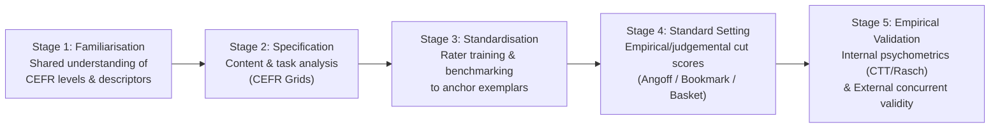

# Phase 6.2.6 — Assessment Standards Research & CEFR Alignment Specification

- **Date**: 2026-09-26
- **Phase**: 6.2.6 (Research + Specification Only — Zero Code / Zero Schema / Zero Seed Changes)
- **Status**: **`EVIDENCE BASE ESTABLISHED — PRODUCT & ASSESSMENT DESIGN DECISIONS REQUIRED`**

> [!IMPORTANT]
> **Non-Overclaiming & Governance Principle**: The Council of Europe explicitly states that the Common European Framework of Reference for Languages (CEFR) is a descriptive reference framework, **not** a test or certification body, and that the Council of Europe does not validate or certify the link between any specific language examination and the CEFR (*Relating Language Examinations to the CEFR: A Manual*, Council of Europe, 2009). All CEFR alignment claims remain the responsibility of the assessment provider and must be supported by documented specification, standardisation, standard-setting, and empirical validation evidence.

---

## 1. Source Hierarchy & Authoritative Bibliography

All findings in this specification are classified according to the following four-tier evidentiary hierarchy:

- **LEVEL 1 — Official Council of Europe (Primary Normative & Methodological Sources)**
  1. **CEFR (2001)**: Council of Europe (2001). *Common European Framework of Reference for Languages: Learning, teaching, assessment*. Cambridge University Press / Council of Europe, Language Policy Division, Strasbourg. (`https://www.coe.int/en/web/common-european-framework-reference-languages`)
  2. **CEFR Companion Volume (2020)**: Council of Europe (2020). *Common European Framework of Reference for Languages: Learning, teaching, assessment – Companion volume*. Council of Europe Publishing, Strasbourg. (`https://www.coe.int/en/web/common-european-framework-reference-languages/cefr-companion-volume-and-its-language-versions`)
  3. **CoE Linking Manual (2009)**: Figueras, N., North, B., Takala, S., Verhelst, N., & Van Avermaet, P. (2009). *Relating Language Examinations to the Common European Framework of Reference for Languages: Learning, Teaching, Assessment (CEFR) – A Manual*. Council of Europe, Language Policy Division, Strasbourg. (`https://www.coe.int/en/web/common-european-framework-reference-languages/relating-examinations-to-the-cefr`)
  4. **CoE / ALTE Test Development Manual (2011 / 2026 rev.)**: Association of Language Testers in Europe (ALTE) on behalf of the Council of Europe (2011; revised edition 2026). *Manual for Language Test Development and Examining: For use with the CEFR*. Language Policy Division, Council of Europe, Strasbourg.
  5. **CoE Content Analysis Grids**:
     - Dutch CEFR Construct Project Team (Alderson, J. C., Figueras, N., Kuijper, H., Nold, G., Takala, S., & Tardieu, C., 2004/2006). *Analysing Tests of Reading and Listening in Relation to the Common European Framework of Reference: The Construction of Grids for Speaking and Writing / Reading and Listening*. Council of Europe.
     - Council of Europe / ALTE. *CEFR Grid for Speaking Tests* and *CEFR Grids for Writing Tasks (Analysis and Presentation)*.

- **LEVEL 2 — Official Examination Boards & International Testing Associations**
  6. **ALTE (2020)**: Association of Language Testers in Europe. *Principles of Good Practice for ALTE Examinations* (2020 ed.) & *ALTE Q-Mark 18 Minimum Standards*.
  7. **EALTA (2006 / 2014)**: European Association for Language Testing and Assessment. *EALTA Guidelines for Good Practice in Language Testing and Assessment* (including Section D: *Linkage to the CEFR*, 2014).
  8. **British Council / UKALTA / EALTA / ALTE Consortium (2022 / 2026 Supplement)**: *Aligning Language Education with the CEFR: A Handbook* (April 2022; Supplement March 2026). British Council, EALTA, UKALTA, and ALTE.
  9. **Cambridge English Qualifications / Cambridge Assessment English**:
     - *The Cambridge English Scale explained: A guide to converting practice test scores to Cambridge English Scale scores*. Cambridge Assessment English (`cambridgeenglish.org`).
     - Official Handbooks for Teachers: *A2 Key (KET)*, *B1 Preliminary (PET)*, *B2 First (FCE)*, *C1 Advanced (CAE)*, *C2 Proficiency (CPE)*.
     - *Principles of Good Practice: Research and Validation in Language Assessment*. Cambridge Assessment English.
  10. **University of Oxford / Oxford University Press (OUP)**:
      - *Oxford Test of English: Test Specifications* and *Oxford Test of English Advanced: Test Specifications*. Oxford University Press (`elt.oup.com`).
      - *Aligning the Oxford Test of English to the CEFR* & *Ecctis Independent Benchmarking Summary*. University of Oxford / OUP.

- **LEVEL 3 — Peer-Reviewed Academic Psychometrics & Language Testing Literature**
  11. Alderson, J. C. (2005). *Diagnosing Foreign Language Proficiency: The Interface between Learning and Assessment*. Continuum.
  12. Cizek, G. J., & Bunch, M. B. (2007). *Standard Setting: A Guide to Establishing and Evaluating Performance Standards on Tests*. SAGE Publications.
  13. Linacre, J. M. (1989/2015). *Many-Facet Rasch Measurement*. MESA Press (referenced in CoE Manual & OTE/Cambridge rater calibration).

- **LEVEL 4 — Secondary Explanatory Material**
  - None used as the basis for any rule in this specification. All rules below derive strictly from Levels 1–3.

---

## 2. Answers to Core Research Questions (Sections 5.1 – 5.8)

### 5.1 What Exactly Is the CEFR?

1. **What the CEFR Defines (Level 1: CEFR 2001, Ch. 1–5; Companion Volume 2020, pp. 21–42)**:
   - A descriptive scheme of **common reference levels** (`Pre-A1`, `A1`, `A2`, `B1`, `B2`, `C1`, `C2`, plus `A2+`, `B1+`, `B2+` sub-bands) expressed as action-oriented, positive **"can-do" illustrative descriptors**.
   - Four modes of communicative language activities and strategies (**Reception**, **Production**, **Interaction**, and **Mediation**) alongside **Communicative Language Competences** (linguistic, sociolinguistic, and pragmatic) across four domains of language use (**personal**, **public**, **occupational**, and **educational**).
2. **What the CEFR Does NOT Define (Level 1: CEFR 2001, Ch. 9; Companion Volume 2020, p. 26; CoE Linking Manual 2009, Ch. 1)**:
   - **CEFR is NOT an examination or test**: It contains zero test items, zero exam papers, and zero test administration rules.
   - **CEFR does NOT specify raw-score thresholds**: There is no CEFR rule stating that $X$ out of $N$ items equals `B1` or `B2`.
   - **CEFR does NOT specify percentage thresholds**: There is no CEFR rule stating that `60% = B1`, `70% = B2`, or `80% = C1`. A raw percentage depends entirely on the psychometric difficulty of the specific items administered; 70% on an `A1` item set represents a completely different proficiency level from 70% on a `C1` item set.
   - **CEFR does NOT specify a universal scoring formula**: Every examination system must establish its own empirical link between test performance and CEFR descriptors through standard setting and psychometric calibration.

#### Structural Distinction Matrix

| Concept | Definition | Who Owns It | Example |
| :--- | :--- | :--- | :--- |
| **1. CEFR Framework** | Language-independent taxonomic reference scheme of proficiency descriptors (`Pre-A1` to `C2`). | Council of Europe | *"Can understand the main points of clear standard input on familiar matters regularly encountered in work, school, leisure, etc."* (`B1` Overall Reading/Listening). |
| **2. Individual Examination** | A specific operational test instrument designed under a documented test specification for a defined candidate population and purpose. | Examination provider (e.g., Cambridge, Oxford, or Glova) | *Cambridge B1 Preliminary (PET)*, *Oxford Test of English*, or *Glova Diagnostic / Mock Exam*. |
| **3. Exam-Specific Score Scale** | A numerical reporting scale constructed by an exam provider to report candidate performance consistently across test forms of that provider's assessments. | Examination provider | **Cambridge English Scale** (`80–230`), **Oxford Test of English Scale** (`51–140` / `0–170`). |
| **4. CEFR Reporting** | The interpreted mapping of an exam's score band (or cut score) to a CEFR level, justified by a documented alignment and standard-setting study. | Examination provider (subject to external scrutiny, e.g., ALTE Q-Mark or Ecctis) | Cambridge Scale `140–159` reported as `B1`; Oxford Test of English `81–110` reported as `B1`. |

---

### 5.2 How Are Examinations Related to the CEFR?

The Council of Europe's *Relating Language Examinations to the CEFR: A Manual* (2009) establishes a structured five-stage alignment methodology (often grouped into four operational chapters plus Familiarisation). Each stage contributes a distinct, non-optional pillar to the validity argument:



1. **Stage 1 — Familiarisation (CoE Manual 2009, Ch. 3)**:
   - *Procedure*: Structured training exercises (sorting descriptors, reconstructing CEFR scales, rating calibrated exemplar performances) for item writers, raters, and standard-setting panellists.
   - *Contribution to Validity*: Ensures that human experts share an accurate, internalized interpretation of the CEFR criterion levels rather than relying on idiosyncratic personal impressions of what "B1" or "B2" means.
2. **Stage 2 — Specification (Content & Task Analysis) (CoE Manual 2009, Ch. 4)**:
   - *Procedure*: Detailed audit of test coverage, domains, text types, communicative activities, and item demands using structured **Content Analysis Grids** (Reading, Listening, Writing, Speaking).
   - *Contribution to Validity*: Establishes **construct and content validity**—proving that the test actually elicits the language behaviours described at the target CEFR levels and does not suffer from construct under-representation (e.g., claiming to assess `B2` overall proficiency using only isolated grammar multiple-choice items).
3. **Stage 3 — Standardisation Training & Benchmarking (CoE Manual 2009, Ch. 5)**:
   - *Procedure*: Aligning human raters (for Speaking and Writing) and item judges against Council of Europe / ALTE calibrated video and written benchmark samples, verifying inter-rater and intra-rater agreement.
   - *Contribution to Validity*: Establishes **scoring validity** for productive/interactive tasks by preventing rater drift, halo effects, or systematic leniency/severity.
4. **Stage 4 — Standard Setting (Establishing Cut Scores) (CoE Manual 2009, Ch. 6)**:
   - *Procedure*: Applying a recognized psychometric standard-setting protocol—either **test-centred** (*Modified Angoff*, *Bookmark*, *Basket procedure*) for receptive/objective papers or **examinee-centred** (*Contrasting Groups*, *Borderline Group*, *Body of Work*)—with a qualified panel of judges (typically 10–15+ experts) across multiple rounds with empirical feedback.
   - *Contribution to Validity*: Provides the defensible link between a numerical score on the test and the minimum threshold ("cut score") required to classify a candidate at a given CEFR level (`A1`, `A2`, `B1`, `B2`, `C1`, `C2`).
5. **Stage 5 — Empirical Validation (CoE Manual 2009, Ch. 7)**:
   - *Procedure*:
     - **Internal Validation**: Classical Test Theory (item facility, discrimination, reliability $\alpha$) and Item Response Theory / Rasch analysis (item fit, person separation, Differential Item Functioning [DIF], dimensionality, Standard Error of Measurement [SEM] at each cut score).
     - **External Validation**: Criterion-related concurrent studies comparing test classifications against external anchor tests, calibrated teacher ratings, or standardized benchmark items.
   - *Contribution to Validity*: Demonstrates empirically that the test measures consistently across candidates and forms, and that its CEFR level classifications agree with external empirical criteria.

---

### 5.3 How Should Questions Be Designed?

According to the Council of Europe *CEFR (2001)*, *CEFR Companion Volume (2020)*, the *CoE / ALTE Manual for Language Test Development and Examining (2011/2026)*, and the *Content Analysis Grids*:

1. **Alignment to Communicative Activities & Competences**:
   - Items must be designed around a clear **communicative activity** (e.g., *Reading for orientation*, *Reading for information and argument*, *Understanding conversation between other people*, *Listening to announcements and instructions*, *Overall written production*, *Sustained monologue*) or specific **linguistic competence** (*Vocabulary range*, *Vocabulary control*, *Grammatical accuracy*) rather than arbitrary uncontextualized puzzles.
2. **Official Content Analysis Grid Parameters**:
   - **Reading & Listening Grids (Dutch CEFR Construct Project / CoE Manual)**:
     - *Text/Input Characteristics*: Source (authentic vs. pedagogic/adapted), discourse type (narrative, descriptive, expository, argumentative, instructional, transactional), domain (`personal`, `public`, `occupational`, `educational`), topic familiarity, text length (word count / audio duration), nature of content (concrete vs. abstract), propositional/syntactic complexity, and for Listening: speech rate, number of speakers, accent variety, and acoustic clarity.
     - *Task/Item Characteristics*: Operation tested (identifying gist, locating specific detail, inferencing implicit attitude, following line of argument), item format (`multiple_choice`, `true_false`, `matching`, `gap_fill`, `short_answer`), number of options, and whether the key requires lexical matching (lower levels `A1–A2`) vs. paraphrasing/synonymy (`B1–B2`) vs. pragmatic/implicit inference (`C1–C2`).
   - **Writing Grid (ALTE / CoE Manual)**:
     - *Task Characteristics*: Communicative purpose/function (informing, requesting, persuading, evaluating, arguing), target audience/register (formal, neutral, informal), genre (message/note, email, story, review, report, essay), input stimulus, expected length (word range), time allocation, and assessment criteria (*Content*, *Communicative Achievement*, *Organisation*, *Language* in Cambridge; *Task Fulfillment*, *Organisation*, *Grammar*, *Lexis* in Oxford).
   - **Speaking Grid (CoE Grid for Speaking Tests)**:
     - *Task Characteristics*: Interaction mode (spoken production/monologue vs. spoken interaction/dialogue), interlocutor role, preparation time, response time, prompt type (personal questions, visual prompt/photo comparison, collaborative decision-making, abstract discussion), and analytic rating criteria (*Grammar & Vocabulary*, *Discourse Management*, *Pronunciation*, *Interactive Communication*).
3. **Verbatim Official CEFR Descriptor Examples (Level 1: CEFR 2001, Table 2 Self-Assessment Grid, pp. 26–27)**:
   - **Reading `A2`**: *"I can read very short, simple texts. I can find specific, predictable information in simple everyday material such as advertisements, prospectuses, menus and timetables and I can understand short simple personal letters."*
   - **Listening `B1`**: *"I can understand the main points of clear standard speech on familiar matters regularly encountered in work, school, leisure, etc. I can understand the main point of many radio or TV programmes on current affairs or topics of personal or professional interest when the delivery is relatively slow and clear."*
   - **Writing `B2`**: *"I can write clear, detailed text on a wide range of subjects related to my interests. I can write an essay or report, passing on information or giving reasons in support of or against a particular point of view. I can write letters highlighting the personal significance of events and experiences."*

---

### 5.4 How Is Item and Task Difficulty Established?

Both the *CoE / ALTE Manual for Language Test Development and Examining (2011)* and official Cambridge / Oxford technical documentation establish that **item writer intent (expert judgement alone) is insufficient** to establish true item difficulty:

1. **Phase 1 — A Priori Expert Judgement & Specification Targeting**:
   - Item writers draft items targeting a specific CEFR level and descriptor, reviewed by an item-moderation panel for construct relevance, key unambiguity, distractor plausibility, and cultural fairness.
   - However, research cited in the CoE Linking Manual (2009, Ch. 6) consistently shows that judges' a priori estimates of item difficulty correlate imperfectly with actual candidate performance.
2. **Phase 2 — Pretesting (Trialling) on Representative Candidate Samples**:
   - Before live operational scoring, new items are embedded as unscored pretest sections or administered in pretest trials to a sample of learners spanning the target proficiency levels.
3. **Phase 3 — Classical Test Theory (CTT) Item Analysis (ALTE Manual 2011, Appendix)**:
   - **Item Facility ($p$-value / proportion correct)**: $p = \frac{\text{Number of candidates answering correctly}}{N}$. Identifies items that are too easy ($p > 0.90$) or too hard ($p < 0.15$) for the target cohort.
   - **Item Discrimination (Point-Biserial Correlation $r_{pbis}$)**: Measures whether higher-ability candidates answer the item correctly more often than lower-ability candidates. Items with $r_{pbis} < 0.20$ (or negative discrimination) are flagged for revision or rejection.
   - **Distractor Analysis**: Verifies that every incorrect option attracts a reasonable proportion of lower-ability candidates and does not positively correlate with high ability.
4. **Phase 4 — Item Response Theory (IRT) / Rasch Calibration (CoE Manual 2009; Cambridge; Oxford)**:
   - **Dichotomous Rasch Model (1-Parameter Logistic IRT)** for objective items:
     $$P(X_{ni} = 1 \mid \theta_n, b_i) = \frac{\exp(\theta_n - b_i)}{1 + \exp(\theta_n - b_i)}$$
     where $\theta_n$ is person ability and $b_i$ is item difficulty on a common logit scale.
   - **Many-Facet Rasch Measurement (MFRM)** for Speaking and Writing tasks: Models candidate ability ($\theta_n$), task difficulty ($b_i$), rating criterion difficulty ($c_k$), and rater severity ($r_j$) simultaneously.
   - **Anchor-Item Linking**: Common calibrated "anchor items" link new pretest items onto the historical item bank scale so item difficulty $b_i$ is sample-independent.

---

### 5.5 How Are Scores Converted and Reported?

1. **The Psychometric Conversion Pipeline**:
   $$\text{Candidate Responses} \longrightarrow \text{Raw Score (or Ability Estimate }\hat{\theta}\text{)} \longrightarrow \text{Psychometrically Equated Scale Score} \longrightarrow \text{CEFR Level & Grade}$$
2. **Why This Pipeline Is Strictly Exam-Specific and Form-Specific**:
   - In both Cambridge English Qualifications and the Oxford Test of English, **raw scores (and raw percentages) are never mapped universally to CEFR levels**.
   - Instead, each test form's raw marks (or adaptive item responses) are equated via Rasch item difficulty parameters to that examination board's proprietary scale, and the scale cutoffs are established by formal standard-setting studies on that examination.
3. **Can Glova Legitimately Copy Cambridge's or Oxford's Score Conversion Tables?**
   - **No.** Cambridge's raw-to-scale conversion tables apply *exclusively* to the specific Cambridge examination papers for which those items were pretested and Rasch-calibrated. Oxford's `51–140` / `0–170` scale outputs are generated directly from Oxford's Rasch-calibrated Computer-Adaptive Testing (CAT) item bank and MFRM-calibrated human rating scales.
   - Applying Cambridge's `80–230` numbers or Oxford's `51–140` numbers to Glova's uncalibrated questions via a linear percentage formula (as `estimatePlatformCefr` currently does in `api/_lib/assessment/cefr-calculator.ts`) creates a **synthetic numerical projection**, not a psychometrically equated Cambridge or Oxford score.

---

### 5.6 Official Findings: Cambridge English Scale

From official Cambridge Assessment English documentation (*The Cambridge English Scale explained*; *Handbooks for Teachers*):

1. **Why Cambridge Uses the Scale (`80–230`)**:
   - Introduced in 2015 to provide a single, continuous reporting scale across Cambridge English Qualifications (`A2 Key` through `C2 Proficiency`), replacing legacy standardized scores (where every exam was reported out of 100 with `60` as Pass, `75` as Grade B, `80` as Grade A).
2. **Exam-Specific Reporting Ranges & Grade Thresholds**:
   Each qualification only reports scores within a **68-point window** spanning the level below the target level, the target CEFR level (Grades C and B), and one level above (Grade A):

| Qualification | Target CEFR | Minimum Reported Score | One Level Below Certificate Band | **Pass (Grade C)** | **Pass (Grade B)** | **Pass with Distinction (Grade A / Next CEFR Level)** | Maximum Reported Score |
| :--- | :---: | :---: | :---: | :---: | :---: | :---: | :---: |
| **A2 Key (KET)** | `A2` | `82` (`82–99` not reported on cert) | **Level A1**: `100–119` | **`120–132`** (`A2`) | **`133–139`** (`A2`) | **`140–150`** (Certified at `B1`) | `150` |
| **B1 Preliminary (PET)** | `B1` | `102` (`102–119` not reported on cert) | **Level A2**: `120–139` | **`140–152`** (`B1`) | **`153–159`** (`B1`) | **`160–170`** (Certified at `B2`) | `170` |
| **B2 First (FCE)** | `B2` | `122` (`122–139` not reported on cert) | **Level B1**: `140–159` | **`160–172`** (`B2`) | **`173–179`** (`B2`) | **`180–190`** (Certified at `C1`) | `190` |
| **C1 Advanced (CAE)** | `C1` | `142` (`142–159` not reported on cert) | **Level B2**: `160–179` | **`180–192`** (`C1`) | **`193–199`** (`C1`) | **`200–210`** (Certified at `C2`) | `210` |
| **C2 Proficiency (CPE)** | `C2` | `162` (`162–179` not reported on cert) | **Level C1**: `180–199` | **`200–212`** (`C2`) | **`213–219`** (`C2`) | **`220–230`** (`C2`) | `230` |

3. **Exact Meaning of `120`, `140`, and `160`**:
   - **`120`**: Minimum Cambridge English Scale score to pass **A2 Key (KET)** at Grade C (`A2`). On **B1 Preliminary (PET)**, `120` is *not* a pass—it is the lower bound of the "Level A2" fallback certificate (`120–139`).
   - **`140`**: Minimum Cambridge English Scale score to pass **B1 Preliminary (PET)** at Grade C (`B1`), AND the threshold for **Grade A** (`B1` recognition) on **A2 Key (KET)**.
   - **`160`**: Minimum Cambridge English Scale score to pass **B2 First (FCE)** at Grade C (`B2`), AND the threshold for **Grade A** (`B2` recognition) on **B1 Preliminary (PET)**.
4. **How Overall and Skill Scores Are Calculated**:
   - Candidates receive a separate Cambridge English Scale score for each skill (**Reading**, **Writing**, **Listening**, **Speaking**—plus **Use of English** on `B2 First`, `C1 Advanced`, and `C2 Proficiency`).
   - **A2 Key**: Paper 1 combines Reading and Writing (`30` marks, 50% of total exam weight), Paper 2 is Listening (`25` marks, 25%), Paper 3 is Speaking (`45` marks, 25%). On the Statement of Results, Reading & Writing is reported as a single scale score (weighted $\times 2$), added to Listening ($\times 1$) and Speaking ($\times 1$), and divided by **4** (rounded to the nearest integer).
   - **B1 Preliminary**: Four separate papers (Reading, Writing, Listening, Speaking), each weighted 25%. The overall scale score is the **arithmetic mean of the 4 skill scale scores**.
   - **B2 First / C1 Advanced / C2 Proficiency**: Five components reported on the scale (Reading, Use of English, Writing, Listening, Speaking), each weighted 20%. The overall scale score is the **arithmetic mean of the 5 component scale scores**.
   - **No Minimum Per-Paper Hurdle**: Cambridge explicitly states there is no requirement to achieve a minimum passing score in every individual paper; passing depends on the overall average Cambridge English Scale score.
5. **Practice Test Conversion Note**:
   - In Cambridge's published practice test conversion guide (*The Cambridge English Scale explained*), approximate practice-test raw score thresholds are provided only as **illustrative examples** for specific published sample papers (for instance, on a sample B2 First Reading paper of 42 marks, ~24/42 [57%] maps to 160 [B2], whereas on a sample B1 Preliminary Reading paper of 32 marks, ~23/32 [72%] maps to 140 [B1], and on a sample A2 Key Reading & Writing paper of 30 marks, ~20/30 [67%] maps to 120 [A2]). Cambridge explicitly warns that live exam conversions vary by paper difficulty via Rasch equating.

---

### 5.7 Official Findings: Oxford Test of English (OTE)

From official University of Oxford / Oxford University Press documentation (*Oxford Test of English Test Specifications*; *Ecctis Benchmarking Report*):

1. **Target CEFR Levels & Exam Variants**:
   - **Oxford Test of English (OTE)**: Assesses and certifies across **A2, B1, and B2** (with "Below A2" reported for scores under 51).
   - **Oxford Test of English Advanced**: Assesses and certifies across **B2 and C1** (`111–140` = `B2`, `141–170` = `C1`).
2. **Skills Assessed & Delivery Architecture**:
   - Assesses four modular skills: **Speaking**, **Listening**, **Reading**, and **Writing**. Modules may be taken together or individually.
   - **Reading & Listening**: **Computer-Adaptive Tests (CAT)** powered by a Rasch IRT algorithm. After each response, the algorithm updates the candidate's ability estimate $\hat{\theta}$ and selects the next item from a large pretested, Rasch-calibrated item bank to maximize measurement information at the candidate's current ability level.
   - **Speaking & Writing**: **Randomized linear tasks** selected from an equated task bank and double-marked / quality-assured by trained human assessors using analytical 4-dimension CEFR rating scales (*Task Fulfillment*, *Organisation*, *Grammar*, *Lexis* for Writing; *Pronunciation/Fluency*, *Task Fulfillment/Interaction*, *Grammar*, *Lexis* for Speaking).
3. **Oxford Score Scale & CEFR Mapping**:
   - Uses an **Oxford-specific scale** (completely distinct from the Cambridge `80–230` scale):

| Oxford Standardized Scale Score | Reported CEFR Level | Exam Variant |
| :---: | :---: | :--- |
| `0 – 50` | Below `A2` (Unclassified) | Oxford Test of English |
| **`51 – 80`** | **`A2`** | Oxford Test of English |
| **`81 – 110`** | **`B1`** | Oxford Test of English |
| **`111 – 140`** | **`B2`** | Oxford Test of English & OTE Advanced |
| **`141 – 170`** | **`C1`** | Oxford Test of English Advanced |

4. **Overall Score Calculation**:
   - Each of the 4 modules is reported on the Oxford scale (`51–140` for OTE) with its own module CEFR level.
   - When all 4 modules are completed, the **Overall Score** is the arithmetic mean of the 4 module scale scores, mapped to the corresponding CEFR band (`51–80` = `A2`, `81–110` = `B1`, `111–140` = `B2`).
5. **Crucial Distinction**:
   - Oxford's `51 / 81 / 111 / 141` cutoffs and Cambridge's `120 / 140 / 160 / 180` cutoffs are **entirely separate proprietary scales**. Neither scale is part of the Council of Europe's CEFR specification, and they must never be mixed or treated as interchangeable without an empirical concordance study.

---

### 5.8 Deriving an Overall CEFR Level from Multiple Skills

Evidence from the Council of Europe, Cambridge, Oxford, and ALTE demonstrates that multi-skill aggregation is an **explicit assessment policy decision**, not a mathematical law of the CEFR:

1. **CEFR's Position on "Partial Competences" and Uneven Profiles (Level 1: CEFR 2001, Ch. 6 & Ch. 9; Companion Volume 2020, pp. 37–40)**:
   - The Council of Europe explicitly emphasizes **uneven / "spiky" plurilingual profiles**—a learner is very often at `B2` in Reading, `B1` in Listening, and `A2` in Speaking/Writing.
   - The CEFR encourages reporting **profile scores by communicative activity/skill** rather than collapsing uneven performance into a single monolithic label without context.
2. **How Real Standardized Exams Aggregate Skills**:
   - **Compensatory Averaging Model (Cambridge & Oxford)**: Both Cambridge English Qualifications and the Oxford Test of English report **individual skill scores/levels on the certificate** AND compute an **overall score as the weighted/unweighted mean of the skill scale scores** (with no minimum hurdle per skill). Under this compensatory model, a strong Reading score (`B2`) can compensate for a weaker Listening score (`A2`) to yield an overall `B1` average, provided all required skills were actually assessed.
   - **Conjunctive / Minimum-Hurdle Model (Used by certain national/immigration/academic institutions)**: Some certification systems or receiving universities require a candidate to reach the target CEFR level in **every** individual skill (e.g., minimum `B2` in each of Reading, Listening, Writing, and Speaking), where the overall certified level is the **minimum** across the four skills ($\min(\text{Reading}, \text{Listening}, \text{Writing}, \text{Speaking})$) or requires passing each paper independently.
   - **Partial-Skill Restriction**: Neither Cambridge nor Oxford awards an overall 4-skill CEFR qualification certificate if the candidate only took Reading and Listening items while omitting Writing and Speaking. (In Glova's current repository, the 3 Mock Exams in `src/data/mockExams.ts` only contain `reading` and `listening` sections [4 to 6 questions total] and contain **zero** `writing` or `speaking` tasks).

---

## 3. Diagnostic / Placement Assessment vs. Certification-Style Examination (Section 6)

| Dimension | A. Diagnostic / Placement Assessment | B. High-Stakes / Certification-Style Examination |
| :--- | :--- | :--- |
| **Primary Purpose** | Identify learner strengths, weaknesses, and approximate starting CEFR band (`A1–C2`) to recommend learning materials and practice paths (Alderson, 2005; CEFR 2001 Ch. 9). | Certify attained proficiency across defined communicative skills for external stakeholders (employers, universities, ministries). |
| **Stakes & Consequences** | Low stakes (internal platform routing, self-study feedback, formative progress tracking). | Medium-to-high stakes (official qualification claim, external comparability). |
| **Skill Coverage** | Often abbreviated (e.g., receptive + lexicogrammatical recognition items for rapid placement), though must clearly state which skills were not directly sampled. | Comprehensive sampling across target communicative modes (Reception, Production, Interaction, Mediation—typically all 4 skills). |
| **Test Length & Reliability** | Shorter (15–30 minutes); wider Standard Error of Measurement ($\text{SEM}$); tolerant of classification uncertainty because placement can self-correct during learning. | Longer (90–240 minutes across multiple papers/tasks) or calibrated CAT with stopping rule based on low $\text{SEM}$ ($\alpha \ge 0.85\text{–}0.90$). |
| **Item Calibration & Equating** | May begin with expert-judged CEFR-targeted items (`CEFR-informed`), evolving toward empirical CTT/Rasch calibration as learner response data accumulates. | Mandatory pretesting on representative samples ($N \ge 200\text{–}500+$ per item), IRT/Rasch calibration, anchor-item equating across forms, and formal standard setting. |
| **Security & Exposure** | Unproctored self-access; small item pools acceptable initially if labeled as practice/diagnostic. | Strict item exposure controls, large item banks or secure test sessions, proctoring, and double-marked human/validated scoring for productive skills. |

### Graduated Evidentiary Ladder for Platform Claims

| Claim Tier | Exact Phrase | Minimum Evidence Required Before Glova Can Make This Claim | Current Glova Status |
| :---: | :--- | :--- | :---: |
| **Tier 1** | **"CEFR-informed practice & diagnostic estimate"** | Items and learning content are written with reference to CEFR levels (`A1–C2`); results are explicitly disclaimed as non-official internal estimates. | **Supported today** (with explicit disclaimers already in code) |
| **Tier 2** | **"CEFR-aligned task specification"** | Every question and task is formally mapped to official Council of Europe CEFR descriptors (`2001` / `2020 Companion Volume`) and audited using CoE Content Analysis Grids (Stage 1 Familiarisation + Stage 2 Specification). | **Not yet completed** (Current questions have `cefr_level`, `skill`, `weakness_tag`, `difficulty_weight`, but lack formal CoE descriptor codes and grid audits) |
| **Tier 3** | **"CEFR-referenced assessment result"** | Tier 2 + documented rater/judge standardisation (Stage 3) + formal multi-judge Standard Setting study (Stage 4: Angoff / Bookmark / Basket / Contrasting Groups) establishing defensible cut scores for each test form. | **Not yet completed** |
| **Tier 4** | **"Empirically validated CEFR level"** | Tier 3 + Stage 5 Empirical Validation: pretesting on representative samples, CTT/Rasch item calibration, reliability/SEM verification at cut scores, and internal/external validity documentation. | **Not yet completed** |
| **Tier 5** | **"Equivalent to / Predictive of Cambridge or Oxford Exam Score"** | Tier 4 + an empirical **criterion-related concurrent / predictive concordance study** where a statistically powered sample of candidates takes both Glova and an official Cambridge/Oxford examination, establishing regression/equating functions and prediction intervals. | **Not completed — Forbidden to claim** |

---

## 4. Assessment Standards Evidence Matrix (Section 7)

| Topic | Source | Exact Evidence | Implication for Glova | Confidence |
| :--- | :--- | :--- | :--- | :---: |
| **1. CEFR Purpose** | **LEVEL 1**: Council of Europe (2001), *CEFR*, Ch. 1 (pp. 1–5); *Companion Volume* (2020), Ch. 1–2 (pp. 21–28). | The CEFR provides a common basis for the elaboration of language syllabuses, curriculum guidelines, examinations, and textbooks across Europe; it is descriptive, not prescriptive, and is **not** a test or harmonization instrument. | Glova must use CEFR as a reference taxonomy for curriculum and task design, never claiming "CEFR certification" from the Council of Europe. | **High (Level 1)** |
| **2. CEFR Levels** | **LEVEL 1**: Council of Europe (2001), *CEFR*, Ch. 3 (pp. 21–42); *Companion Volume* (2020), pp. 31–36. | Six broad reference levels (`A1`, `A2` Basic User; `B1`, `B2` Independent User; `C1`, `C2` Proficient User) plus `Pre-A1` and plus-levels (`A2+`, `B1+`, `B2+`). Levels represent qualitative shifts in communicative capability, not equal linear percentage steps (e.g., `0–16%`, `17–33%`). | Glova cannot divide `0–100%` into 6 arbitrary percentage buckets and call that an official CEFR measurement scale. | **High (Level 1)** |
| **3. CEFR Descriptors** | **LEVEL 1**: Council of Europe (2001), Table 1–3 & Ch. 4–5; *Companion Volume* (2020), Descriptor Scales (pp. 47–175). | Descriptors are empirically calibrated (via North's Rasch scaling of teacher ratings) positive "can-do" statements describing communicative activities (Reception, Production, Interaction, Mediation) and competences. | Glova's question bank should reference verbatim Council of Europe descriptor IDs/texts rather than inventing custom descriptor wording. | **High (Level 1)** |
| **4. CEFR Companion Volume (2020)** | **LEVEL 1**: Council of Europe (2020), *CEFR Companion Volume*, pp. 21–45. | Replaces the traditional "four skills" view with four modes of communication (**Reception**, **Production**, **Interaction**, **Mediation**), adds `Pre-A1`, online interaction, and plurilingual/mediation scales, and reiterates that CEFR is not a test. | Glova's metadata model should record both the user-facing skill (`reading`, `listening`, `writing`, `speaking`, `grammar`, `vocabulary`) and the CEFR communicative mode/activity. | **High (Level 1)** |
| **5. Examination Alignment** | **LEVEL 1**: Council of Europe (2009), *Relating Language Examinations to the CEFR: A Manual*, Ch. 1–7. | Linking an exam to CEFR requires a 5-stage evidentiary process: (1) Familiarisation, (2) Specification, (3) Standardisation, (4) Standard Setting, and (5) Empirical Validation. CoE does not validate third-party exams. | Glova must document which alignment stages have been completed and restrict user-facing claims accordingly. | **High (Level 1)** |
| **6. Test Specification** | **LEVEL 1**: CoE / ALTE (2011/2026), *Manual for Language Test Development and Examining*, Ch. 2–4; **LEVEL 2**: ALTE (2020) *Principles of Good Practice*. | A test specification is the blueprint defining test purpose, target population, target CEFR level(s), skills/constructs, number of sections/items, task types, text lengths, timing, scoring rules, and reporting format. | Before seeding or grading Mock Exams, Glova requires an explicit Test Specification per exam (`KET`/`A2`, `PET`/`B1`, `FCE`/`B2`) defining item counts, skills covered, weights, and scoring rules. | **High (Level 1 & 2)** |
| **7. Task Analysis** | **LEVEL 1**: CoE Linking Manual (2009), Ch. 4; Dutch CEFR Construct Project Grids; ALTE Writing/Speaking Grids. | Tasks must be audited across input text characteristics (domain, genre, length, abstractness, lexical/syntactic complexity) and response demands (operation, cognitive load, output criteria). | Glova's question bank needs structured task/text metadata (`domain`, `discourse_type`, `cognitive_operation`) to verify that an item tagged `B2` actually demands `B2` processing. | **High (Level 1)** |
| **8. Item Analysis** | **LEVEL 1**: CoE / ALTE (2011), *Manual for Language Test Development and Examining*, Appendix; CoE Manual (2009), Ch. 7. | Pretest and operational response data must be analyzed using CTT (facility $p$, point-biserial discrimination $r_{pbis}$, distractor tallies, reliability $\alpha$) and/or IRT/Rasch (item difficulty $b$, infit/outfit MNSQ). | Glova cannot know the true empirical difficulty of its 48 questions until response telemetry is collected and analyzed; `difficulty_weight` (`1–5`) is currently only an uncalibrated author tag. | **High (Level 1)** |
| **9. Standard Setting** | **LEVEL 1**: CoE Linking Manual (2009), Ch. 6; **LEVEL 3**: Cizek & Bunch (2007). | Cut scores separating CEFR levels (`A2`/`B1`/`B2`) must be established via documented test-centred (*Modified Angoff*, *Bookmark*, *Basket*) or examinee-centred (*Contrasting Groups*, *Borderline Group*) panel procedures—never by arbitrary developer-chosen percentages. | Any pass threshold on Glova Mock Exams (`passing_score`) chosen before formal standard setting must be explicitly labeled as a **provisional platform practice threshold**, not a validated CEFR cut score. | **High (Level 1 & 3)** |
| **10. Validation** | **LEVEL 1**: CoE Linking Manual (2009), Ch. 7; **LEVEL 2**: EALTA *Guidelines* (2006/2014); British Council/UKALTA/EALTA/ALTE *Handbook* (2022). | Requires both **Internal Validity** (reliability, SEM at cut scores, dimensionality, DIF, rater consistency via MFRM) and **External Validity** (concurrent correlation against external CEFR-anchored measures or teacher ratings). | Glova must track item-level attempt data (`user_question_attempts`) to enable future CTT/Rasch validation and must not claim external exam equivalence without a concurrent study. | **High (Level 1 & 2)** |
| **11. Scoring** | **LEVEL 1**: CoE Linking Manual (2009), Ch. 6–7; **LEVEL 2**: Cambridge Assessment English & Oxford OUP technical specifications. | Raw scores depend on the difficulty of the specific test form. Professional exams convert raw marks to an equated scale score via Rasch/IRT calibration before mapping to CEFR levels. Raw percentage $\neq$ universal CEFR level. | Glova's current `estimatePlatformCefr` (which maps raw `0–100%` across `A1–C2` and `80–230` regardless of item difficulty or exam level) is a provisional heuristic and cannot be used as a calibrated exam-equating engine. | **High (Level 1 & 2)** |
| **12. Reporting** | **LEVEL 1**: CEFR (2001), Ch. 9; **LEVEL 2**: EALTA (2006); ALTE (2020). | Score reports must transparently state what was assessed, separate skill profiles where appropriate, indicate measurement uncertainty/disclaimers, and avoid misleading stakeholders about official certification status. | When a Glova Mock Exam only assesses Reading and Listening (as in `src/data/mockExams.ts`), the report must explicitly state that the result reflects **Receptive Skills (Reading & Listening)** rather than a full 4-skill qualification. | **High (Level 1 & 2)** |
| **13. Reading Assessment** | **LEVEL 1**: CEFR Companion Volume (2020), *Reading Comprehension* scales (pp. 54–60): Overall reading comprehension, Reading correspondence, Reading for orientation, Reading for information & argument, Reading instructions. | Progression from `A1` (very short, simple concrete texts, matching familiar words) $\to$ `B1` (straightforward factual texts on familiar subjects) $\to$ `B2` (complex texts on concrete/abstract topics, recognizing writer stance) $\to$ `C1/C2` (long, demanding texts, implicit/subtle distinctions). | Reading passages and questions in Glova should record the specific reading activity scale, text genre/domain, word count, and cognitive operation (`gist`, `detail`, `inference`, `attitude`). | **High (Level 1)** |
| **14. Listening Assessment** | **LEVEL 1**: CEFR Companion Volume (2020), *Oral Comprehension* scales (pp. 48–53): Overall oral comprehension, Understanding conversation between other people, Listening as a member of a live audience, Listening to announcements & instructions, Listening to audio media & recordings. | Progression from `A1/A2` (slow, clear standard speech on everyday survival topics) $\to$ `B1/B2` (standard spoken language on familiar and abstract/complex topics, extended speech) $\to$ `C1/C2` (fast idiomatic/colloquial speech, implicit meaning). | Listening exercises in Glova require actual audio delivery (currently `audio_storage_path = NULL` in Production) to validly assess **Oral Comprehension** rather than reading a transcript (`audio_script`). | **High (Level 1)** |
| **15. Writing Assessment** | **LEVEL 1**: CEFR Companion Volume (2020), *Written Production & Interaction* (pp. 66–86); ALTE *CEFR Grids for Writing Tasks*. | Assessed via communicative tasks (correspondence, notes/messages, creative writing, reports/essays) evaluated analytically across multiple dimensions (e.g., Content/Task Fulfillment, Communicative Achievement/Register, Organisation/Cohesion, Linguistic Range & Accuracy). | Productive writing cannot be graded by exact string matching (`fill_blank`); it requires an analytic CEFR rubric and calibrated human or validated automated evaluation with explicit uncertainty disclosure. | **High (Level 1)** |
| **16. Speaking Assessment** | **LEVEL 1**: CEFR Companion Volume (2020), *Oral Production & Interaction* (pp. 61–65, 71–82); CoE *CEFR Grid for Speaking Tests*. | Separates **Spoken Production** (sustained monologue: describing, arguing, announcements) from **Spoken Interaction** (conversation, discussion, goal-oriented cooperation), rated analytically across range, accuracy, fluency, interaction, and coherence. | Recording an audio file (`speaking-submissions` bucket) is only capture; assigning a speaking CEFR level requires analytic rubric evaluation across production/interaction criteria. | **High (Level 1)** |
| **17. Cambridge English Scale** | **LEVEL 2**: Cambridge Assessment English, *The Cambridge English Scale explained* (`cambridgeenglish.org`). | Continuous `80–230` scale. Each exam reports in a 68-point range (`KET: 82–150`, `PET: 102–170`, `FCE: 122–190`, `CAE: 142–210`, `CPE: 162–230`). Pass (Grade C) thresholds are `120` (KET / `A2`), `140` (PET / `B1`), `160` (FCE / `B2`), `180` (CAE / `C1`), `200` (CPE / `C2`). Raw marks are converted per paper via Rasch calibration. | Source values `120`, `140`, `160` in `src/data/mockExams.ts` are **Cambridge English Scale thresholds**, NOT percentages (`0–100`). Furthermore, Cambridge's `80–230` scale is proprietary to Cambridge's Rasch-calibrated exams. | **High (Level 2)** |
| **18. Oxford Test of English** | **LEVEL 2**: University of Oxford / OUP, *Oxford Test of English Test Specifications* & *OTE Advanced Specifications* (`elt.oup.com`). | Modular test of Speaking, Listening, Reading, Writing. Reading & Listening use Rasch-based Computer-Adaptive Testing (CAT); Speaking & Writing use randomized tasks scored by human raters. Scale is `51–140` (`51–80 = A2`, `81–110 = B1`, `111–140 = B2`) and `141–170 = C1` (Advanced). | Proves that CEFR-aligned exams use completely different numerical scales (`51–140` vs. `80–230`). Glova must not conflate Oxford and Cambridge scales or treat either scale as part of CEFR itself. | **High (Level 2)** |
| **19. Diagnostic Testing** | **LEVEL 3**: Alderson (2005), *Diagnosing Foreign Language Proficiency*; **LEVEL 1**: CEFR (2001), Ch. 9. | Diagnostic tests are low-stakes assessments designed to identify specific learner strengths and weaknesses to guide instruction and placement, prioritizing actionable feedback over high-stakes gatekeeping certification. | Glova's 18-question initial placement test (`diagnosticAssessment.ts`) and weakness tracking (`weakness_tag`) fit the **Diagnostic / Placement** paradigm, provided results are framed as learning guidance with confidence bounds. | **High (Level 1 & 3)** |
| **20. Multi-Skill Reporting** | **LEVEL 1**: CEFR (2001), Ch. 9; Companion Volume (2020), pp. 37–40; **LEVEL 2**: Cambridge & Oxford Handbooks. | CEFR highlights uneven skill profiles. Standardized 4-skill exams report separate skill scores plus an overall average across all assessed skills, with no minimum score per paper in Cambridge/Oxford. Partial-skill tests must report only the skills actually tested. | Glova must report skill-specific breakdowns and must not label a Reading+Listening-only mock exam as an overall 4-skill CEFR qualification without qualifying which skills were assessed. | **High (Level 1 & 2)** |

---

## 5. Claim Boundary Specification (Section 9)

### A. Claims Supported Directly by Council of Europe CEFR Documentation
- *"The CEFR defines six common reference levels (`A1`, `A2`, `B1`, `B2`, `C1`, `C2`) describing what language learners can do across communicative activities (Reception, Production, Interaction, Mediation) and competences."*
- *"Learner proficiency is frequently uneven across skills (for example, a learner may demonstrate `B1` in Reading while performing at `A2` in Listening or Speaking)."*
- *"The Council of Europe provides the CEFR descriptive framework and alignment methodology, but does not certify or validate individual commercial language platforms or examinations."*

### B. Claims Supported by an External Examination's Methodology (Cambridge / Oxford)
- *"On the official Cambridge English Scale (`80–230`), the minimum passing scale scores (Grade C) are `120` for A2 Key (KET), `140` for B1 Preliminary (PET), `160` for B2 First (FCE), `180` for C1 Advanced (CAE), and `200` for C2 Proficiency (CPE)."*
- *"On the official Oxford Test of English scale (`51–140` / `0–170`), `51–80` corresponds to `A2`, `81–110` to `B1`, `111–140` to `B2`, and `141–170` (OTE Advanced) to `C1`."*
- *"In official Cambridge and Oxford examinations, raw marks are converted to scale scores through psychometric (Rasch/IRT) calibration of pretested items rather than a universal fixed percentage formula."*

### C. Claims Glova Can Legitimately Make Today (or After Implementing Documented Specification & Content Grids)
- **Today**: *"Glova provides CEFR-informed English practice and an internal diagnostic placement estimate (`A1–C2`) to help learners identify focus areas and select study materials. Results are internal platform estimates and are not official CEFR, Cambridge, or Oxford certificates."*
- **After completing Stage 1 (Familiarisation) & Stage 2 (Specification / Content Grid Audit)**: *"Glova's practice items and mock exam tasks are designed and classified against Council of Europe CEFR descriptors (2001 / 2020 Companion Volume) and Content Analysis Grids."*

### D. Claims That Require Empirical Validation Before Glova Can Make Them
- *"Glova provides a **CEFR-referenced** or **empirically validated CEFR level** (`A1–C2`)."*
  - **Required Evidence**: Completion of CoE Manual Stages 1–5: documented test specification, CEFR grid content analysis, rater standardisation (for Writing/Speaking), formal multi-judge standard setting (e.g., Angoff/Bookmark/Basket) to establish cut scores, pretesting on a representative learner sample ($N \ge 200+$), CTT/Rasch item calibration, reliability/SEM verification ($\alpha \ge 0.80$), and external concurrent validation.

### E. Claims Glova MUST NOT Make Without Additional External Evidence
- ❌ *"Glova is CEFR certified by the Council of Europe."* (Impossible: the Council of Europe never certifies tests.)
- ❌ *"Glova scores are equivalent to Cambridge English Scale scores or Oxford Test of English scores."*
- ❌ *"Passing the Glova A2/B1/B2 Mock Exam guarantees that the learner will pass A2 Key (KET), B1 Preliminary (PET), B2 First (FCE), or the Oxford Test of English."*

### Detailed Analysis of the Predictive Claim:
> **Statement under analysis**: *"If Glova predicts A2, the learner should obtain A2 in a real Oxford/Cambridge examination."*

Why this claim **cannot** be made without dedicated empirical validation, and what evidence would be required to support even a probabilistic version of it:

1. **Construct Representation Gap**:
   - Real *Cambridge A2 Key (KET)* and the *Oxford Test of English* assess **all four skills** (Reading, Writing, Listening with real audio, and live/recorded Speaking graded by trained human assessors).
   - Glova's current diagnostic assessment (18 multiple-choice questions) and current mock exams (`mock-ket-01`: 6 multiple-choice questions across Reading & Listening; `mock-pet-01`: 5 questions; `mock-fce-01`: 4 questions) sample only a tiny fraction of receptive/lexicogrammatical recognition items, and Listening currently lacks audio files in Production (`audio_storage_path = NULL`).
2. **Measurement Error ($\text{SEM}$) on Short Tests**:
   - Under Classical Test Theory and IRT, the Standard Error of Measurement ($\text{SEM} = \sigma \sqrt{1 - r_{xx}}$ or $\text{SE}(\hat{\theta}) = 1 / \sqrt{\sum I_i(\theta)}$) is inversely proportional to the square root of test length. A 4-to-6 question mock exam has a very large confidence interval ($\pm 20\text{–}35\%$ per single question), meaning a 1-question slip shifts a candidate across multiple CEFR bands.
3. **Lack of Psychometric Equating (No Common Anchor Items)**:
   - To claim that Score $X$ on Test A predicts Score $Y$ on Test B, psychometric standards (*AERA/APA/NCME Standards for Educational and Psychological Testing*; CoE Manual 2009, Ch. 7) require an **empirical concordance / predictive validity study**:
     1. A representative sample of candidates ($N \ge 300\text{–}500+$ across target bands) takes **both** the full Glova assessment and the official Cambridge or Oxford examination within a short time window.
     2. Statistical correlation ($r$), classification agreement ($\kappa$, exact/adjacent percentage agreement), and logistic regression / equipercentile linking functions are computed.
     3. Even after such a study, results can only be stated **probabilistically with confidence intervals** (e.g., *"In a validation study of $N$ learners, $X\%$ of candidates scoring in this range achieved A2 or higher on [Exam]"*), never as a deterministic guarantee.

---

## 6. Proposed Conceptual Assessment Architecture for Glova (Section 10)

The following 14-layer conceptual architecture describes how Glova can evolve from its current **Tier 1 (CEFR-informed heuristic)** state toward a rigorous, evidence-based **CEFR-aligned assessment architecture**. *(Note: This is a conceptual specification only; Glova does not currently satisfy Layers 3, 4, 7, 8, 9, 10, 11, 13, or 14.)*

```mermaid
flowchart TD
  L1["1. CEFR Reference Framework\n(CoE 2001 & 2020 Companion Volume)"] --> L2["2. Skill & Mode Model\n(Reception, Production, Interaction, Mediation\n+ Linguistic Competences)"]
  L2 --> L3["3. Official Descriptor Mapping\n(Verbatim CoE Descriptor Registry)"]
  L3 --> L4["4. Formal Test Specifications\n(Blueprints for Diagnostic vs. Practice vs. Mock Exams)"]
  L4 --> L5["5. Question Bank Metadata\n(CoE Grid Attributes + Psychometric Telemetry Fields)"]
  L5 --> L6["6. Task Design & Authoring\n(Domain, Genre, Cognitive Operation, Key/Distractor Rationale)"]
  L6 --> L7["7. Structured Item Review\n(Moderation Checklist & Content Grid Audit)"]
  L7 --> L8["8. Pretesting / Trialling\n(Unscored Anchor/Trial Items in Live Sessions)"]
  L8 --> L9["9. Empirical Item Analysis\n(CTT Facility p, Discrimination r_pbis, Rasch b_i)"]
  L9 --> L10["10. Standard Setting\n(Panel Cut-Score Establishment: Angoff / Bookmark / Basket)"]
  L10 --> L11["11. Score Scaling\n(Raw Score -> Exam/Level-Specific Calibrated Scale)"]
  L11 --> L12["12. CEFR Profile Reporting\n(Per-Skill Breakdown + Overall Estimate + Scope Disclaimers)"]
  L12 --> L13["13. Uncertainty & Confidence Reporting\n(SEM / Confidence Band Based on Item Count & Information)"]
  L13 --> L14["14. Ongoing Validation & Drift Monitoring\n(Item Exposure, DIF, Rater Reliability, External Benchmarking)"]
```



| Layer | Conceptual Purpose | Current Glova State | Gap to Evidence-Based Standard |
| :--- | :--- | :--- | :--- |
| **1. CEFR Reference Framework** | Anchor `A1–C2` definitions to CoE 2001 & 2020 Companion Volume. | `cefr_levels` table seeded (`A1–C2`). | `cefr_levels` contains legacy scale numbers that conflict between `20260925000004_seed_reference_data.sql` (`A2: 100–119`) and `src/data/cefrLevels.ts` (`A2: 120–139`). |
| **2. Skill Model** | Distinguish communicative activities (Reading, Listening, Writing, Speaking) from linguistic competences (Vocabulary, Grammar). | 6 skills seeded (`vocabulary`, `grammar`, `reading`, `listening`, `writing`, `speaking`). | Needs explicit distinction between 4 communicative skills and 2 enabling linguistic competences when reporting exam results. |
| **3. Descriptor Mapping** | Link every task/item to one or more official CoE "can-do" descriptors. | `can_do_descriptors_th` exists only as a summary array on `cefr_levels`. | Requires a granular descriptor registry table or canonical CoE descriptor IDs linked per question/prompt. |
| **4. Test Specification** | Formal blueprint per assessment type (item counts per level/skill, timing, text lengths, weighting). | Implicit in static TypeScript arrays (`18` diagnostic Qs; `6`/`5`/`4` mock exam Qs). | Requires formal documented blueprints; current Mock Exams (`4–6` questions, Reading+Listening only) are mini-quizzes rather than full-length multi-skill mock specifications. |
| **5. Question Bank Metadata** | Store task/text characteristics (CoE Grids) and empirical item statistics. | Stores `skill`, `cefr_level`, `type`, `weakness_tag`, `difficulty_weight`. | Missing CoE grid attributes (`domain`, `discourse_type`, `cognitive_operation`, `descriptor_id`) and empirical statistics (`p_value`, `r_pbis`, `rasch_b`, `validation_status`). |
| **6. Task Design** | Ensure authentic text genres, clear communicative operations, and Audio for Listening. | Reading, Grammar, Vocab, Writing, Speaking prompts exist; Listening has transcripts (`audio_script`). | Listening exercises currently have `audio_storage_path = NULL` in Production; Listening cannot assess oral comprehension without audio. |
| **7. Item Review** | Multi-reviewer moderation against CEFR Content Analysis Grids before publication. | Single-pass static seed content. | Needs documented item review status (`draft` $\to$ `reviewed` $\to$ `pretesting` $\to$ `operational`). |
| **8. Pretesting** | Administer new items to representative learners to gather response data before high-confidence scoring. | Not implemented. | Needs ability to serve trial items and accumulate `N` responses in `user_question_attempts`. |
| **9. Item Analysis** | Compute empirical facility ($p$), discrimination ($r_{pbis}$), and Rasch difficulty ($b_i$). | Not implemented (`difficulty_weight` is static `1–5`). | Can be computed from `user_question_attempts` once sufficient sample size ($N \ge 100\text{–}200$ per item) is collected. |
| **10. Standard Setting** | Establish defensible cut scores per exam/level via Angoff, Bookmark, or Basket method. | Hardcoded heuristic buckets (`<25%`, `25–44%`, `45–64%`, `65–79%`, `80–91%`, `>=92%`). | Requires formal cut-score definition per test specification rather than arbitrary global percentage bands. |
| **11. Score Scaling** | Convert raw marks to a scale that accounts for exam target level and item difficulty. | `estimatePlatformCefr` maps `0–100%` globally to `80–230` (`A1–C2`) even on a single-level KET exam. | Must decouple single-level Mock Exam scoring from the multi-level `A1–C2` diagnostic heuristic and stop conflating Glova percentages with Cambridge Scale numbers. |
| **12. CEFR Reporting** | Report skill profile + overall estimate with clear scope of what was tested. | Reports single `estimated_cefr_level` and `estimated_cambridge_score`. | Must report per-skill accuracy, clearly label partial-skill tests (e.g., Reading & Listening only), and separate Glova's internal score from proprietary Cambridge/Oxford scales. |
| **13. Uncertainty / Confidence** | Communicate measurement precision based on number of items answered and SEM. | Not reported (a 4-question exam reports a point score like `160` with apparent certainty). | Should report confidence level (`low` / `medium` / `high` or $\pm \text{SEM}$ / CEFR range) based on total items completed. |
| **14. Ongoing Validation** | Monitor item drift, distractor failure, and external concordance over time. | Not implemented. | Periodic psychometric audit of `user_question_attempts` and `user_mock_exam_attempts`. |

---

## 7. Proposed Question Bank Metadata Specification (Section 11)

Every field below is evaluated against authoritative research (CoE Manual 2009, Dutch CEFR Grids, ALTE 2011/2026 Manual) and classified by whether it can be populated **immediately** (authoring/specification time) or **requires empirical learner response data first**:

| Proposed Field | Why It Exists | Authoritative Evidence Supporting It | Immediate Implementation vs. Requires Empirical Data First |
| :--- | :--- | :--- | :--- |
| **1. `skill`** | Identifies the primary language domain (`reading`, `listening`, `writing`, `speaking`, `grammar`, `vocabulary`). | **Level 1**: CEFR (2001) Ch. 4–5; ALTE Content Analysis Grids. | **Immediate** *(Already exists in `public.questions.skill`)*. |
| **2. `cefr_target`** (`cefr_level`) | Records the intended target CEFR band (`A1`–`C2`) for which the item was authored. | **Level 1**: CoE Linking Manual (2009), Ch. 4 (Specification). | **Immediate** *(Already exists in `public.questions.cefr_level` as author-intended target)*. |
| **3. `communicative_activity`** | Specifies the CEFR Companion Volume (2020) mode and activity scale (e.g., `reading_for_orientation`, `reading_for_information_and_argument`, `listening_to_announcements`, `understanding_conversation`, `grammatical_accuracy`, `vocabulary_range`). | **Level 1**: CEFR Companion Volume (2020), pp. 47–175; CoE Manual (2009), Ch. 4. | **Immediate** (Can be assigned during content authoring/specification review against the 2020 Companion Volume tables). |
| **4. `descriptor_reference`** | Links the item to an exact official Council of Europe descriptor ID and verbatim descriptor text. | **Level 1**: CEFR Companion Volume (2020) searchable descriptor bank; CoE Manual (2009), Ch. 4. | **Immediate** (Requires referencing the official CoE descriptor bank; zero empirical data needed, only expert content mapping). |
| **5. `task_type`** (`type`) | Defines the response format (`multiple_choice`, `true_false`, `fill_blank`, `short_answer`, `essay`, `spoken_monologue`, etc.). | **Level 1**: CoE / ALTE Test Development Manual (2011), Ch. 3–4; Dutch CEFR Grid. | **Immediate** *(Already exists in `public.questions.type`)*. |
| **6. `text_task_characteristics`** | Captures CoE Grid parameters: `domain` (`personal`, `public`, `occupational`, `educational`), `discourse_type` (`narrative`, `argumentative`, `transactional`, etc.), `cognitive_operation` (`lexical_match`, `paraphrase_detail`, `global_gist`, `pragmatic_inference`), and input length. | **Level 1**: Dutch CEFR Construct Project Reading/Listening Grids; ALTE Writing Grid; CoE Speaking Grid (CoE Manual 2009, Ch. 4). | **Immediate** (Can be recorded by content authors/reviewers directly from inspection of the passage/prompt and item key). |
| **7. `author_difficulty_estimate`** (`difficulty_weight`) | Records the item writer's initial a priori rating of within-level complexity before empirical pretesting. | **Level 1**: CoE Linking Manual (2009), Ch. 4 & Ch. 6 (distinguishing a priori expert judgement from empirical item difficulty). | **Immediate** *(Already exists as `difficulty_weight` `1–5`, but must be explicitly recognized as an uncalibrated author estimate)*. |
| **8. `validation_status`** | Tracks lifecycle stage: `draft` $\to$ `grid_reviewed` $\to$ `pretesting` $\to$ `empirically_calibrated` $\to$ `retired`. | **Level 1**: CoE / ALTE Manual for Language Test Development and Examining (2011), test production cycle. | **Immediate** (Can be set to `draft` or `grid_reviewed` immediately; advancing to `empirically_calibrated` requires pretest data). |
| **9. `exposure_count`** | Counts how many times the item has been administered in live/pretest sessions ($N$). | **Level 1 & 2**: CoE / ALTE Manual (2011) item banking & security standards; Oxford CAT item exposure control. | **Immediate Counter / Empirical Accumulation** (Can be initialized to `0` or derived from `COUNT(*)` in `user_question_attempts` as learners take tests). |
| **10. `pretest_statistics`** (`empirical_p_value`, `sample_size_n`) | Records Classical Test Theory item facility ($p \in [0, 1]$, proportion correct) and sample size $N$. | **Level 1**: CoE Linking Manual (2009), Ch. 7; ALTE Manual (2011), Appendix on CTT. | **Requires Empirical Data First** (Cannot be invented; must remain `NULL` until computed from real candidate responses, typically $N \ge 100\text{–}200$). |
| **11. `item_discrimination`** (`r_pbis`) | Records point-biserial correlation ($r_{pbis} \in [-1, 1]$) between item score and total test score. | **Level 1**: CoE Linking Manual (2009), Ch. 7; ALTE Manual (2011), Appendix on CTT. | **Requires Empirical Data First** (Must remain `NULL` until computed from real candidate response matrices). |
| **12. `calibrated_difficulty`** (`rasch_b_logit`, `rasch_se`) | Records sample-independent IRT / Rasch item difficulty parameter ($b_i$) and standard error on a common logit scale. | **Level 1 & 2**: CoE Linking Manual (2009), Ch. 6–7; Cambridge & Oxford Rasch item banking methodology. | **Requires Empirical Data First** (Must remain `NULL` until anchor-linked IRT/Rasch calibration is run on sufficient response data). |
| **13. `version` & `source_reference`** | Tracks item revision history (since changing a distractor invalidates prior pretest statistics) and provenance/citation of source text. | **Level 1 & 2**: ALTE (2020) *Principles of Good Practice* (Quality Management & Version Control). | **Immediate** (Can be populated at authoring time). |

---

## 8. Scoring Model Requirements (Section 12)

In accordance with Phase 6.2.6 constraints, **no scoring formula is invented or implemented here**. Instead, the following requirements specify what must be established before Glova can legitimately define each scoring layer:

### 12.1 Raw Score (`raw_score` / `total_marks`)
- **What it is**: The sum of marks awarded on objectively graded (or rubric-graded) items within a test session (`0` to `total_marks`).
- **What is required to define it**:
  1. Explicit `marks` assignment per item in `mock_exam_questions` (currently defaults to `1` mark per question in DB schema).
  2. Strict separation between **evaluated objective marks** (`objective_score` / `objective_total_marks`) and **pending subjective marks** (`pending_subjective_marks` for Writing/Speaking), which `api/mock-exams/_engine.ts` already implements.

### 12.2 Percentage Score (`percentage_score`)
- **What it is**: The proportion of earned marks out of total evaluated marks ($\frac{\text{raw\_score}}{\text{total\_marks}} \times 100$, range `0–100%`).
- **What is required to interpret it**:
  - A percentage score is **strictly relative to the specific item set administered**. It is a valid descriptive summary of accuracy on that test paper, but it is **not** a calibrated scale score and **not** a universal CEFR level.

### 12.3 Scaled Score
- **What it is**: A transformation of raw scores onto a standardized reporting scale that adjusts for differences in difficulty across test forms via psychometric equating (CTT linear/equipercentile equating or IRT/Rasch $\theta$-to-scale transformation).
- **What is required before Glova can define a true Scaled Score**:
  1. Empirical item difficulty calibration ($b_i$) or form-equating data from candidate responses.
  2. A **Glova-specific scale definition** (or direct reporting of percentage + CEFR estimate) rather than borrowing proprietary Cambridge (`80–230`) or Oxford (`51–140`) scale numbers without empirical concordance.
  3. If Glova retains an `estimated_cambridge_score` field for backward schema compatibility, it must be documented and labeled strictly as an **illustrative reference mapping**, AND for single-level Mock Exams (`KET`, `PET`, `FCE`), it must not use the global `A1–C2` diagnostic heuristic (`estimatePlatformCefr`) that maps `100%` on an `A2` KET test to `C2 (230)`.

### 12.4 Skill Score (`skill_breakdown`)
- **What it is**: Separate performance reporting for each assessed skill (`reading`, `listening`, `writing`, `speaking`).
- **What is required to define it**:
  1. Sufficient item count per skill to report a meaningful sub-score (e.g., in current `mock-fce-01`, the Listening section has only **1 question** (`fce-l1`), meaning the Listening skill score can only be `0%` or `100%`).
  2. Explicit indication of which skills were **assessed** vs. **not assessed** in a given test session.

### 12.5 Overall Score & CEFR Mapping
- **What it is**: The synthesis of multi-skill performance into an overall test result and estimated CEFR band.
- **What is required before Glova can define it**:
  1. **Aggregation Policy Decision**: Whether overall score is an equal-weighted mean of skills, a mark-weighted sum across sections, or restricted to a "Receptive Skills Estimate" when Writing and Speaking are absent.
  2. **Level Scope Constraint**: A single-level Mock Exam targeting `A2` (KET), `B1` (PET), or `B2` (FCE) can only assess whether the learner has demonstrated performance at that target level (or adjacent band), NOT classify a learner at `C2` from 6 `A2` questions.

### 12.6 Pass / Fail Threshold (`passing_score` / `is_passed`)
- **What it is**: The minimum cut score on a Mock Exam required to classify the attempt as `is_passed = true`.
- **What is required to define it**:
  1. In professional assessment (CoE Manual 2009, Ch. 6), cut scores are set via **Standard Setting** (e.g., Modified Angoff or Basket method where expert judges inspect each item in the exam and estimate the probability that a borderline `A2` / `B1` / `B2` learner answers it correctly; the sum of those probabilities across the exam's items becomes the cut score for that specific form).
  2. Until a formal Angoff/Basket review or empirical calibration is performed on Glova's items, any passing threshold chosen by Product must be treated and labeled as a **provisional platform practice threshold**.

### 12.7 Confidence / Measurement Uncertainty
- **What it is**: An indicator of the statistical precision of the score/CEFR estimate ($\text{SEM}$ or confidence tier based on total items $N$).
- **What is required to define it**:
  - Because $N = 4\text{ to }6$ items in the current Mock Exams and $N = 18$ items in the Diagnostic Assessment, every score report should disclose that short practice tests carry high measurement variance and recommend completing additional items/skills to increase confidence.

### Values That Cannot Currently Be Chosen from the Repository Alone
The repository **does not contain** empirical pretest data, Angoff item ratings, or a documented mapping rule to determine:
1. What raw score or percentage (`0–100%`) on `mock-ket-01` (6 Qs), `mock-pet-01` (5 Qs), or `mock-fce-01` (4 Qs) corresponds to a `Pass` at `A2`, `B1`, or `B2`.
2. How raw accuracy (`0–100%`) on a single-level mock exam (`KET`, `PET`, or `FCE`) should map to `estimated_cambridge_score` and `estimated_cefr_level`.
3. Whether `mock_exams.passing_score` in PostgreSQL should store a percentage (`0–100`), a raw mark count (`0..total_marks`), or a scale score (`80–230`).

---

## 9. Specific Analysis of the `mock_exams.passing_score` Blocker (Section 13)

### 13.1 What Do the Source Values (`KET = 120`, `PET = 140`, `FCE = 160`) Represent?

Based on **Level 2 Official Cambridge Assessment English documentation** (*The Cambridge English Scale explained*) and the inline comments in [`src/data/mockExams.ts`](file:///c:/CEFR_platform/src/data/mockExams.ts) (lines 11, 163, 285):

- **`KET = 120`**, **`PET = 140`**, and **`FCE = 160`** are **Cambridge English Scale Grade C Pass thresholds** (`80–230` scale).
- They are **NOT** percentages (`0–100%`).
- They are **NOT** raw point totals (the three exams in `src/data/mockExams.ts` have `6`, `5`, and `4` questions respectively).
- They are **NOT** Council of Europe CEFR numbers (the CEFR defines alphanumeric levels `A1–C2`, not `120 / 140 / 160`).

### 13.2 Can `120 / 140 / 160` Legitimately Be Inserted into the Current `0–100` Database Field?

**No — for two independent reasons:**

1. **Technical / Schema Constraint Incompatibility**:
   - In [`supabase/migrations/20260925000001_create_cefr_platform_schema.sql`](file:///c:/CEFR_platform/supabase/migrations/20260925000001_create_cefr_platform_schema.sql#L221), `public.mock_exams.passing_score` is defined as:
     ```sql
     passing_score SMALLINT NOT NULL CHECK (passing_score BETWEEN 0 AND 100)
     ```
   - Attempting to insert `120`, `140`, or `160` fails immediately with PostgreSQL error `23514` (`check_violation`).
2. **Semantic & Psychometric Incompatibility**:
   - In [`api/mock-exams/results.ts`](file:///c:/CEFR_platform/api/mock-exams/results.ts#L198-L199), the backend evaluates pass/fail as:
     ```ts
     const percentage = Number(attempt.percentage_score) || 0;
     const isPassed = percentage >= exam.passing_score;
     ```
   - Even if the database `CHECK (0..100)` constraint were relaxed to `CHECK (80..230)`, comparing `percentage_score` (`0..100`) against `120`, `140`, or `160` would cause **every possible attempt (even 100% correct) to fail (`100 >= 120 === false`)**.
   - Conversely, if `results.ts` were changed to compare `attempt.estimated_cambridge_score >= exam.passing_score` while keeping the current `estimatePlatformCefr` heuristic in [`api/mock-exams/_engine.ts`](file:///c:/CEFR_platform/api/mock-exams/_engine.ts#L380), then:
     - On `mock-ket-01` (KET), a candidate scoring **33% (2 out of 6 questions correct)** receives `estimated_cambridge_score = 128` and would **PASS** (`128 >= 120`).
     - On `mock-ket-01` (an A2 Key exam), a candidate scoring **100% (6 out of 6 questions correct)** receives `estimated_cefr_level = 'C2'` and `estimated_cambridge_score = 230`, which is impossible on an A2 Key examination (official Cambridge KET reporting caps at `150` / `B1`).
   - Finally, arbitrarily replacing `120 / 140 / 160` with an invented percentage (such as `70%`) without a documented standard-setting decision or product specification is prohibited because `70%` is not an official Cambridge or CEFR rule and interacts discretely with small question counts (`6`, `5`, and `4` questions).

### 13.3 Blocker Verdict

**`Decision required`**

The current representation across [`src/data/mockExams.ts`](file:///c:/CEFR_platform/src/data/mockExams.ts) (`120 / 140 / 160` Cambridge Scale), [`supabase/migrations/20260925000001_create_cefr_platform_schema.sql`](file:///c:/CEFR_platform/supabase/migrations/20260925000001_create_cefr_platform_schema.sql#L221) (`CHECK BETWEEN 0 AND 100`), [`api/mock-exams/_engine.ts`](file:///c:/CEFR_platform/api/mock-exams/_engine.ts#L380) (global `A1–C2` heuristic), [`api/mock-exams/results.ts`](file:///c:/CEFR_platform/api/mock-exams/results.ts#L199) (`percentage >= exam.passing_score`), and [`components/views/MockExamView.tsx`](file:///c:/CEFR_platform/components/views/MockExamView.tsx#L494) (`{exam.passing_score} คะแนน`) is mutually incompatible.

---

## 10. Remaining Product & Assessment Design Decisions Required Before Implementation

To unblock Mock Exam seeding and align Glova's scoring model with documented assessment principles, Product must make the following explicit decisions:

1. **Decision 1 — Primary Scale & Reporting Identity for Glova**:
   - Should Glova report Mock Exam results primarily using **Glova's own transparent metrics** (**Raw Score**, **Percentage Accuracy `0–100%`**, and **Target CEFR Level `A2` / `B1` / `B2` practice status**), while treating any Cambridge Scale number (`80–230`) strictly as an optional/secondary reference—or does Product want to retain Cambridge-style scale numbers in the UI?
2. **Decision 2 — Resolution of `mock_exams.passing_score` Representation**:
   - **Path 1 (Percentage / Raw Cut-Score Model in `0–100`)**: Keep `mock_exams.passing_score` as a `0–100` percentage threshold in the database, update `MockExamView.tsx` to display `%` (or both raw marks required and `%`), and establish the provisional cut score per exam via an item-level Angoff/Basket review of the 6 KET, 5 PET, and 4 FCE questions (e.g., specifying exact required correct counts such as `4/6` [`67%`] for KET, `3/5` [`60%`] or `4/5` [`80%`] for PET, and `3/4` [`75%`] for FCE, explicitly documented as provisional practice thresholds).
   - **Path 2 (Dual-Column Explicit Model)**: Keep `passing_score` (`0–100%`) as the operational percentage cut score AND add an informational column `target_cambridge_score` (`120`, `140`, `160`) if the UI needs to display the nominal Cambridge Scale benchmark alongside the practice percentage threshold.
3. **Decision 3 — Bounding Mock Exam CEFR Estimates by Exam Target Level**:
   - In `api/mock-exams/_engine.ts`, should single-level Mock Exams (`KET` [`A2`], `PET` [`B1`], `FCE` [`B2`]) be bounded to their respective exam target band (so a 6-question `A2` KET mock exam can evaluate up to `A2` [or `B1` for high distinction] rather than awarding `C2 / 230`), while reserving multi-level `A1–C2` estimation for multi-level placement assessments?
4. **Decision 4 — Partial-Skill Labeling & Listening Audio**:
   - Since the current 3 Mock Exams in `src/data/mockExams.ts` contain only Reading and Listening sections (15 questions total) and Production Listening exercises currently have `audio_storage_path = NULL`, should Mock Exam results explicitly label the score as a **Reading & Listening Practice Result** until Writing, Speaking, and Listening audio assets are added?
